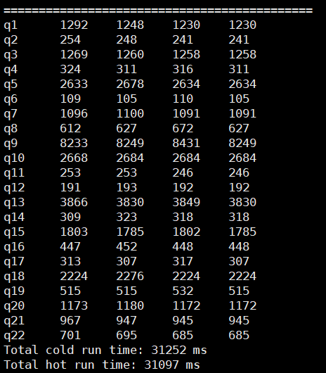

# Doris Instruction Optimization Feature Guide \(openEuler\)<a name="EN-US_TOPIC_0000002552616085"></a>

## Doris Overview<a name="EN-US_TOPIC_0000002026945504"></a>

Based on the massively parallel processing \(MPP\) architecture, Doris is a high-performance, real-time analytic database. It performs hotspot calculations by calling Kunpeng vectorized instructions to improve operator execution efficiency and optimize SQL computing performance.

Doris is a high-performance and real-time analytic database based on the MPP architecture. It is known for its high efficiency, ease of use, and unification. It can return query results of massive data in sub-seconds, supporting high-concurrent point query scenarios and high-throughput complex analysis scenarios. Therefore, Doris can meet the requirements of scenarios such as report analysis, ad-hoc query, unified data warehouse building, and data lakehouse integration. You can build applications such as large-screen dashboard, user behavior analysis, A/B test platform, log retrieval and analysis, user profile analysis, and order analysis.

Doris uses the Bitshuffle algorithm to resort data, improving the efficiency of LZ4 and Zstandard \(Zstd\) compression. Doris instruction optimization uses the NEON instruction set to optimize the Bitshuffle running logic on the Arm architecture, further improving the efficiency of LZ4 and Zstd compression and the data write and query performance of Doris on the Kunpeng server.

Based on the massively parallel processing \(MPP\) architecture, Doris is a high-performance, real-time analytic database. It performs hotspot calculations by calling Kunpeng vectorized instructions to improve operator execution efficiency and optimize SQL computing performance.
## Key Features<a name="EN-US_TOPIC_0000002063065321"></a>

The big data Doris instruction optimization feature uses the NEON instruction set to optimize the Bitshuffle running logic on the Arm architecture, speeding up the LZ4 and Zstandard \(Zstd\) data compression/decompression, and improving the data write and query performance of Doris on the Kunpeng server.


## Application Scenarios<a name="EN-US_TOPIC_0000002062986649"></a>

Bitshuffle is a lossless data compression algorithm that reduces the storage space of data while maintaining data precision. It is mainly applied to large scientific datasets \(such as meteorological, seismic, and astronomical data\). These datasets are often massive in scale. Data compression can effectively save storage space and enhance data transmission efficiency.

The specific application scenarios include:

- Data storage: Efficiently compresses various types of data to save storage space.
- Data transmission: Reduces the data transmission duration and bandwidth consumption.
- Data backup: Decreases backup data size by optimizing compression.
- Data processing: Compresses data before analysis to reduce computing resource usage.

Bitshuffle is a lossless data compression algorithm that reduces the storage space of data while maintaining data precision. It is mainly applied to large scientific datasets \(such as meteorological, seismic, and astronomical data\). These datasets are often massive in scale. Data compression can effectively save storage space and enhance data transmission efficiency.
## Principles<a name="EN-US_TOPIC_0000002026787068"></a>

The Bitshuffle algorithm divides the input data into multiple small blocks, rearrange each small data block by bit, and make adjacent bits more similar. This increases the data local repetition, facilitating the compression algorithms to easily identify and utilize the repetition, thereby improving the data compression efficiency.


## Feature Usage<a name="EN-US_TOPIC_0000002026945508"></a>

### Starting BEs<a name="EN-US_TOPIC_0000002063065325"></a>

This section describes how to deploy and use the Doris instruction optimization feature.

1. Deploy the Doris instruction optimization by following the instructions in  [Doris Instruction Optimization Deployment Guide](https://www.hikunpeng.com/document/detail/en/kunpengbds/ecosystemEnable/Doris/kunpengbds_doris_04_0001.html).
2. Stop all Backend \(BEs\) on all nodes in the cluster.

    ```
    sh /opt/tools/installed/apache-doris-2.1.2-bin-arm64/be/bin/stop_be.sh
    ```

3. Use the compiled  **/opt/tools/installed/doris-2.1.2-rc04/be/output/lib/doris\_be**  to replace all  **doris\_be**  files in  **/opt/tools/installed/apache-doris-2.1.2-bin-arm64/be/lib/doris\_be**  of all BEs in the cluster.

    ```
    cp /opt/tools/installed/doris-2.1.2-rc04/be/output/lib/doris_be /opt/tools/installed/apache-doris-2.1.2-bin-arm64/be/lib/doris_be
    ```

4. Start all BEs in the cluster.

    ```
    sh /opt/tools/installed/apache-doris-2.1.2-bin-arm64/be/bin/start_be.sh --daemon
    ```

5. Check the BE startup status.

    ```
    mysql -h FE_IP -P FE_QUERY_PORT -u root 
    SHOW BACKENDS\G;
    ```

This section describes how to deploy and use the Doris instruction optimization feature.
### Importing Test Data to Test Performance<a name="EN-US_TOPIC_0000002029516528"></a>

This section describes how to test performance after the Doris instruction optimization on the TPC-H test set.

1. Download and install the TPC-H tool package.
    1. Copy the  **tpch-tools**  folder from the downloaded Doris source code to the  **/opt/tools/installed**  directory.

        ```
        cp -r /opt/tools/installed/doris-2.1.2-rc04/tools/tpch-tools /opt/tools/installed
        ```

    2. Go to the  **tpch-tools**  folder.

        ```
        cd /opt/tools/installed/tpch-tools
        ```

    3. Manually download the  [TPC-H dependency tool package](https://www.tpc.org/tpc_documents_current_versions/download_programs/tools-download-request5.asp?bm_type=TPC-H&bm_vers=3.0.0&mode=CURRENT-ONLY), rename the tool package, and save the tool package to the specified directory.

        ```
        mv Downloaded_package TPC-H_Tools_v3.0.0new.zip
        mv TPC-H_Tools_v3.0.0new.zip /opt/tools/installed/tpch-tools/bin
        ```

    4. Modify the  **build-tpch-dbgen.sh**  file and comment out the wget download content.
        1. Open the file.

            ```
            vi bin/build-tpch-dbgen.sh
            ```

        2. Press  **i**  to enter the insert mode and modify the file as follows:

            ```
            #wget "https://doris-build-1308700295.cos.ap-beijing.myqcloud.com/tools/TPC-H_Tools_v3.0.0new.zip"
            ```

        3. Press  **Esc**, type  **:wq!**, and press  **Enter**  to save the file and exit.

    5. Generate the  **dbgen**  binary file in the  **TPC-H\_Tools\_v3.0.0/**  directory.

        ```
        sh bin/build-tpch-dbgen.sh
        ```

2. Modify the configuration file  **conf/doris-cluster.conf**  of the test tool.
    1. Open the configuration file.

        ```
        vi conf/doris-cluster.conf
        ```

    2. Press  **i**  to enter the insert mode and modify the following content of the file:

        ```
        # Any of FE host
        export FE_HOST='xx.xx.xx.xx'
        # http_port in fe.conf
        export FE_HTTP_PORT=8030
        # query_port in fe.conf
        export FE_QUERY_PORT=9030
        # Doris username
        export USER='root'
        # Doris password
        export PASSWORD=''
        # The database where TPC-H tables located
        export DB='tpch100G'
        ```

        > **NOTE:** 
        >-   **FE\_HOST**  indicates the FE IP address, which is usually the IP address of the local physical machine, for example,  **172.18.0.11/21**.
        >-   **FE\_HTTP\_PORT**  indicates the value of the  **http\_port**  parameter of the FE. The value must be the same as that in  **fe.conf**.
        >-   **FE\_QUERY\_PORT**  indicates the value of the  **query\_port**  parameter of the FE. The value must be the same as that in  **fe.conf**.
        >-   **USER**  indicates the username.
        >-   **PASSWORD**  indicates the password. If it is not configured, leave it blank.
        >-   **DB**  indicates the name of the database corresponding to TPC-H.

    3. Press  **Esc**, type  **:wq!**, and press  **Enter**  to save the file and exit.

3. Generate a TPC-H dataset.

    ```
    sh bin/gen-tpch-data.sh -s 100 -c 40
    ```

    > **NOTE:** 
    >-   **-s**  indicates the size of the dataset, which can be set to  **10**,  **500**, or  **1000**, in GB.
    >-   **-c**  specifies the number of threads used to generate data in parallel.

4. Generate TPC-H data tables.

    ```
    sh bin/create-tpch-tables.sh
    ```

5. Import data.

    ```
    sh bin/load-tpch-data.sh -c 40
    ```

6. Run the test SQL statement to compare the performance of the open source  **doris\_be**  and newly compiled  **doris\_be**.

    ```
    sh bin/run-tpch-queries.sh -s 100
    ```

    - The following figure shows the performance result of the open source  **doris\_be**.

        

    - The following figure shows the performance result of the optimized  **doris\_be**.

        

This section describes how to test performance after the Doris instruction optimization on the TPC-H test set.


