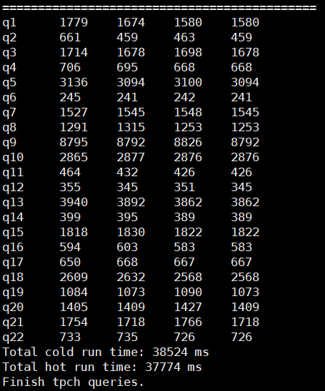

# Doris指令优化特性指南（openEuler）<a name="ZH-CN_TOPIC_0000002552616085"></a>

## 简介<a name="ZH-CN_TOPIC_0000002026945504"></a>

Doris是一款基于MPP架构的高性能、实时的分析型数据库，热点计算通过调用鲲鹏向量化指令，提升算子执行效率，进而优化SQL计算性能。

Doris是一款基于MPP架构的高性能、实时分析型数据库，以高效、简单、统一的特点被人们所熟知，仅需亚秒级响应时间即可返回海量数据下的查询结果，不仅支持高并发的点查询场景，也支持高吞吐的复杂分析场景。基于此，Doris能够满足报表分析、即席查询、统一数仓构建、湖仓一体等使用场景，用户可以在此之上进行构建大屏看板、用户行为分析、AB实验平台、日志检索分析、用户画像分析、订单分析等应用。

Doris使用Bitshuffle算法对数据重新排序，提升LZ4/ZSTD压缩算法的效率，Doris指令优化通过使用NEON指令集优化Bitshuffle在Arm架构上运行的逻辑，进一步提升LZ4/ZSTD压缩的效率，实现提升Doris在鲲鹏服务器上的数据写入和查询性能。

Doris是一款基于MPP架构的高性能、实时的分析型数据库，热点计算通过调用鲲鹏向量化指令，提升算子执行效率，进而优化SQL计算性能。
## 关键特性<a name="ZH-CN_TOPIC_0000002063065321"></a>

大数据Doris指令优化特性使用NEON指令集优化Bitshuffle在Arm架构上运行的逻辑，提升对LZ4压缩和ZSTD压缩的数据的压缩速度和解压缩速度，实现提升数据查询和写入性能的目标，提升Doris在鲲鹏服务器的数据写入和查询性能。


## 应用场景<a name="ZH-CN_TOPIC_0000002062986649"></a>

Bitshuffle是一种无损的数据压缩算法，能够在保持数据精度的前提下减小数据的存储空间，主要应用于大型科学数据集（如气象、地震、天文数据）的处理场景。这些数据集通常非常庞大，数据压缩可以有效节省存储空间并提高数据传输效率。

具体应用场景包括：

- 数据存储：通过对各类数据的高效压缩，节省存储空间，提高存储效率。
- 数据传输：减少数据传输的时间和带宽消耗，提高传输效率。
- 数据备份：对数据进行高效的压缩，从而减少备份数据的大小，提高备份效率。
- 数据处理：在数据分析前将数据压缩，以减少计算资源的使用量。

Bitshuffle是一种无损的数据压缩算法，能够在保持数据精度的前提下减小数据的存储空间，主要应用于大型科学数据集（如气象、地震、天文数据）的处理场景。这些数据集通常非常庞大，数据压缩可以有效节省存储空间并提高数据传输效率。
## 原理描述<a name="ZH-CN_TOPIC_0000002026787068"></a>

Bitshuffle算法核心是将输入数据分成多个小块，然后对每个小块按位重排，使得相邻的位变得更加相似，从而增加了数据的局部重复性，使得压缩算法更容易识别和利用这些重复性，提高数据压缩效率。


## 特性使用<a name="ZH-CN_TOPIC_0000002026945508"></a>

### 启动BE<a name="ZH-CN_TOPIC_0000002063065325"></a>

本章举例说明部署Doris指令优化特性并使用。

1. 请参见《[Doris指令优化 部署指南](https://www.hikunpeng.com/document/detail/zh/kunpengbds/ecosystemEnable/Doris/kunpengbds_doris_04_0001.html)》完成Doris指令优化部署。
2. 停止集群中的所有节点运行的BE运行。

    ```
    sh /opt/tools/installed/apache-doris-2.1.2-bin-arm64/be/bin/stop_be.sh
    ```

3. 用编译后的“/opt/tools/installed/doris-2.1.2-rc04/be/output/lib/doris\_be“替换集群Backend（BE）中的所有doris\_be，路径为“/opt/tools/installed/apache-doris-2.1.2-bin-arm64/be/lib/doris\_be“。

    ```
    cp /opt/tools/installed/doris-2.1.2-rc04/be/output/lib/doris_be /opt/tools/installed/apache-doris-2.1.2-bin-arm64/be/lib/doris_be
    ```

4. 启动集群的所有BE。

    ```
    sh /opt/tools/installed/apache-doris-2.1.2-bin-arm64/be/bin/start_be.sh --daemon
    ```

5. 查看BE启动状态。

    ```
    mysql -h FE_IP -P FE_QUERY_PORT -u root 
    SHOW BACKENDS\G;
    ```

本章举例说明部署Doris指令优化特性并使用。
### 导入测试数据并测试性能<a name="ZH-CN_TOPIC_0000002029516528"></a>

以Doris指令优化在TPC-H测试集上的测试步骤为例测试性能。

1. 下载安装TPC-H工具包。
    1. 从已下载的Doris源码中拷贝tpch-tools文件夹到“/opt/tools/installed“目录下。

        ```
        cp -r /opt/tools/installed/doris-2.1.2-rc04/tools/tpch-tools /opt/tools/installed
        ```

    2. 进入tpch-tools文件夹。

        ```
        cd /opt/tools/installed/tpch-tools
        ```

    3. 手动下载[TPC-H依赖工具包](https://www.tpc.org/tpc_documents_current_versions/download_programs/tools-download-request5.asp?bm_type=TPC-H&bm_vers=3.0.0&mode=CURRENT-ONLY)并修改工具包名称，再将工具包放入到指定目录中。

        ```
        mv 下载的包 TPC-H_Tools_v3.0.0new.zip
        mv TPC-H_Tools_v3.0.0new.zip /opt/tools/installed/tpch-tools/bin
        ```

    4. 修改build-tpch-dbgen.sh，注释wget下载内容。
        1. 打开文件。

            ```
            vi bin/build-tpch-dbgen.sh
            ```

        2. 按“i”进行编辑，在文件中进行以下修改。

            ```
            #wget "https://doris-build-1308700295.cos.ap-beijing.myqcloud.com/tools/TPC-H_Tools_v3.0.0new.zip"
            ```

        3. 按“Esc“键，输入:**wq!**，按“Enter“保存并退出编辑。

    5. 在“TPC-H\_Tools\_v3.0.0/“目录下生成dbgen二进制文件。

        ```
        sh bin/build-tpch-dbgen.sh
        ```

2. 更改测试工具的配置文件“conf/doris-cluster.conf“。
    1. 打开配置文件。

        ```
        vi conf/doris-cluster.conf
        ```

    2. 按“i“进入编辑模式，在文件中修改以下内容。

        ```
        # Any of FE host
        export FE_HOST='xx.xx.xx.xx'
        # http_port in fe.conf
        export FE_HTTP_PORT=8030
        # query_port in fe.conf
        export FE_QUERY_PORT=9030
        # Doris username
        export USER='root'
        # Doris password
        export PASSWORD=''
        # The database where TPC-H tables located
        export DB='tpch100G'
        ```

        > **说明：** 
        >-   FE\_HOST是配置FE的IP地址，一般为本地物理机的IP地址，例如：172.18.0.11/21。
        >-   FE\_HTTP\_PORT是配置FE的http\_port，与fe.conf中保持一致。
        >-   FE\_QUERY\_PORT是配置FE的query\_port，与fe.conf中保持一致。
        >-   USER是用户名。
        >-   PASSWORD是密码，如无配置则为空。
        >-   DB是TPC-H对应的数据库名称。

    3. 按“Esc“键，输入:**wq!**，按“Enter“保存并退出编辑。

3. 生成TPC-H数据集。

    ```
    sh bin/gen-tpch-data.sh -s 100 -c 40
    ```

    > **说明：** 
    >-   -s用于指定生成的数据集的大小，可以自定义改为10、500、1000，单位为GB。
    >-   -c用于指定使用多少个线程来并行生成数据。

4. 生成TPC-H数据表执行。

    ```
    sh bin/create-tpch-tables.sh
    ```

5. 导入数据执行。

    ```
    sh bin/load-tpch-data.sh -c 40
    ```

6. 执行测试SQL，对比开源版本doris\_be和新编译的doris\_be的性能。

    ```
    sh bin/run-tpch-queries.sh -s 100
    ```

    - 开源版本doris\_be性能结果图如下图所示。

        

    - 优化后的doris\_be性能结果图如下图所示。

        

以Doris指令优化在TPC-H测试集上的测试步骤为例测试性能。


