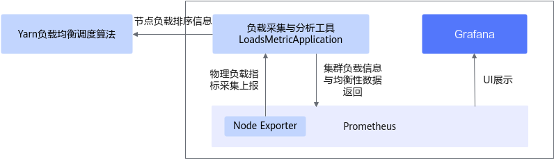

# OmniScheduler介绍<a name="ZH-CN_TOPIC_0000002520858174"></a>

## 最新消息<a name="ZH-CN_TOPIC_0000002552098141"></a>

- \[2025.03.30\]：发布OmniScheduler 1.0.0。在Hadoop集群节点间负载不均衡场景下，OmniScheduler Yarn负载调度算法优化开源版本Capacity Scheduler调度器，拆分为基于物理资源权重计算及排序结果进行资源调度。该算法实现了资源的均衡分配和高效利用。


## 项目简介<a name="ZH-CN_TOPIC_0000002552058153"></a>

### 简介<a name="ZH-CN_TOPIC_0000002521018158"></a>

大数据OmniRuntime通过插件化的形式，端到端提升数据加载、数据计算和数据交换的性能，从而提升大数据分析性能。

随着互联网的发展，数据规模出现了爆炸式的增长，需要处理的数据量越来越大，CPU算力的增长远远滞后于数据的增长。大数据开源生态也越来越丰富，但多样化的计算引擎和开源组件也同时带来了全生命周期数据处理性能提升难的问题。不同的大数据引擎采用各自独特的优化策略和技术来提高性能和效率，但有些优化项会在多个引擎中重复应用，可能存在差异或冲突，导致计算性能下降。此外，重复应用相同的优化项可能导致资源竞争和冲突，降低整体计算性能。

大数据OmniRuntime是鲲鹏BoostKit大数据面向应用加速推出的一系列特性，通过插件化的形式，端到端提升数据加载、数据计算和数据交换的性能，从而提升大数据分析的性能。

OmniScheduler Yarn负载调度算法为OmniRuntime的特性之一。OmniScheduler Yarn负载调度算法优化了Hadoop Yarn的容量调度算法，通过获取集群的负载信息，并基于节点物理资源权重计算及排序结果，优先调度低负载节点，提升了集群的负载均衡性，实现资源的均衡配置和高效利用。

已适配的开源组件及版本有：

- Spark 3.1.1
- Spark 3.3.1
- Hive 3.1.0
- Hadoop 3.3.4


### 架构介绍<a name="ZH-CN_TOPIC_0000002521018166"></a>

Yarn（Yet Another Resource Negotiator）是Hadoop生态系统中的一个资源管理和调度框架。它负责集群中资源的分配和任务的调度，使得多个计算框架（如MapReduce、Spark、Tez等）可以共享同一个集群资源。Yarn通过ResourceManager（RM）、NodeManager（NM）和ApplicationMaster（AM）三个主要组件来实现资源管理和任务调度。Yarn提供了多种调度算法，包括FIFO Scheduler（先进先出调度器）、Capacity Scheduler（容量调度器）、Fair Scheduler（公平调度器）等调度算法，用户可以根据具体需求选择合适的调度器。

OmniScheduler Yarn负载调度算法优化开源版本Capacity Scheduler调度器，基于集群节点物理资源权重计算及排序结果进行资源调度，实现资源的均衡配置和高效利用。OmniScheduler Yarn负载调度算法整体架构如[**图 1** OmniScheduler Yarn负载调度算法整体架构](#OmniScheduler Yarn负载调度算法整体架构)所示。

**图 1** OmniScheduler Yarn负载调度算法整体架构<a name="zh-cn_topic_0000002543922629_zh-cn_topic_0000002197112569_fig46951631125517"></a><a id="OmniScheduler Yarn负载调度算法整体架构"></a>


包含五大模块：

- Prometheus：一个开源的监控系统和时间序列数据库，广泛用于监控各种服务和基础设施。
- Node Exporter：Prometheus生态系统中的一个组件，用于收集和暴露机器级别的指标（metrics），包括但不限于CPU使用率、内存使用情况、磁盘I/O、网络I/O和文件系统信息等。
- LoadsMetricApplication：负载采集与分析工具，负责从Node Exporter中获取机器指标信息，进行分析处理后，将集群负载信息与均衡性数据上报给Prometheus进行存储。
- Grafana：从Prometheus获取负载信息和均衡性数据，并将其可视化为图表和仪表板，进行前端UI展示。
- Yarn负载调度算法：从LoadsMetric中获取节点负载排序信息，并按照顺序优先调度低负载节点。


### 应用场景<a name="ZH-CN_TOPIC_0000002552098145"></a>

在应用特性前，请先了解OmniScheduler Yarn负载调度算法特性的应用场景，支持Hadoop 3.3.4。

OmniScheduler Yarn负载调度算法特性适用于Hadoop集群节点间负载不均衡场景，用户在提交计算任务（如Spark任务）到Yarn后，通过给定参数可以利用Yarn负载调度算法使得任务优先调度到负载低的节点，实现集群资源的均衡配置和高效利用。

在应用特性前，请先了解OmniScheduler Yarn负载调度算法特性的应用场景，支持Hadoop 3.3.4。
### 相关概念<a name="ZH-CN_TOPIC_0000002552098137"></a>

- Prometheus：一个开源的监控系统和时间序列数据库，广泛用于监控各种服务和基础设施。
- Node Exporter：Prometheus生态系统中的一个组件，用于收集和暴露机器级别的指标（metrics）。
- Grafana：一个开源的分析和监控平台，用于构建和展示各种数据源的时间序列数据。Grafana支持多种数据源，包括Prometheus、InfluxDB、Elasticsearch、MySQL等。


## 约束与限制<a name="ZH-CN_TOPIC_0000002552058163"></a>

无。
## 目录结构<a name="ZH-CN_TOPIC_0000002520858170"></a>

项目全量目录层级介绍如下：

```
├── docs                                                     # 项目文档目录
│   └── zh                                                   # 中文文档目录
│       ├── figures                                          # 中文文档图片资源目录
│       ├── release_notes.md                                 # OmniScheduler版本说明书
│       ├── installation_guide.md                            # OmniScheduler安装指导
│       ├── user_guide.md                                    # OmniScheduler使用指导
├── LoadsMetric                                              # LoadsMetric服务模块
│   ├── LoadsMetricServer                                    # LoadsMetric服务实现
│       ├── package                                          # 打包代码目录
│       ├── server                                           # 服务代码目录
│       ├── pom.xml                                          # Maven项目配置文件
├── yarn-schedule-load-evolution                             # LoadsMetric Yarn插件模块
│   ├── src                                                  # Yarn插件代码目录
│   ├── pom.xml                                              # Maven项目配置文件
├── build.sh                                                 # 编译脚本
├── LoadsMetric.json                                         # LoadsMetric配置文件
├── README.md                                                # 项目介绍
```


## 版本说明<a name="ZH-CN_TOPIC_0000002520858176"></a>

每个版本的特性变更详细信息，请参见《[版本说明书](./docs/zh/release_notes.md)》。


## 环境部署<a name="ZH-CN_TOPIC_0000002521018162"></a>

介绍OmniScheduler的环境依赖及安装方式，具体请参见《[安装指南](./docs/zh/installation_guide.md)》。


## 学习文档<a name="ZH-CN_TOPIC_0000002521018170"></a>

|名称|路径|简介|
|--|--|--|
|版本说明书|[版本说明书](./docs/zh/release_notes.md)|提供OmniScheduler每个发布版本的基础信息和特性更新信息。|
|安装指南|[安装指南](./docs/zh/installation_guide.md)|提供安装OmniScheduler的详细指导。|
|使用指南|[使用指南](./docs/zh/user_guide.md)|提供使用OmniScheduler的详细指导。|
|常见问题|[常见问题](./docs/zh/faq.md)|提供OmniScheduler安装、使用过程的常见问题和解决方法。|
|视频课程|OmniRuntime特性大揭秘|提供操作视频，帮助开发者在鲲鹏服务器上了解、使能OmniRuntime特性。|


## 安全声明<a name="ZH-CN_TOPIC_0000002521018160"></a>

### 防病毒软件例行检查<a name="ZH-CN_TOPIC_0000002552058159"></a>

定期开展对集群和Spark组件的防病毒扫描，防病毒例行检查会帮助集群免受病毒、恶意代码、间谍软件以及恶意程序，降低系统瘫痪、信息泄露等风险。建议使用业界主流防病毒软件进行防病毒检查。


### 日志控制<a name="ZH-CN_TOPIC_0000002552058155"></a>

- 检查系统是否可以限制单个日志文件的大小。
- 检查日志空间占满后，是否存在机制进行清理。


### 漏洞修复<a name="ZH-CN_TOPIC_0000002552058157"></a>

为保证生产环境的安全，降低被攻击的风险，请开启防火墙，并定期修复以下漏洞。

- 操作系统漏洞
- JDK漏洞
- Hadoop及Spark漏洞
- ZooKeeper漏洞
- Kerberos漏洞
- OpenSSL漏洞
- 其他相关组件漏洞

    以CVE-2021-37137为例。

    漏洞描述：

    Netty 4.1.17版本存在两个Content-Length的http header可能会发生混淆的风险通告，漏洞编号：CVE-2021-37137。

    本系统使用hdfs-ceph（version 3.2.0）服务作为存算分离的存储对象，它因依赖aws-java-sdk-bundle-1.11.375.jar而涉及该漏洞。建议用户及时更新漏洞补丁进行防护，以免遭受黑客攻击。

    影响范围：

    Netty 4.1.68及以前版本。

    修复建议：

    目前厂商已发布升级补丁以修复漏洞，请参见[Github](https://github.com/netty/netty/security/advisories/GHSA-9vjp-v76f-g363)修复漏洞。


### SSH加固<a name="ZH-CN_TOPIC_0000002520858166"></a>

在部署安装过程中，需要通过SSH连接服务器。由于root用户拥有最高权限，直接使用root用户登录服务器可能会存在安全风险。建议您使用普通用户登录服务器进行安装部署，并建议您通过配置禁止root用户SSH登录的选项，来提升系统安全性。操作步骤：

用户登录系统后检查`/etc/ssh/sshd\_config`配置项`PermitRootLogin`。

- 如果显示no，说明禁止了root用户SSH登录。
- 如果显示yes，说明需要修改PermitRootLogin为no。


### 通信矩阵<a name="ZH-CN_TOPIC_0000002521018168"></a>

<a name="table15869145122717"></a>
<table><tbody><tr id="row199002517272"><th class="firstcol" valign="top" width="10%" id="mcps1.1.6.1.1"><p id="p8900165132711"><a name="p8900165132711"></a><a name="p8900165132711"></a>源设备</p>
</th>
<td class="cellrowborder" valign="top" width="22.5%" headers="mcps1.1.6.1.1 "><p id="p99006520279"><a name="p99006520279"></a><a name="p99006520279"></a>ResourceManager运行服务器</p>
</td>
<td class="cellrowborder" valign="top" width="22.5%" headers="mcps1.1.6.1.1 "><p id="p12900195192719"><a name="p12900195192719"></a><a name="p12900195192719"></a>CLI查询客户端进程运行服务器</p>
</td>
<td class="cellrowborder" valign="top" width="22.5%" headers="mcps1.1.6.1.1 "><p id="p13900185192712"><a name="p13900185192712"></a><a name="p13900185192712"></a>ResourceManager运行服务器</p>
</td>
<td class="cellrowborder" valign="top" width="22.5%" headers="mcps1.1.6.1.1 "><p id="p1590065142710"><a name="p1590065142710"></a><a name="p1590065142710"></a>ResourceManager运行服务器</p>
</td>
</tr>
<tr id="row8900165142714"><th class="firstcol" valign="top" width="10%" id="mcps1.1.6.2.1"><p id="p1900195102715"><a name="p1900195102715"></a><a name="p1900195102715"></a>源IP地址</p>
</th>
<td class="cellrowborder" valign="top" width="22.5%" headers="mcps1.1.6.2.1 "><p id="p1790019532715"><a name="p1790019532715"></a><a name="p1790019532715"></a>ResourceManager运行服务器IP地址</p>
</td>
<td class="cellrowborder" valign="top" width="22.5%" headers="mcps1.1.6.2.1 "><p id="p189009513274"><a name="p189009513274"></a><a name="p189009513274"></a>无默认值（CLI查询客户端的IP地址）</p>
</td>
<td class="cellrowborder" valign="top" width="22.5%" headers="mcps1.1.6.2.1 "><p id="p1390045152720"><a name="p1390045152720"></a><a name="p1390045152720"></a>ResourceManager运行服务器IP地址</p>
</td>
<td class="cellrowborder" valign="top" width="22.5%" headers="mcps1.1.6.2.1 "><p id="p119002582719"><a name="p119002582719"></a><a name="p119002582719"></a>ResourceManager运行服务器IP地址</p>
</td>
</tr>
<tr id="row19000572714"><th class="firstcol" valign="top" width="10%" id="mcps1.1.6.3.1"><p id="p19001251277"><a name="p19001251277"></a><a name="p19001251277"></a>源端口</p>
</th>
<td class="cellrowborder" valign="top" width="22.5%" headers="mcps1.1.6.3.1 "><p id="p290012519277"><a name="p290012519277"></a><a name="p290012519277"></a>1024~65535</p>
</td>
<td class="cellrowborder" valign="top" width="22.5%" headers="mcps1.1.6.3.1 "><p id="p13900105112714"><a name="p13900105112714"></a><a name="p13900105112714"></a>1024~65535</p>
</td>
<td class="cellrowborder" valign="top" width="22.5%" headers="mcps1.1.6.3.1 "><p id="p89005582717"><a name="p89005582717"></a><a name="p89005582717"></a>1024~65535</p>
</td>
<td class="cellrowborder" valign="top" width="22.5%" headers="mcps1.1.6.3.1 "><p id="p490011515271"><a name="p490011515271"></a><a name="p490011515271"></a>1024~65535</p>
</td>
</tr>
<tr id="row490010532711"><th class="firstcol" valign="top" width="10%" id="mcps1.1.6.4.1"><p id="p119000592718"><a name="p119000592718"></a><a name="p119000592718"></a>目的设备</p>
</th>
<td class="cellrowborder" valign="top" width="22.5%" headers="mcps1.1.6.4.1 "><p id="p59002512279"><a name="p59002512279"></a><a name="p59002512279"></a>ResourceManager运行服务器</p>
</td>
<td class="cellrowborder" valign="top" width="22.5%" headers="mcps1.1.6.4.1 "><p id="p10900157272"><a name="p10900157272"></a><a name="p10900157272"></a>ResourceManager运行服务器</p>
</td>
<td class="cellrowborder" valign="top" width="22.5%" headers="mcps1.1.6.4.1 "><p id="p390016552713"><a name="p390016552713"></a><a name="p390016552713"></a>ResourceManager运行服务器</p>
</td>
<td class="cellrowborder" valign="top" width="22.5%" headers="mcps1.1.6.4.1 "><p id="p39001657273"><a name="p39001657273"></a><a name="p39001657273"></a>NodeManager运行服务器</p>
</td>
</tr>
<tr id="row8900454276"><th class="firstcol" valign="top" width="10%" id="mcps1.1.6.5.1"><p id="p5900105192715"><a name="p5900105192715"></a><a name="p5900105192715"></a>目的IP地址</p>
</th>
<td class="cellrowborder" valign="top" width="22.5%" headers="mcps1.1.6.5.1 "><p id="p49001582714"><a name="p49001582714"></a><a name="p49001582714"></a>ResourceManager运行服务器IP地址</p>
</td>
<td class="cellrowborder" valign="top" width="22.5%" headers="mcps1.1.6.5.1 "><p id="p16900175112714"><a name="p16900175112714"></a><a name="p16900175112714"></a>ResourceManager运行服务器IP地址</p>
</td>
<td class="cellrowborder" valign="top" width="22.5%" headers="mcps1.1.6.5.1 "><p id="p14900557272"><a name="p14900557272"></a><a name="p14900557272"></a>ResourceManager运行服务器IP地址</p>
</td>
<td class="cellrowborder" valign="top" width="22.5%" headers="mcps1.1.6.5.1 "><p id="p490017522717"><a name="p490017522717"></a><a name="p490017522717"></a>NodeManager运行服务器IP地址</p>
</td>
</tr>
<tr id="row189008572719"><th class="firstcol" valign="top" width="10%" id="mcps1.1.6.6.1"><p id="p189005518270"><a name="p189005518270"></a><a name="p189005518270"></a>目的端口（侦听）</p>
</th>
<td class="cellrowborder" valign="top" width="22.5%" headers="mcps1.1.6.6.1 "><p id="p190055152718"><a name="p190055152718"></a><a name="p190055152718"></a>9090</p>
</td>
<td class="cellrowborder" valign="top" width="22.5%" headers="mcps1.1.6.6.1 "><p id="p2900165152719"><a name="p2900165152719"></a><a name="p2900165152719"></a>3000</p>
</td>
<td class="cellrowborder" valign="top" width="22.5%" headers="mcps1.1.6.6.1 "><p id="p1390014522711"><a name="p1390014522711"></a><a name="p1390014522711"></a>9060</p>
</td>
<td class="cellrowborder" valign="top" width="22.5%" headers="mcps1.1.6.6.1 "><p id="p10900852273"><a name="p10900852273"></a><a name="p10900852273"></a>9100</p>
</td>
</tr>
<tr id="row1990015510278"><th class="firstcol" valign="top" width="10%" id="mcps1.1.6.7.1"><p id="p8900175112714"><a name="p8900175112714"></a><a name="p8900175112714"></a>协议</p>
</th>
<td class="cellrowborder" valign="top" width="22.5%" headers="mcps1.1.6.7.1 "><p id="p169001152278"><a name="p169001152278"></a><a name="p169001152278"></a>TCP</p>
</td>
<td class="cellrowborder" valign="top" width="22.5%" headers="mcps1.1.6.7.1 "><p id="p159007502710"><a name="p159007502710"></a><a name="p159007502710"></a>TCP</p>
</td>
<td class="cellrowborder" valign="top" width="22.5%" headers="mcps1.1.6.7.1 "><p id="p3900756271"><a name="p3900756271"></a><a name="p3900756271"></a>TCP</p>
</td>
<td class="cellrowborder" valign="top" width="22.5%" headers="mcps1.1.6.7.1 "><p id="p10900205142714"><a name="p10900205142714"></a><a name="p10900205142714"></a>TCP</p>
</td>
</tr>
<tr id="row10900145192713"><th class="firstcol" valign="top" width="10%" id="mcps1.1.6.8.1"><p id="p119001657275"><a name="p119001657275"></a><a name="p119001657275"></a>端口说明</p>
</th>
<td class="cellrowborder" valign="top" width="22.5%" headers="mcps1.1.6.8.1 "><p id="p290015513276"><a name="p290015513276"></a><a name="p290015513276"></a>SpringBoot的侦听端口，用于ResourceManager和SpringBoot进行通信</p>
</td>
<td class="cellrowborder" valign="top" width="22.5%" headers="mcps1.1.6.8.1 "><p id="p9900205102713"><a name="p9900205102713"></a><a name="p9900205102713"></a>Grafana的侦听端口，用于客户端和Grafana进行通信</p>
</td>
<td class="cellrowborder" valign="top" width="22.5%" headers="mcps1.1.6.8.1 "><p id="p9900758276"><a name="p9900758276"></a><a name="p9900758276"></a>Prometheus的侦听端口，用于Grafana和Prometheus进行通信</p>
</td>
<td class="cellrowborder" valign="top" width="22.5%" headers="mcps1.1.6.8.1 "><p id="p8900659272"><a name="p8900659272"></a><a name="p8900659272"></a>NodeExporter的侦听端口，用于SpringBoot和NodeExporter进行通信</p>
</td>
</tr>
<tr id="row590016582717"><th class="firstcol" valign="top" width="10%" id="mcps1.1.6.9.1"><p id="p1790011510278"><a name="p1790011510278"></a><a name="p1790011510278"></a>侦听端口是否可更改</p>
</th>
<td class="cellrowborder" valign="top" width="22.5%" headers="mcps1.1.6.9.1 "><p id="p169001518272"><a name="p169001518272"></a><a name="p169001518272"></a>是</p>
</td>
<td class="cellrowborder" valign="top" width="22.5%" headers="mcps1.1.6.9.1 "><p id="p390113511271"><a name="p390113511271"></a><a name="p390113511271"></a>是</p>
</td>
<td class="cellrowborder" valign="top" width="22.5%" headers="mcps1.1.6.9.1 "><p id="p10901105132710"><a name="p10901105132710"></a><a name="p10901105132710"></a>是</p>
</td>
<td class="cellrowborder" valign="top" width="22.5%" headers="mcps1.1.6.9.1 "><p id="p149010518270"><a name="p149010518270"></a><a name="p149010518270"></a>是</p>
</td>
</tr>
<tr id="row179012511279"><th class="firstcol" valign="top" width="10%" id="mcps1.1.6.10.1"><p id="p139011657279"><a name="p139011657279"></a><a name="p139011657279"></a>认证方式</p>
</th>
<td class="cellrowborder" valign="top" width="22.5%" headers="mcps1.1.6.10.1 "><p id="p19901165202714"><a name="p19901165202714"></a><a name="p19901165202714"></a>N/A</p>
</td>
<td class="cellrowborder" valign="top" width="22.5%" headers="mcps1.1.6.10.1 "><p id="p19901165202716"><a name="p19901165202716"></a><a name="p19901165202716"></a>N/A</p>
</td>
<td class="cellrowborder" valign="top" width="22.5%" headers="mcps1.1.6.10.1 "><p id="p139011157274"><a name="p139011157274"></a><a name="p139011157274"></a>N/A</p>
</td>
<td class="cellrowborder" valign="top" width="22.5%" headers="mcps1.1.6.10.1 "><p id="p590116502710"><a name="p590116502710"></a><a name="p590116502710"></a>N/A</p>
</td>
</tr>
<tr id="row5901185172717"><th class="firstcol" valign="top" width="10%" id="mcps1.1.6.11.1"><p id="p590114552713"><a name="p590114552713"></a><a name="p590114552713"></a>加密方式</p>
</th>
<td class="cellrowborder" valign="top" width="22.5%" headers="mcps1.1.6.11.1 "><p id="p19901754274"><a name="p19901754274"></a><a name="p19901754274"></a>N/A</p>
</td>
<td class="cellrowborder" valign="top" width="22.5%" headers="mcps1.1.6.11.1 "><p id="p090120518274"><a name="p090120518274"></a><a name="p090120518274"></a>N/A</p>
</td>
<td class="cellrowborder" valign="top" width="22.5%" headers="mcps1.1.6.11.1 "><p id="p1690195162715"><a name="p1690195162715"></a><a name="p1690195162715"></a>N/A</p>
</td>
<td class="cellrowborder" valign="top" width="22.5%" headers="mcps1.1.6.11.1 "><p id="p490135142711"><a name="p490135142711"></a><a name="p490135142711"></a>N/A</p>
</td>
</tr>
<tr id="row189011572712"><th class="firstcol" valign="top" width="10%" id="mcps1.1.6.12.1"><p id="p19901155182719"><a name="p19901155182719"></a><a name="p19901155182719"></a>所属平面</p>
</th>
<td class="cellrowborder" valign="top" width="22.5%" headers="mcps1.1.6.12.1 "><p id="p9901552275"><a name="p9901552275"></a><a name="p9901552275"></a>业务面</p>
</td>
<td class="cellrowborder" valign="top" width="22.5%" headers="mcps1.1.6.12.1 "><p id="p890116582715"><a name="p890116582715"></a><a name="p890116582715"></a>业务面</p>
</td>
<td class="cellrowborder" valign="top" width="22.5%" headers="mcps1.1.6.12.1 "><p id="p590113511271"><a name="p590113511271"></a><a name="p590113511271"></a>业务面</p>
</td>
<td class="cellrowborder" valign="top" width="22.5%" headers="mcps1.1.6.12.1 "><p id="p1290114511273"><a name="p1290114511273"></a><a name="p1290114511273"></a>业务面</p>
</td>
</tr>
<tr id="row290115511275"><th class="firstcol" valign="top" width="10%" id="mcps1.1.6.13.1"><p id="p5901175202715"><a name="p5901175202715"></a><a name="p5901175202715"></a>版本</p>
</th>
<td class="cellrowborder" valign="top" width="22.5%" headers="mcps1.1.6.13.1 "><p id="p169012514278"><a name="p169012514278"></a><a name="p169012514278"></a>所有版本</p>
</td>
<td class="cellrowborder" valign="top" width="22.5%" headers="mcps1.1.6.13.1 "><p id="p9901259274"><a name="p9901259274"></a><a name="p9901259274"></a>所有版本</p>
</td>
<td class="cellrowborder" valign="top" width="22.5%" headers="mcps1.1.6.13.1 "><p id="p8901185112710"><a name="p8901185112710"></a><a name="p8901185112710"></a>所有版本</p>
</td>
<td class="cellrowborder" valign="top" width="22.5%" headers="mcps1.1.6.13.1 "><p id="p29011255270"><a name="p29011255270"></a><a name="p29011255270"></a>所有版本</p>
</td>
</tr>
<tr id="row890112542718"><th class="firstcol" valign="top" width="10%" id="mcps1.1.6.14.1"><p id="p149018517271"><a name="p149018517271"></a><a name="p149018517271"></a>特殊场景</p>
</th>
<td class="cellrowborder" valign="top" width="22.5%" headers="mcps1.1.6.14.1 "><p id="p169016542711"><a name="p169016542711"></a><a name="p169016542711"></a>无</p>
</td>
<td class="cellrowborder" valign="top" width="22.5%" headers="mcps1.1.6.14.1 "><p id="p16901125192718"><a name="p16901125192718"></a><a name="p16901125192718"></a>无</p>
</td>
<td class="cellrowborder" valign="top" width="22.5%" headers="mcps1.1.6.14.1 "><p id="p89011352277"><a name="p89011352277"></a><a name="p89011352277"></a>无</p>
</td>
<td class="cellrowborder" valign="top" width="22.5%" headers="mcps1.1.6.14.1 "><p id="p109015542713"><a name="p109015542713"></a><a name="p109015542713"></a>无</p>
</td>
</tr>
</tbody>
</table>


## 免责声明<a name="ZH-CN_TOPIC_0000002521018164"></a>

**致OmniScheduler使用者**

- 本工具仅供调试和开发之用，使用者需自行承担使用风险，并理解以下内容：
    - 数据处理及删除：用户在使用本工具过程中产生的数据属于用户责任范畴。建议用户在使用完毕后及时删除相关数据，以防信息泄露。
    - 数据保密与传播：使用者了解并同意不得将通过本工具产生的数据随意外发或传播。对于由此产生的信息泄露、数据泄露或其他不良后果，本工具及其开发者概不负责。
    - 用户输入安全性：用户需自行保证输入的命令行的安全性，并承担因输入不当而导致的任何安全风险或损失。对于输入命令行不当所导致的问题，本工具及其开发者概不负责。

- 免责声明范围：本免责声明适用于所有使用本工具的个人或实体。使用本工具即表示您同意并接受本声明的内容，并愿意承担因使用该功能而产生的风险和责任，如有异议请停止使用本工具。
- 在使用本工具之前，请**谨慎阅读并理解以上免责声明的内容**。对于使用本工具所产生的任何问题或疑问，请及时联系开发者。

**致数据所有者**

如果您不希望您的模型或数据集等信息在OmniScheduler中被提及，或希望更新OmniScheduler中有关的描述，请在GitCode提交issue，我们将根据您的issue要求删除或更新您相关描述。衷心感谢您对OmniScheduler的理解和贡献。


## License<a name="ZH-CN_TOPIC_0000002552058161"></a>

OmniScheduler产品的使用许可证，具体请参见[LICENSE](../LICENSE)文件。

OmniScheduler docs目录下的文档适用CC-BY 4.0许可证，具体请参见[LICENSE](../LICENSE)文件。


## 贡献声明<a name="ZH-CN_TOPIC_0000002552098139"></a>

1. 提交错误报告：如果您在OmniScheduler中发现了一个不存在安全问题的漏洞，请在OmniScheduler仓库中的Issues中搜索，以防该漏洞被重复提交，如果找不到漏洞可以创建一个新的Issues。如果发现了一个安全问题请不要将其公开，请参阅安全问题处理方式。提交错误报告时应该包含完整信息。
2. 安全问题处理：本项目中对安全问题处理的形式，请通过邮箱通知项目核心人员确认编辑。
3. 解决现有问题：通过查看仓库的Issues列表可以发现需要处理的问题信息，可以尝试解决其中的某个问题。
4. 如何提出新功能：请使用Issues的Feature标签进行标记，我们会定期处理和确认开发。
5. 开始贡献：
    1. Fork本项目的仓库。
    2. Clone到本地。
    3. 创建开发分支。
    4. 本地测试：提交前请通过所有单元测试，包括新增的测试用例。
    5. 提交代码。
    6. 新建Pull Request。
    7. 代码检视：您需要根据评审意见修改代码，并重新提交更新。此流程可能涉及多轮迭代。
    8. 当您的PR获得足够数量的检视者批准后，Committer会进行最终审核。
    9. 审核和测试通过后，CI会将您的PR合并入到项目的主干分支。


## 建议与交流<a name="ZH-CN_TOPIC_0000002520858172"></a>

欢迎大家为社区做贡献。如果有任何疑问或建议，请提交[Issues](https://gitcode.com/boostkit/boostkit-bigdata/tree/main/load-based-schedule)，我们会尽快回复。感谢您的支持。


## 致谢<a name="ZH-CN_TOPIC_0000002552098143"></a>

OmniScheduler由华为公司的下列部门联合贡献：

鲲鹏计算BoostKit开发部

感谢来自社区的每一个PR，欢迎贡献OmniScheduler！


