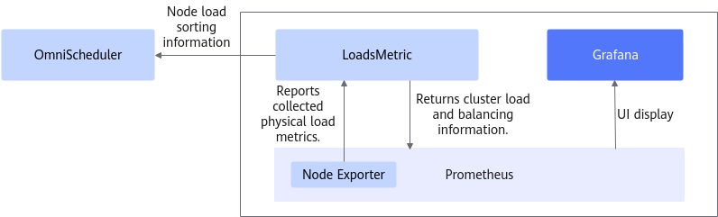

# Introduction to OmniScheduler<a name="EN-US_TOPIC_0000002520858174"></a>

## What's New<a name="EN-US_TOPIC_0000002552098141"></a>

- \[2025-03-30\]: Released OmniScheduler 1.0.0. In a Hadoop cluster with unbalanced load between nodes, the OmniScheduler Yarn load scheduling algorithm optimizes the open source Capacity Scheduler to schedule resources based on the weight calculation and sorting results of cluster nodes' physical resources. This algorithm enables balanced resource configuration and efficient resource utilization.


## Introduction to the Project<a name="EN-US_TOPIC_0000002552058153"></a>

### Overview<a name="EN-US_TOPIC_0000002521018158"></a>

The big data features of OmniRuntime are presented in the form of plugins to improve the performance of data loading, computing, and exchange from end to end.

Data volumes generated from Internet services have been growing much faster than CPUs' computing power. The open-source big data ecosystem is also developing on a fast track. However, diversified computing engines and open source components make it difficult to improve data processing performance throughout the lifecycle. Different big data engines use their own unique tuning policies and technologies to improve performance and efficiency. Some tuning items may be applied across multiple engines, which may cause resource contention and conflicts, reducing overall computing performance.

OmniRuntime  consists of a series of features provided by Kunpeng BoostKit for Big Data in terms of application acceleration. It aims to improve the performance of end-to-end data loading, computing, and exchange through plugins, thereby improving the performance of big data analytics.

OmniScheduler is a subfeature of OmniRuntime. OmniScheduler enhances the capacity scheduling algorithm of Hadoop Yarn. It obtains the cluster load information and preferentially schedules low-load nodes based on the physical resource weight calculation and sorting results of node. Consequently, it improves load balancing within the cluster with balanced resource configuration and efficient resource utilization.

Compatible open source components and versions:

- Spark 3.1.1
- Spark 3.3.1
- Hive 3.1.0
- Hadoop 3.3.4


### Architecture<a name="EN-US_TOPIC_0000002521018166"></a>

Yet Another Resource Negotiator \(Yarn\) is a framework for resource management and job scheduling in a Hadoop cluster. It allocates resources and schedules jobs in a cluster so that multiple computing frameworks \(such as MapReduce, Spark, and Tez\) can share the same cluster resources. YARN employs the ResourceManager \(RM\), NodeManager \(NM\), and ApplicationMaster \(AM\) to manage resources and schedule jobs. Yarn offers multiple schedulers, including the First In First Out \(FIFO\) Scheduler, Capacity Scheduler, and Fair Scheduler. Choose the scheduler most appropriate to your service environment.

OmniScheduler optimizes the open source Capacity Scheduler to schedule resources based on the weight calculation and sorting results of cluster nodes' physical resources. This optimized Yarn load scheduling algorithm enables balanced resource configuration and efficient resource utilization.  [Figure 1](#en-us_topic_0000002543922629_en-us_topic_0000002197112569_fig46951631125517)  shows the overall architecture.

**Figure  1**  Overall architecture of OmniScheduler<a name="en-us_topic_0000002543922629_en-us_topic_0000002197112569_fig46951631125517"></a>  


It consists of five modules:

- Prometheus: This open-source event monitoring system and time series database is widely used to manage various infrastructure resources.
- Node Exporter: It is a component in the Prometheus ecosystem used to collect and expose machine-level metrics, including but not limited to CPU usage, memory usage, disk I/O, network I/O, and file system information.
- LoadsMetricApplication: This load collection and analysis tool obtains machine metric information from the Node Exporter, analyzes and processes the information, and reports the generated cluster load and balancing data to Prometheus.
- Grafana: It obtains cluster load and balancing data from Prometheus, and visualizes the data in charts and dashboards for display on the user interface.
- OmniScheduler: It obtains the node load sorting information from LoadsMetric and prioritizes job scheduling for nodes with lower loads.


### Application Scenarios<a name="EN-US_TOPIC_0000002552098145"></a>

Learn about the application scenarios of OmniScheduler before using the feature. OmniScheduler supports Hadoop 3.3.4.

OmniScheduler balances load between nodes of a Hadoop cluster. After a user submits a computing job \(such as a Spark job\) to Yarn, OmniScheduler assigns the job to less-loaded nodes based on specified parameters. This ensures balanced configuration and efficient utilization of cluster resources.

Learn about the application scenarios of OmniScheduler before using the feature. OmniScheduler supports Hadoop 3.3.4.
### Related Concepts<a name="EN-US_TOPIC_0000002552098137"></a>

- Prometheus: This open-source event monitoring system and time series database is widely used to manage various infrastructure resources.
- Node Exporter: It is a component in the Prometheus ecosystem used to collect and expose machine-level metrics.
- Grafana: This open-source analytics and monitoring platform is used to build and visualize time series data of various data sources. Grafana supports multiple data sources, including Prometheus, InfluxDB, Elasticsearch, and MySQL.


## Constraints<a name="EN-US_TOPIC_0000002552058163"></a>

OmniStream has restrictions on supported data types, operators, and state backends. Plan your tasks accordingly and avoid unsupported scenarios.

**SQL<a name="en-us_topic_0000002512242608_section9207153194615"></a>**

- OmniStream Flink Native supports the Nexmark benchmarking suite, including Nexmark data types and built-in functions.
- Supported data types: BIGINT, TIMESTAMP\(3\), and VARCHAR.
- Supported expressions: + - \* /
- Supported built-in functions: LOWER, SPLIT\_INDEX, DATE\_FORMAT, MOD, and COUNT\_CHAR.
- Supported GroupAggregate functions: SUM\(BIGINT\), COUNT\(BIGINT\), AVG \(BIGINT\), MIN\(BIGINT\), MIN\(VARCHAR\), MAX \(BIGINT\), and MAX\(VARCHAR\).
- The join key of the join operator must be of the BIGINT type, and the operation type must be Inner Join.
- The Deduplicate and Rank operators allow only Partition By BIGINT. All fields in the query table must be of the supported data type and only the ROW\_NUMBER function is supported. Partition By of Rank supports only one field of the BIGINT type. Order By of TOPN supports only one BIGINT field, whose sorting rule is DESC. Order By of TOP1 supports a maximum of two fields. The type can be BIGINT TIMESTAMP\(3\), and the sorting rule can be DESC or ASC.
- The Group By column of the Aggregate operator allows only BIGINT.
- The aggregate function of the LocalWindowAGG and GlobalWindowAGG operators is COUNT or MAX. The aggregate function of the GroupWindowAGG operator is COUNT.
- The LocalWindowAGG and GlobalWindowAGG operators support only the TUMBLE and HOP windows.
- The GroupWindowAGG operator supports only the SESSION window.
- The external table data source of the Lookup Join operator supports only CSV files.
- The state backend supports only the memory and RocksDB.
- Flink stores states in the memory state backend, and the memory usage grows over time as the volume of data increases. In comparison, OmniStream uses the columnar vectorized architecture to optimize performance. Its state storage behaves the same as the native Flink while delivering a higher processing speed and consuming the memory space faster. Therefore, the Nexmark benchmark test cases support a maximum of 50 million data records.

**DataStream<a name="en-us_topic_0000002512242608_section14862183194614"></a>**

For details, see  [Supported DataStream Operators and UDFs](en-us_topic_0000002512242732.md).

- Source and Sink support only Kafka data sources.
- These operators are supported: Map, FlatMap, GroupReduce, Filter, Source, and Sink.
- The Filter operator must be RichFilterFunction.
- The state backend supports only memory and does not support checkpoints.

OmniStream has restrictions on supported data types, operators, and state backends. Plan your tasks accordingly and avoid unsupported scenarios.
## Directory Structure<a name="EN-US_TOPIC_0000002520858170"></a>

The full project directory structure is as follows:

```
├── docs                                                      # Project document directory
│   └── en                                                   # English document directory
│       ├── figures                                          # Directory of images in English documents
│       ├── quick_start.md                                   # Quick Start
│       ├── release_notes.md                                 # OmniScheduler Release Notes
│       ├── installation_guide.md                            # OmniScheduler Installation Guide
│       ├── user_guide.md                                    # OmniScheduler User Guide
│       ├── best_practices.md                                # OmniScheduler Scenario-specific Application Best Practices
│       ├── api_reference.md                                 # OmniScheduler API Reference
│       ├── design_guide.md                                  # OmniScheduler Design Guide
│       ├── faq.md                                           # OmniScheduler Installation FAQs
├── LoadsMetric                                              # LoadsMetric service module
│   ├── LoadsMetricServer                                    # LoadsMetric service implementation
│       ├── package                                          # Packaging code directory
│       ├── server                                           # Service code directory
│       ├── pom.xml                                          # Maven project configuration file
├── yarn-schedule-load-evolution                             # LoadsMetric Yarn plugin module
│   ├── src                                                  # Yarn plugin code directory
│   ├── pom.xml                                              # Maven project configuration file
├── build.sh                                                 # Compilation script
├── LoadsMetric.json                                         # LoadsMetric configuration file
```


## Release Notes<a name="EN-US_TOPIC_0000002520858176"></a>

For details about feature changes in each version, see [release_notes.md](./docs/en/release_notes.md).


## Environment Deployment<a name="EN-US_TOPIC_0000002521018162"></a>

For details about the environment dependencies and installation methods of OmniScheduler, see [installation_guide.md](./docs/en/installation_guide.md).


## Quick Start<a name="EN-US_TOPIC_0000002552098147"></a>

For instructions on quickly verifying whether OmniScheduler is active and its performance improvements, see [quick_start.md](./docs/en/user_guide.md).


## Helpful Links<a name="EN-US_TOPIC_0000002521018170"></a>

|Name|Path|Overview|
|--|--|--|
|Quick Start|[quick_start.md](./docs/en/quick_start.md)|Provides guidance on how to quickly enable and verify the OmniScheduler feature.|
|Release Notes|[release_notes.md](./docs/en/release_notes.md)|Provides basic information and feature updates of each OmniScheduler version.|
|Installation Guide|[installation_guide.md](./docs/en/installation_guide.md)|Describes how to install OmniScheduler.|
|User Guide|[user_guide.md](./docs/en/user_guide.md)|Provides details about how to use OmniScheduler.|
|Best Practices|[best_practices.md](./docs/en/best_practices.md)|Provides practice cases of OmniScheduler.|
|FAQs|[faq.md](./docs/zh/faq.md)|Provides answers to frequently asked questions (FAQs) about installing and using OmniScheduler.|


## Security Statement<a name="EN-US_TOPIC_0000002521018160"></a>

### Routine Antivirus Software Check<a name="EN-US_TOPIC_0000002552058159"></a>

Periodically scan clusters and Spark components for viruses. This protects clusters from viruses, malicious code, spyware, and malicious programs, reducing risks such as system breakdown and information leakage. Mainstream antivirus software can be recommended for antivirus check.


### Log Control<a name="EN-US_TOPIC_0000002552058155"></a>

- Check whether the system can limit the size of a single log file.
- Check whether there is a mechanism for clearing logs when the log space is used up.


### Vulnerability Fixing<a name="EN-US_TOPIC_0000002552058157"></a>

To ensure the security of the production environment and reduce the risk of attacks, enable the firewall and periodically fix the following vulnerabilities:

- OS vulnerabilities
- JDK vulnerabilities
- Hadoop and Spark vulnerabilities
- ZooKeeper vulnerabilities
- Kerberos vulnerabilities
- OpenSSL vulnerabilities
- Vulnerabilities in other components

    The following uses CVE-2021-37137 as an example.

    Vulnerability description:

    Netty 4.1.17 has two Content-Length HTTP headers that may be confused. The vulnerability ID is CVE-2021-37137.

    The system uses the hdfs-ceph \(version 3.2.0\) service as the storage object with decoupled storage and compute. This service depends on  **aws-java-sdk-bundle-1.11.375.jar**  and involves this vulnerability. You are advised to update the vulnerability patch in a timely manner to prevent hacker attacks.

    Impact:

    Netty 4.1.68 and earlier versions

    Handling suggestion:

    Currently, the vendor has released an upgrade patch to fix the vulnerability. For details, visit  [GitHub](https://github.com/netty/netty/security/advisories/GHSA-9vjp-v76f-g363).


### SSH Hardening<a name="EN-US_TOPIC_0000002520858166"></a>

During the installation and deployment, you need to connect to the server through SSH. The  **root**  user has all the operation permissions. Logging in to the server as the  **root**  user may pose security risks. You are advised to log in to the server as a common user for installation and deployment and disable  **root**  user login using SSH to improve system security. 

Check the  **PermitRootLogin**  configuration item in  **/etc/ssh/sshd\_config**.

- If the value is  no,  **root**  user login using SSH is disabled.
- If the value is  yes, change it to  no.


### Communication Matrix<a name="EN-US_TOPIC_0000002521018168"></a>

<a name="table15869145122717"></a>
<table><tbody><tr id="row199002517272"><th class="firstcol" valign="top" width="10%" id="mcps1.1.6.1.1"><p id="p8900165132711"><a name="p8900165132711"></a><a name="p8900165132711"></a>Source Device</p>
</th>
<td class="cellrowborder" valign="top" width="22.5%" headers="mcps1.1.6.1.1 "><p id="p99006520279"><a name="p99006520279"></a><a name="p99006520279"></a>Server running the Resource Manager</p>
</td>
<td class="cellrowborder" valign="top" width="22.5%" headers="mcps1.1.6.1.1 "><p id="p12900195192719"><a name="p12900195192719"></a><a name="p12900195192719"></a>Server running the CLI query client process</p>
</td>
<td class="cellrowborder" valign="top" width="22.5%" headers="mcps1.1.6.1.1 "><p id="p13900185192712"><a name="p13900185192712"></a><a name="p13900185192712"></a>Server running the Resource Manager</p>
</td>
<td class="cellrowborder" valign="top" width="22.5%" headers="mcps1.1.6.1.1 "><p id="p1590065142710"><a name="p1590065142710"></a><a name="p1590065142710"></a>Server running the Resource Manager</p>
</td>
</tr>
<tr id="row8900165142714"><th class="firstcol" valign="top" width="10%" id="mcps1.1.6.2.1"><p id="p1900195102715"><a name="p1900195102715"></a><a name="p1900195102715"></a>Source IP Address</p>
</th>
<td class="cellrowborder" valign="top" width="22.5%" headers="mcps1.1.6.2.1 "><p id="p1790019532715"><a name="p1790019532715"></a><a name="p1790019532715"></a>IP address of the server running the Resource Manager</p>
</td>
<td class="cellrowborder" valign="top" width="22.5%" headers="mcps1.1.6.2.1 "><p id="p189009513274"><a name="p189009513274"></a><a name="p189009513274"></a>No default value (IP address of the CLI query client)</p>
</td>
<td class="cellrowborder" valign="top" width="22.5%" headers="mcps1.1.6.2.1 "><p id="p1390045152720"><a name="p1390045152720"></a><a name="p1390045152720"></a>IP address of the server running the Resource Manager</p>
</td>
<td class="cellrowborder" valign="top" width="22.5%" headers="mcps1.1.6.2.1 "><p id="p119002582719"><a name="p119002582719"></a><a name="p119002582719"></a>IP address of the server running the Resource Manager</p>
</td>
</tr>
<tr id="row19000572714"><th class="firstcol" valign="top" width="10%" id="mcps1.1.6.3.1"><p id="p19001251277"><a name="p19001251277"></a><a name="p19001251277"></a>Source Port</p>
</th>
<td class="cellrowborder" valign="top" width="22.5%" headers="mcps1.1.6.3.1 "><p id="p290012519277"><a name="p290012519277"></a><a name="p290012519277"></a>1024 to 65535</p>
</td>
<td class="cellrowborder" valign="top" width="22.5%" headers="mcps1.1.6.3.1 "><p id="p13900105112714"><a name="p13900105112714"></a><a name="p13900105112714"></a>1024 to 65535</p>
</td>
<td class="cellrowborder" valign="top" width="22.5%" headers="mcps1.1.6.3.1 "><p id="p89005582717"><a name="p89005582717"></a><a name="p89005582717"></a>1024 to 65535</p>
</td>
<td class="cellrowborder" valign="top" width="22.5%" headers="mcps1.1.6.3.1 "><p id="p490011515271"><a name="p490011515271"></a><a name="p490011515271"></a>1024 to 65535</p>
</td>
</tr>
<tr id="row490010532711"><th class="firstcol" valign="top" width="10%" id="mcps1.1.6.4.1"><p id="p119000592718"><a name="p119000592718"></a><a name="p119000592718"></a>Destination Device</p>
</th>
<td class="cellrowborder" valign="top" width="22.5%" headers="mcps1.1.6.4.1 "><p id="p59002512279"><a name="p59002512279"></a><a name="p59002512279"></a>Server running the Resource Manager</p>
</td>
<td class="cellrowborder" valign="top" width="22.5%" headers="mcps1.1.6.4.1 "><p id="p10900157272"><a name="p10900157272"></a><a name="p10900157272"></a>Server running the Resource Manager</p>
</td>
<td class="cellrowborder" valign="top" width="22.5%" headers="mcps1.1.6.4.1 "><p id="p390016552713"><a name="p390016552713"></a><a name="p390016552713"></a>Server running the Resource Manager</p>
</td>
<td class="cellrowborder" valign="top" width="22.5%" headers="mcps1.1.6.4.1 "><p id="p39001657273"><a name="p39001657273"></a><a name="p39001657273"></a>Server running the Node Manager</p>
</td>
</tr>
<tr id="row8900454276"><th class="firstcol" valign="top" width="10%" id="mcps1.1.6.5.1"><p id="p5900105192715"><a name="p5900105192715"></a><a name="p5900105192715"></a>Destination IP Address</p>
</th>
<td class="cellrowborder" valign="top" width="22.5%" headers="mcps1.1.6.5.1 "><p id="p49001582714"><a name="p49001582714"></a><a name="p49001582714"></a>IP address of the server running the Resource Manager</p>
</td>
<td class="cellrowborder" valign="top" width="22.5%" headers="mcps1.1.6.5.1 "><p id="p16900175112714"><a name="p16900175112714"></a><a name="p16900175112714"></a>IP address of the server running the Resource Manager</p>
</td>
<td class="cellrowborder" valign="top" width="22.5%" headers="mcps1.1.6.5.1 "><p id="p14900557272"><a name="p14900557272"></a><a name="p14900557272"></a>IP address of the server running the Resource Manager</p>
</td>
<td class="cellrowborder" valign="top" width="22.5%" headers="mcps1.1.6.5.1 "><p id="p490017522717"><a name="p490017522717"></a><a name="p490017522717"></a>IP address of the server running the Node Manager</p>
</td>
</tr>
<tr id="row189008572719"><th class="firstcol" valign="top" width="10%" id="mcps1.1.6.6.1"><p id="p189005518270"><a name="p189005518270"></a><a name="p189005518270"></a>Destination Port (Listening)</p>
</th>
<td class="cellrowborder" valign="top" width="22.5%" headers="mcps1.1.6.6.1 "><p id="p190055152718"><a name="p190055152718"></a><a name="p190055152718"></a>9090</p>
</td>
<td class="cellrowborder" valign="top" width="22.5%" headers="mcps1.1.6.6.1 "><p id="p2900165152719"><a name="p2900165152719"></a><a name="p2900165152719"></a>3000</p>
</td>
<td class="cellrowborder" valign="top" width="22.5%" headers="mcps1.1.6.6.1 "><p id="p1390014522711"><a name="p1390014522711"></a><a name="p1390014522711"></a>9060</p>
</td>
<td class="cellrowborder" valign="top" width="22.5%" headers="mcps1.1.6.6.1 "><p id="p10900852273"><a name="p10900852273"></a><a name="p10900852273"></a>9100</p>
</td>
</tr>
<tr id="row1990015510278"><th class="firstcol" valign="top" width="10%" id="mcps1.1.6.7.1"><p id="p8900175112714"><a name="p8900175112714"></a><a name="p8900175112714"></a>Protocol</p>
</th>
<td class="cellrowborder" valign="top" width="22.5%" headers="mcps1.1.6.7.1 "><p id="p169001152278"><a name="p169001152278"></a><a name="p169001152278"></a>TCP</p>
</td>
<td class="cellrowborder" valign="top" width="22.5%" headers="mcps1.1.6.7.1 "><p id="p159007502710"><a name="p159007502710"></a><a name="p159007502710"></a>TCP</p>
</td>
<td class="cellrowborder" valign="top" width="22.5%" headers="mcps1.1.6.7.1 "><p id="p3900756271"><a name="p3900756271"></a><a name="p3900756271"></a>TCP</p>
</td>
<td class="cellrowborder" valign="top" width="22.5%" headers="mcps1.1.6.7.1 "><p id="p10900205142714"><a name="p10900205142714"></a><a name="p10900205142714"></a>TCP</p>
</td>
</tr>
<tr id="row10900145192713"><th class="firstcol" valign="top" width="10%" id="mcps1.1.6.8.1"><p id="p119001657275"><a name="p119001657275"></a><a name="p119001657275"></a>Port Description</p>
</th>
<td class="cellrowborder" valign="top" width="22.5%" headers="mcps1.1.6.8.1 "><p id="p290015513276"><a name="p290015513276"></a><a name="p290015513276"></a>Spring Boot listening port, which is used for communication between the Resource Manager and Spring Boot</p>
</td>
<td class="cellrowborder" valign="top" width="22.5%" headers="mcps1.1.6.8.1 "><p id="p9900205102713"><a name="p9900205102713"></a><a name="p9900205102713"></a>Grafana listening port, which is used for communication between the client and Grafana</p>
</td>
<td class="cellrowborder" valign="top" width="22.5%" headers="mcps1.1.6.8.1 "><p id="p9900758276"><a name="p9900758276"></a><a name="p9900758276"></a>Prometheus listening port, which is used for communication between Grafana and Prometheus</p>
</td>
<td class="cellrowborder" valign="top" width="22.5%" headers="mcps1.1.6.8.1 "><p id="p8900659272"><a name="p8900659272"></a><a name="p8900659272"></a>Node Exporter listening port, which is used for communication between Spring Boot and Node Exporter</p>
</td>
</tr>
<tr id="row590016582717"><th class="firstcol" valign="top" width="10%" id="mcps1.1.6.9.1"><p id="p1790011510278"><a name="p1790011510278"></a><a name="p1790011510278"></a>Listening Port Configurable</p>
</th>
<td class="cellrowborder" valign="top" width="22.5%" headers="mcps1.1.6.9.1 "><p id="p169001518272"><a name="p169001518272"></a><a name="p169001518272"></a>Yes</p>
</td>
<td class="cellrowborder" valign="top" width="22.5%" headers="mcps1.1.6.9.1 "><p id="p390113511271"><a name="p390113511271"></a><a name="p390113511271"></a>Yes</p>
</td>
<td class="cellrowborder" valign="top" width="22.5%" headers="mcps1.1.6.9.1 "><p id="p10901105132710"><a name="p10901105132710"></a><a name="p10901105132710"></a>Yes</p>
</td>
<td class="cellrowborder" valign="top" width="22.5%" headers="mcps1.1.6.9.1 "><p id="p149010518270"><a name="p149010518270"></a><a name="p149010518270"></a>Yes</p>
</td>
</tr>
<tr id="row179012511279"><th class="firstcol" valign="top" width="10%" id="mcps1.1.6.10.1"><p id="p139011657279"><a name="p139011657279"></a><a name="p139011657279"></a>Authentication Mode</p>
</th>
<td class="cellrowborder" valign="top" width="22.5%" headers="mcps1.1.6.10.1 "><p id="p19901165202714"><a name="p19901165202714"></a><a name="p19901165202714"></a>N/A</p>
</td>
<td class="cellrowborder" valign="top" width="22.5%" headers="mcps1.1.6.10.1 "><p id="p19901165202716"><a name="p19901165202716"></a><a name="p19901165202716"></a>N/A</p>
</td>
<td class="cellrowborder" valign="top" width="22.5%" headers="mcps1.1.6.10.1 "><p id="p139011157274"><a name="p139011157274"></a><a name="p139011157274"></a>N/A</p>
</td>
<td class="cellrowborder" valign="top" width="22.5%" headers="mcps1.1.6.10.1 "><p id="p590116502710"><a name="p590116502710"></a><a name="p590116502710"></a>N/A</p>
</td>
</tr>
<tr id="row5901185172717"><th class="firstcol" valign="top" width="10%" id="mcps1.1.6.11.1"><p id="p590114552713"><a name="p590114552713"></a><a name="p590114552713"></a>Encryption Mode</p>
</th>
<td class="cellrowborder" valign="top" width="22.5%" headers="mcps1.1.6.11.1 "><p id="p19901754274"><a name="p19901754274"></a><a name="p19901754274"></a>N/A</p>
</td>
<td class="cellrowborder" valign="top" width="22.5%" headers="mcps1.1.6.11.1 "><p id="p090120518274"><a name="p090120518274"></a><a name="p090120518274"></a>N/A</p>
</td>
<td class="cellrowborder" valign="top" width="22.5%" headers="mcps1.1.6.11.1 "><p id="p1690195162715"><a name="p1690195162715"></a><a name="p1690195162715"></a>N/A</p>
</td>
<td class="cellrowborder" valign="top" width="22.5%" headers="mcps1.1.6.11.1 "><p id="p490135142711"><a name="p490135142711"></a><a name="p490135142711"></a>N/A</p>
</td>
</tr>
<tr id="row189011572712"><th class="firstcol" valign="top" width="10%" id="mcps1.1.6.12.1"><p id="p19901155182719"><a name="p19901155182719"></a><a name="p19901155182719"></a>Plane</p>
</th>
<td class="cellrowborder" valign="top" width="22.5%" headers="mcps1.1.6.12.1 "><p id="p9901552275"><a name="p9901552275"></a><a name="p9901552275"></a>Service plane</p>
</td>
<td class="cellrowborder" valign="top" width="22.5%" headers="mcps1.1.6.12.1 "><p id="p890116582715"><a name="p890116582715"></a><a name="p890116582715"></a>Service plane</p>
</td>
<td class="cellrowborder" valign="top" width="22.5%" headers="mcps1.1.6.12.1 "><p id="p590113511271"><a name="p590113511271"></a><a name="p590113511271"></a>Service plane</p>
</td>
<td class="cellrowborder" valign="top" width="22.5%" headers="mcps1.1.6.12.1 "><p id="p1290114511273"><a name="p1290114511273"></a><a name="p1290114511273"></a>Service plane</p>
</td>
</tr>
<tr id="row290115511275"><th class="firstcol" valign="top" width="10%" id="mcps1.1.6.13.1"><p id="p5901175202715"><a name="p5901175202715"></a><a name="p5901175202715"></a>Version</p>
</th>
<td class="cellrowborder" valign="top" width="22.5%" headers="mcps1.1.6.13.1 "><p id="p169012514278"><a name="p169012514278"></a><a name="p169012514278"></a>All</p>
</td>
<td class="cellrowborder" valign="top" width="22.5%" headers="mcps1.1.6.13.1 "><p id="p9901259274"><a name="p9901259274"></a><a name="p9901259274"></a>All</p>
</td>
<td class="cellrowborder" valign="top" width="22.5%" headers="mcps1.1.6.13.1 "><p id="p8901185112710"><a name="p8901185112710"></a><a name="p8901185112710"></a>All</p>
</td>
<td class="cellrowborder" valign="top" width="22.5%" headers="mcps1.1.6.13.1 "><p id="p29011255270"><a name="p29011255270"></a><a name="p29011255270"></a>All</p>
</td>
</tr>
<tr id="row890112542718"><th class="firstcol" valign="top" width="10%" id="mcps1.1.6.14.1"><p id="p149018517271"><a name="p149018517271"></a><a name="p149018517271"></a>Special Scenario</p>
</th>
<td class="cellrowborder" valign="top" width="22.5%" headers="mcps1.1.6.14.1 "><p id="p169016542711"><a name="p169016542711"></a><a name="p169016542711"></a>None</p>
</td>
<td class="cellrowborder" valign="top" width="22.5%" headers="mcps1.1.6.14.1 "><p id="p16901125192718"><a name="p16901125192718"></a><a name="p16901125192718"></a>None</p>
</td>
<td class="cellrowborder" valign="top" width="22.5%" headers="mcps1.1.6.14.1 "><p id="p89011352277"><a name="p89011352277"></a><a name="p89011352277"></a>None</p>
</td>
<td class="cellrowborder" valign="top" width="22.5%" headers="mcps1.1.6.14.1 "><p id="p109015542713"><a name="p109015542713"></a><a name="p109015542713"></a>None</p>
</td>
</tr>
</tbody>
</table>


## Disclaimer<a name="EN-US_TOPIC_0000002521018164"></a>

**To OmniScheduler users**

- This tool is intended solely for debugging and development. You are responsible for any risks and should carefully review the following information:
    - Data processing and deletion: Users are responsible for managing and deleting any data generated while using this tool. You are advised to promptly delete any related data after use to prevent information leaks.
    - Data confidentiality and transmission: Users understand and agree not to share or transmit any data generated by this tool. Neither the tool nor its developers are responsible for any information leaks, data breaches, or other negative consequences.
    - User input security: Users are responsible for the security of any commands they enter and for any risks or losses resulting from improper input. The tool and its developers are not liable for issues caused by incorrect command usage.

- Disclaimer scope: This disclaimer applies to all individuals and entities using this tool. By using the tool, you acknowledge and accept this statement and assume all risks and responsibilities arising from its use. If you do not agree, please stop using the tool immediately.
- Before using this tool,  **please read and understand the preceding disclaimer**. If you have any questions, contact the developer.

**To data owners**

If you do not want your model or dataset to be mentioned in OmniScheduler, or if you wish to update its description, please submit an issue on GitCode. We will delete or update your description according to your request. Thank you for your understanding and contribution to OmniScheduler.


## License<a name="EN-US_TOPIC_0000002552058161"></a>

For the OmniScheduler product license, see the [LICENSE](../LICENSE) file for details.

The documents in the docs directory of OmniScheduler are licensed under CC-BY 4.0. See the [LICENSE](../LICENSE) file for details.


## Contribution Statement<a name="EN-US_TOPIC_0000002552098139"></a>

1. Submit an error report: If you discover a vulnerability in OmniScheduler that is not a security issue, first search the  **Issues**  in the OmniScheduler repository to avoid submitting duplicates. If the vulnerability is not listed, create a new issue. If you discover a security-related problem, do not disclose it publicly. Please refer to the security handling guidelines for details. All error reports must include complete information about the issue.
2. Security issue handling: For guidance on handling security issues in this project, please contact the core team via email for instructions.
3. Resolving existing issues: Review the repository's issue list to identify issues that need attention, and attempt to resolve them.
4. How to propose new functions: Use the  **Feature**  tag when creating an issue for a new function. We will review and confirm proposals periodically.
5. How to contribute:
    1. Fork the repository of the project.
    2. Clone it to your local machine.
    3. Create a development branch.
    4. Local testing: All unit tests, including any new test cases, must pass before submission.
    5. Commit your code.
    6. Create a pull request \(PR\).
    7. Code review: Modify the code according to review comments and resubmit your changes. This process may involve multiple rounds of iterations.
    8. After your PR is approved by the required number of reviewers, the committer will conduct the final review.
    9. After your PR is approved and all tests pass, the CI system will merge it into the project's main branch.


## Legal Statement<a name="EN-US_TOPIC_0000002520858168"></a>


## Suggestions and Feedback<a name="EN-US_TOPIC_0000002520858172"></a>

You are welcome to contribute to the community. If you have any questions or suggestions, please submit an  [issue](https://gitcode.com/boostkit/omnistream). We will respond as soon as possible. Thank you for your support.


## Acknowledgments<a name="EN-US_TOPIC_0000002552098143"></a>

OmniScheduler is jointly developed by the following Huawei departments:

- Kunpeng Computing BoostKit Development Dept

Thank you to everyone in the community for your PRs. We warmly welcome contributions to OmniScheduler!


