# Installation Guide<a name="EN-US_TOPIC_0000002551411851"></a>

## Installation Overview<a name="EN-US_TOPIC_0000002551412039"></a>

### Network Planning<a name="EN-US_TOPIC_0000002519971848"></a>

A storage and compute coupled network is recommended for OmniScheduler. Use nodes as both storage and compute nodes to maximize the load balancing effect in big data scenarios.

This storage and compute coupled network consists of four servers, which are one management node and three compute nodes. In the following, we will be using HDFS on the storage nodes for illustration:

- The management node is server1, which is used to manage tasks and run Prometheus, Grafana, and LoadsMetric.
- The compute nodes are agent1, agent2, and agent3, which are used to run compute services and Node Exporter.

**Figure  1**  Networking diagram<a name="en-us_topic_0000002197227009_fig734218245342"></a>  
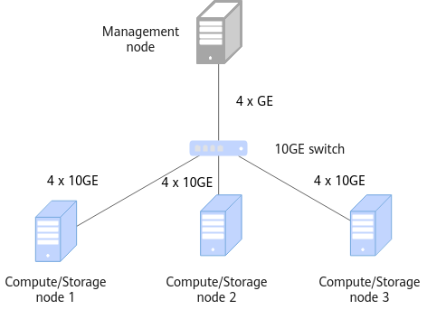

A storage and compute coupled network is recommended for OmniScheduler. Use nodes as both storage and compute nodes to maximize the load balancing effect in big data scenarios.
### Environment Requirements<a name="EN-US_TOPIC_0000002551411963"></a>

Before installing OmniScheduler, prepare the hardware and software environments to facilitate subsequent installation operations.

**Hardware Requirements<a name="en-us_topic_0000002161905896_section197116445713"></a>**

[Table 1](#en-us_topic_0000002161905896___d0e1171)  lists the hardware requirements for each node in the cluster.

**Table  1**  Hardware requirements

|Item|Management/Compute/Storage Node|
|--|--|
|Processor|Kunpeng 920 5250|
|Memory size|384 GB (12 x 32 GB)|
|Memory frequency|2666 MHz|
|Network|Service network: 10GEManagement network: 1GE|
|Drive|System drive: 1 x RAID 0 (1 x 1.2 TB SAS HDD)Data drive: 12 x RAID 0 (12 x 8 TB SATA HDD)|
|RAID controller card|LSI SAS3508|


**OS and Software Requirements<a name="en-us_topic_0000002161905896_en-us_topic_0000001843026488_en-us_topic_0000001664980070_section12083304460"></a>**

[Table 2](#en-us_topic_0000002161905896_en-us_topic_0000001843026488_en-us_topic_0000001664980070_table564mcpsimp)  lists the OS and software requirements for each node in the cluster.

**Table  2**  OS and software requirements

|Item|Version|Description|Management Node|Compute/Storage Node|
|--|--|--|--|--|
|OS|openEuler 22.03 LTS SP3|None|√|√|
|JDK|BiSheng JDK 1.8.0_342|For details about how to install the BiSheng JDK, see BiSheng JDK 8 Installation Guide.|√|√|
|Hadoop|3.3.4|See Hadoop Deployment Guide (CentOS 7.6 & openEuler 20.03).|√|√|
|Spark|3.1.1/3.3.1|See Spark Deployment Guide (CentOS 7.6 & openEuler 20.03).|√|-|
|Hive|3.1.0|See Hive Deployment Guide (CentOS 7.6 & openEuler 20.03).|√|-|
|Prometheus|2.45.4|Download it from the official website: Link|√|-|
|Grafana|10.4.2|Download it from the official website: Link|√|-|
|Node Exporter|1.7.0|Download it from the official website: Link|-|√|
|Go|1.22.2|Download it from the official website: Link|√|√|
|Node|19.9.0|Download it from the official website: Link|√|√|
|Python|3.6.0 or later|None|√|-|


> **NOTICE:** 
>-   √: indicates that the item is required on the node.
>-   -: indicates that the item is not required on the node.
>-   This feature supports only Hadoop 3.3.4.

**Obtaining the Software Package<a name="en-us_topic_0000002161905896_section6777173841917"></a>**

**Table  3**  OmniScheduler software package

|Software Name|Package Name|Release Type|Description|Download URL|
|--|--|--|--|--|
|OmniScheduler|BoostKit-loadsmetric-1.0.0-aarch64.zip|Open source|OmniScheduler software package|Link|


Before installing OmniScheduler, prepare the hardware and software environments to facilitate subsequent installation operations.


## Installing the Feature<a name="EN-US_TOPIC_0000002520291900"></a>

### Configuring the Mapping Between Domain Names and IP Addresses<a name="EN-US_TOPIC_0000002551412031"></a>

Perform the following steps on all nodes.

1. Open the  **/etc/hosts**  file.

    ```
    vi /etc/hosts
    ```

2. Press  **i**  to enter the insert mode and change the value of each  _IP\_address_  to the IP address of the node.

    ```
    server1 IP_address
    agent1 IP_address
    agent2 IP_address
    agent3 IP_address
    ```

3. Press  **Esc**, type  **:wq!**, and press  **Enter**  to save the file and exit.

Perform the following steps on all nodes.
### Installing LoadsMetric<a name="EN-US_TOPIC_0000002519971998"></a>

LoadsMetric is a load collection and analysis tool. It obtains machine metric information from the Node Exporter, analyzes and processes the information, and reports the generated cluster load and balancing data to Prometheus. Install LoadsMetric on the server1 node only.

1. Create the  **hadoop**  user. Skip this step if this user has already existed.

    ```
    useradd hadoop
    ```

2. Create  **/home/hadoop/loadsmetric-software**  to use it as the installation directory. Obtain the dependency package from  [Table 3](environment-requirements.md#en-us_topic_0000002161905896_en-us_topic_0000001924407076_en-us_topic_0000001843026488_en-us_topic_0000001664980070__table677mcpsimp), upload it to the created directory, and extract the package.

    ```
    mkdir -p /home/hadoop/loadsmetric-software
    cd /home/hadoop/loadsmetric-software
    unzip BoostKit-loadsmetric-1.0.0-aarch64.zip
    ```

3. Check whether the following files are generated after the extraction:

    ```
    workers
    loadsmetric_configfile.properties
    loadsmetric_deploy.sh
    loadsmetric-server-1.0.0-SNAPSHOT-aarch64.tar.gz
    boostkit-yarn-schedule-load-evolution-1.0.0.jar
    LoadMetric.json
    ```

4. Change  **workers**  to the compute node list.
    1. Open the  **workers**  file.

        ```
        vi workers
        ```

    2. Press  **i**  to enter the insert mode and modify the file.

        ```
        agent1
        agent2
        agent3
        ```

    3. Press  **Esc**, type  **:wq!**, and press  **Enter**  to save the file and exit.

5. Modify  **loadsmetric\_configfile.properties**. For details about the configuration items, see  [References](references.md).
    1. Open the  **loadsmetric\_configfile.properties**  file.

        ```
        vi loadsmetric_configfile.properties
        ```

    2. Press  **i**  to enter the insert mode and add the following content to the file:

        ```
        # bash properties
        ## software version
        version=1.0.0-SNAPSHOT
        ## install user
        user=hadoop
        ## install type, default: server
        install.type=server
        ## client support resource, default: node-exporter
        client.type=node-exporter
        
        # server properties
        ## server port
        server.port=9090
        ##client lost time
        client.lost.time=2000
        
        # logical resource usage levels, legal range from 0 to 100
        logical-resource-usage.levels.mem=5
        logical-resource-usage.levels.vcores=5
        
        ## limits for multi resource usage
        load.limit.cpu=80
        load.limit.mem=80
        load.limit.diskio=80
        load.limit.netio=80
        ## weights for multi resource usage
        load.weight.cpu=0.3
        load.weight.mem=0.3
        load.weight.diskio=0.2
        load.weight.netio=0.2
        ## window size for usage average calculate, legal range is from 1 to 300
        time.windowsize=5
        ## whether to enable overload determination: true/false
        overload.filter.able=true
        
        # client properties
        ## client post loads-metric-server address
        loads-metric-server.address=server1:9090
        ## client monitor interval
        client.heartbeat.interval=1000
        ## client net compute type(max, send, receive, average)
        net.compute.type=max
        
        # node exporter params
        node-exporter.pull.enable=true
        node-exporter.pull.protocol=http
        node-exporter.pull.port=9100
        node-exporter.pull.thread-pool.size=1000
        ```

    3. Press  **Esc**, type  **:wq!**, and press  **Enter**  to save the file and exit.

6. Perform the installation.

    ```
    cd /home/hadoop/loadsmetric-software
    sh loadsmetric_deploy.sh install
    ```

7. Check whether the installation is successful.

    If the command output contains the installation directory, the installation is successful.

    ```
    ll /home/hadoop/loadsmetric-install/loadsmetric-server
    ```

    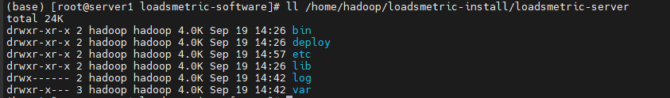

8. Starting LoadsMetric

    ```
    sh loadsmetric_deploy.sh start
    ```

9. Run the  **jps**  command to check whether LoadsMetric is started. If the LoadsMetricApplication process is displayed, the startup is successful.

    

> **NOTE:** 
>The LoadsMetric service can be installed, uninstalled, started, and stopped. It allows starting and stopping Prometheus, Node Exporter, and Grafana with one click. For details about basic O&M commands, see  [Using LoadsMetric](en-us_topic_0000002520291910.md).

LoadsMetric is a load collection and analysis tool. It obtains machine metric information from the Node Exporter, analyzes and processes the information, and reports the generated cluster load and balancing data to Prometheus. Install LoadsMetric on the server1 node only.
### Installing OmniScheduler<a name="EN-US_TOPIC_0000002519971980"></a>

Install OmniScheduler on the server1 node only. Before the installation, deploy Hadoop 3.3.4 on all nodes.

**Description<a name="en-us_topic_0000002197112573_section18971141383916"></a>**

OmniScheduler is deployed as a plugin using the OmniScheduler JAR package. It overwrites open source classes of Hadoop.

For details about the classes of open source Hadoop, see  [Table 1](#en-us_topic_0000002197112573_table146811513442).

**Table  1**  Classes of the open source Hadoop

|Class Name|JAR Package|JAR Package Directory|
|--|--|--|
|org.apache.hadoop.yarn.server.resourcemanager.scheduler.capacity.CapacityScheduler|hadoop-yarn-server-resourcemanager-3.3.4.jar|${HADOOP_HOME}/share/hadoop/yarn/|
|org.apache.hadoop.yarn.server.resourcemanager.webapp.dao.SchedulerInfo|hadoop-yarn-server-resourcemanager-3.3.4.jar|${HADOOP_HOME}/share/hadoop/yarn/|


**Procedure<a name="en-us_topic_0000002197112573_section1792964311399"></a>**

1. Place the OmniScheduler plugin JAR package to the corresponding Hadoop directory.

    ```
    cp /home/hadoop/loadsmetric-software/boostkit-yarn-schedule-load-evolution-1.0.0.jar ${HADOOP_HOME}/share/hadoop/yarn/lib
    ```

2. Modify the  **yarn-site.xml**  configuration file.
    1. Open the configuration file.

        ```
        vi ${HADOOP_HOME}/etc/hadoop/yarn-site.xml
        ```

    2. Press  **i**  to enter the insert mode and add the following content to the file:

        ```
        <!-- Set the RM to use LoadBasedCapacityScheduler. -->
        <property>
          <name>yarn.resourcemanager.scheduler.class</name>
          <value>org.apache.hadoop.yarn.server.resourcemanager.scheduler.capacity.LoadBasedCapacityScheduler</value>
        </property>
        ```

    3. Press  **Esc**, type  **:wq!**, and press  **Enter**  to save the file and exit.

3. Modify the  **capacity-scheduler.xml**  configuration file.
    1. Open the configuration file.

        ```
        vi ${HADOOP_HOME}/etc/hadoop/capacity-scheduler.xml
        ```

    2. Press  **i**  to enter the insert mode and add the following content to the file:

        ```
        <!-- Set whether to enable asynchronous scheduling. -->
        <property>
          <name>yarn.scheduler.capacity.schedule-asynchronously.enable</name>
          <value>true</value>
        </property>
        <!-- Asynchronous scheduling period -->
        <property>
          <name>yarn.scheduler.capacity.schedule-asynchronously.scheduling-interval-ms</name>
          <value>1000</value>
        </property>
        <!-- Percentage of Node Managers involved in generating containers -->
        <property>
          <name>yarn.scheduler.capacity.schedule-asynchronously.global.allocate-percent</name>
          <value>50.0</value>
        </property>
        <!-- Interval for requesting LOADS_METRIC_SERVER. The default value is 1000 milliseconds. -->
        <property>
          <name>yarn.scheduler.capacity.loads-metric-server.request-interval-ms</name>
          <value>1000</value>
        </property>
        <!-- Address for requesting LOADS_METRIC_SERVER (Domain_name:Port), for example, server1:9090. -->
        <property>
          <name>yarn.scheduler.capacity.loads-metric-server.address</name>
          <value>server1:9090</value>
        </property>
        ```

    3. Press  **Esc**, type  **:wq!**, and press  **Enter**  to save the file and exit.

4. Synchronize the configuration file to the other nodes.

    ```
    scp ${HADOOP_HOME}/etc/hadoop/yarn-site.xml agent1:${HADOOP_HOME}/etc/hadoop/
    scp ${HADOOP_HOME}/etc/hadoop/capacity-scheduler.xml agent1:${HADOOP_HOME}/etc/hadoop/
    scp ${HADOOP_HOME}/etc/hadoop/yarn-site.xml agent2:${HADOOP_HOME}/etc/hadoop/
    scp ${HADOOP_HOME}/etc/hadoop/capacity-scheduler.xml agent2:${HADOOP_HOME}/etc/hadoop/
    scp ${HADOOP_HOME}/etc/hadoop/yarn-site.xml agent3:${HADOOP_HOME}/etc/hadoop/
    scp ${HADOOP_HOME}/etc/hadoop/capacity-scheduler.xml agent3:${HADOOP_HOME}/etc/hadoop/
    ```

5. Restart the Yarn cluster.

    ```
    ${HADOOP_HOME}/sbin/stop-yarn.sh
    ${HADOOP_HOME}/sbin/start-yarn.sh
    ```

6. Check whether the OmniScheduler JAR package has taken effect. If it has taken effect, the value of  **Scheduler Type**  is  **LoadBasedCapacityScheduler**  on the Hadoop management page \(**http://**_server1_**:8088/**\).

    

Install OmniScheduler on the server1 node only. Before the installation, deploy Hadoop 3.3.4 on all nodes.
### Installing Prometheus, Grafana, and Node Exporter<a name="EN-US_TOPIC_0000002551411931"></a>

#### Storing Software Packages<a name="EN-US_TOPIC_0000002519971948"></a>

Perform the following operations on the  **server1**  node.

Where,

- Prometheus is open-source event monitoring system and time series database. It is widely used to manage various infrastructure resources.
- Node Exporter is a component in the Prometheus ecosystem. It is used to collect and expose machine-level metrics, including but not limited to CPU usage, memory usage, disk I/O, network I/O, and file system information.
- Grafana obtains cluster load and balancing data from Prometheus, and visualizes the data in charts and dashboards for display on the user interface.

1. Create the  **/opt/prometheus**  directory on the  **server1**  node, download the Go, Node, Prometheus, Node Exporter, and Grafana installation packages \(see  [Table 2](environment-requirements.md#en-us_topic_0000002161905896_en-us_topic_0000001843026488_en-us_topic_0000001664980070_table564mcpsimp)\), and save them to this directory.

    ```
    mkdir -p /opt/prometheus
    cd /opt/prometheus
    wget --no-check-certificate https://go.dev/dl/go1.22.2.linux-arm64.tar.gz
    wget --no-check-certificate https://cdn.npmmirror.com/binaries/node/v19.9.0/node-v19.9.0-linux-arm64.tar.xz
    wget --no-check-certificate https://github.com/prometheus/prometheus/releases/download/v2.45.4/prometheus-2.45.4.linux-arm64.tar.gz
    wget --no-check-certificate https://github.com/prometheus/node_exporter/releases/download/v1.7.0/node_exporter-1.7.0.linux-arm64.tar.gz
    wget --no-check-certificate https://dl.grafana.com/enterprise/release/grafana-enterprise-10.4.2.linux-arm64.tar.gz
    ```

    After the download is complete, the  **/opt/prometheus/**  directory contains the following packages:

    ```
    go1.22.2.linux-arm64.tar.gz
    grafana-enterprise-10.4.2.linux-arm64.tar.gz
    node_exporter-1.7.0.linux-arm64.tar.gz
    node-v19.9.0-linux-arm64.tar.xz
    prometheus-2.45.4.linux-arm64.tar.gz
    ```

2. Extract all the packages.

    ```
    tar -zxvf go1.22.2.linux-arm64.tar.gz
    tar -zxvf grafana-enterprise-10.4.2.linux-arm64.tar.gz
    tar -zxvf node_exporter-1.7.0.linux-arm64.tar.gz
    tar -xvf node-v19.9.0-linux-arm64.tar.xz
    tar -zxvf  prometheus-2.45.4.linux-arm64.tar.gz
    ```

    After the software packages are extracted, the following directories are generated:

    ```
    go
    grafana-v10.4.2
    node_exporter-1.7.0.linux-arm64
    node-v19.9.0-linux-arm64
    prometheus-2.45.4.linux-arm64
    ```

3. Copy the Go, Node Exporter, and Node installation directories in the  **/opt/prometheus/**  directory to the  **/opt/prometheus/**  directory on the other nodes. If the  **/opt/prometheus/**  directory does not exist on the other nodes, create it first.

    ```
    # Directory List
    node_exporter-1.7.0.linux-arm64
    node-v19.9.0-linux-arm64
    go
    # Copy the directory list to the other nodes.
    scp -r node_exporter-1.7.0.linux-arm64 node-v19.9.0-linux-arm64 go agent1:/opt/prometheus/
    scp -r node_exporter-1.7.0.linux-arm64 node-v19.9.0-linux-arm64 go agent2:/opt/prometheus/
    scp -r node_exporter-1.7.0.linux-arm64 node-v19.9.0-linux-arm64 go agent3:/opt/prometheus/
    ```

Perform the following operations on the  **server1**  node.
#### Deploying the Go Environment<a name="EN-US_TOPIC_0000002551411955"></a>

Deploy the Go environment on all nodes.

1. Open the environment variable configuration file.

    ```
    vi /etc/profile
    ```

2. Press  **i**  to enter the insert mode and add the following content to the end of the file:

    ```
    export GO_HOME=/opt/prometheus/go
    export PATH=$GO_HOME/bin:$PATH
    ```

3. Press  **Esc**, type  **:wq!**, and press  **Enter**  to save the file and exit.
4. Update the environment variable.

    ```
    source /etc/profile
    ```

5. View the version to check whether the installation is successful.

    ```
    go version
    ```

Deploy the Go environment on all nodes.
#### Installing Node Exporter<a name="EN-US_TOPIC_0000002519971964"></a>

Deploy Node Exporter on all compute nodes. Place the installation package to the  **/opt/prometheus/**  directory \(see the section of "Storing Software Packages"\).

**Starting the Service<a name="en-us_topic_0000002161746160_section17887248101712"></a>**

1. Go to the Node Exporter directory.

    ```
    cd /opt/prometheus/node_exporter-1.7.0.linux-arm64/
    ```

2. Run the startup command:

    ```
    nohup ./node_exporter --web.listen-address="0.0.0.0:9100" &
    ```

3. Check whether the startup is successful.

    Log in to  **http://$**_\{IP\_address\}_**:9100/metrics**. If the following information is displayed, the startup is successful.

    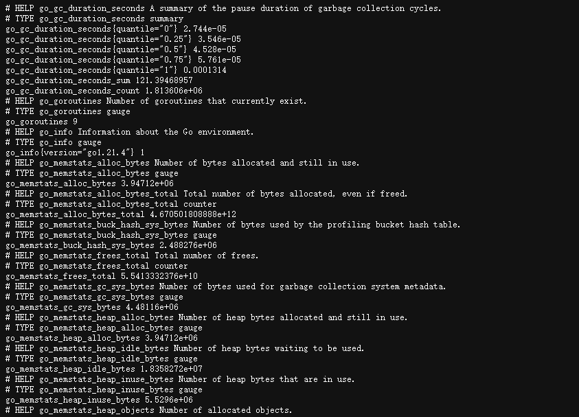

**Stopping the Service<a name="en-us_topic_0000002161746160_section151699211188"></a>**

1. Find the process ID of the Node Exporter service.

    ```
    ps -aux | grep node_exporter
    ```

2. Run the  **kill**  command to stop node\_exporter.

    ```
    kill ID
    ```

Deploy Node Exporter on all compute nodes. Place the installation package to the  **/opt/prometheus/**  directory \(see the section of "Storing Software Packages"\).
#### Installing Prometheus<a name="EN-US_TOPIC_0000002551132003"></a>

Install Prometheus only on the server1 node only.

1. Go to the Prometheus directory.

    ```
    cd /opt/prometheus/prometheus-2.45.4.linux-arm64/
    ```

2. Configure the  **prometheus.yml**  file.
    1. Open the file.

        ```
        vi prometheus.yml
        ```

    2. Press  **i**  to enter the insert mode and modify the file as follows:

        ```
        # my global config
        global:
          scrape_interval: 15s # Set the scrape interval to every 15 seconds. Default is every 1 minute.
          evaluation_interval: 15s # Evaluate rules every 15 seconds. The default is every 1 minute.
          # scrape_timeout is set to the global default (10s).
        # Alertmanager configuration
        alerting:
          alertmanagers:
            - static_configs:
                - targets:
                  # - alertmanager:9093
        # Load rules once and periodically evaluate them according to the global 'evaluation_interval'.
        rule_files:
          # - "first_rules.yml"
          # - "second_rules.yml"
        # A scrape configuration containing exactly one endpoint to scrape:
        # Here it's Prometheus itself.
        scrape_configs:
          # The job name is added as a label `job=<job_name>` to any timeseries scraped from this config.
          - job_name: "prometheus"
            # metrics_path defaults to '/metrics'
            # scheme defaults to 'http'.
            static_configs:
              - targets: ["localhost:9060"]
          - job_name: node_exporter
            honor_timestamps: true
            scrape_interval: 1s
            scrape_timeout: 1s
            metrics_path: /metrics
            scheme: http
            follow_redirects: true
            static_configs:
              - targets: ["agent1:9100","agent2:9100","agent3:9100"]
          - job_name: 'loads_metric'
            static_configs:
              - targets: ['server1:9090']
            metrics_path: '/loadIndicator/get/byCurrTimeForPrometheus'
            scheme: 'http'
            honor_labels: true
            scrape_interval: 1s
          - job_name: 'loads_metric_detail'
            static_configs:
              - targets: ['server1:9090']
            metrics_path: '/loadStatus/get/byCurrTimeForPrometheus'
            scheme: 'http'
            honor_labels: true
            scrape_interval: 1s
        ```

        > **NOTICE:** 
        >If the compute nodes are not agent1, agent2, and agent3, modify the following lines based on the actual node names:
        >```
        >- targets: ["agent1:9100","agent2:9100","agent3:9100"]
        >```

    3. Press  **Esc**, type  **:wq!**, and press  **Enter**  to save the file and exit.

3. Start Prometheus.

    ```
    nohup ./prometheus --web.listen-address="0.0.0.0:9060" &
    ```

4. Check whether the deployment is successful.

    ```
    # Call the API.
    http://server1:9060/targets
    ```

    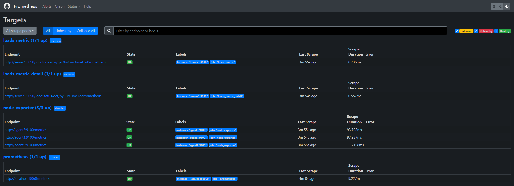

    As shown in the preceding figure, loads\_metric, loads\_metric\_detail, and node\_exporter are all in the  **UP**  state.

    > **NOTE:** 
    >When the LoadsMetricApplication process is running on server1 and Node Exporter is running on the compute nodes, the preceding APIs must be in the  **UP**  state.

5. Stops the Prometheus service.
    1. Find the process ID of the Prometheus service.

        ```
        ps -aux | grep prometheus
        ```

    2. Run the  **kill**  command to stop Prometheus.

        ```
        kill ID
        ```

Install Prometheus only on the server1 node only.
#### Installing Grafana<a name="EN-US_TOPIC_0000002551131869"></a>

Install Grafana on the server1 node only.

1. Go to the Grafana directory.

    ```
    cd /opt/prometheus/grafana-v10.4.2/bin
    ```

2. Start Grafana.

    ```
    nohup ./grafana server &
    ```

3. Check whether the deployment is successful. Access  **http://$\{server1\}:3000**. If the following page is displayed, the deployment is successful.

    

4. Enter the initial login user name and password \(both are  **admin**\) and click  **Log in**.

    

5. Enter a new password as prompted or click  **Skip**  to skip this operation.

    

6. Go to the home page and configure the data sources.
    1. Click  **Datasource**.

        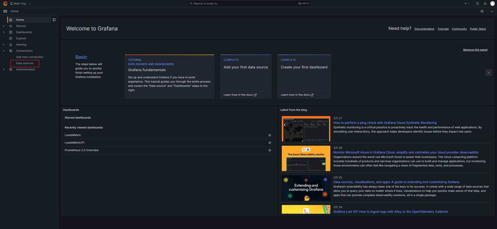

    2. Click  **Add data source**  to add a data source.

        

    3. Select  **Prometheus**.

        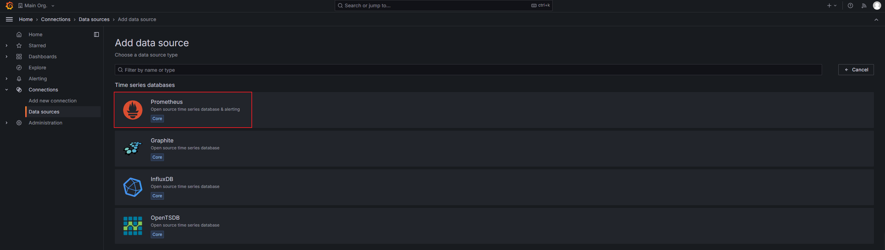

    4. Set the Prometheus URL to  **http://server1:9060/**.

        

    5. Click  **Save&test**.

        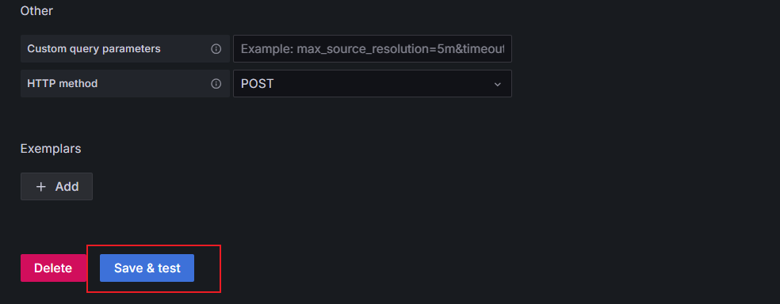

    6. If information in the following figure is displayed, the operation is successful.

        

        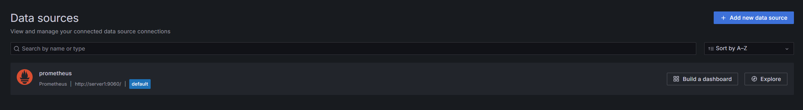

        > **NOTICE:** 
        >Before configuring the data source, ensure that Prometheus is running. Otherwise, the connection fails.

7. Configure the dashboards.
    1. Click  **Dashboards**.

        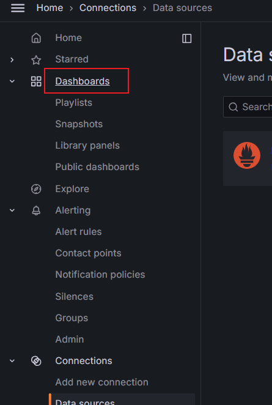

    2. Click  **New**  in the upper right corner of the page and click  **Import**.

        

    3. Upload the  **LoadMetric.json**  file in the  **BoostKit-loadsmetric-1.0.0-aarch64.zip**  package \(obtained in  [Table 3](environment-requirements.md#en-us_topic_0000002161905896_en-us_topic_0000001924407076_en-us_topic_0000001843026488_en-us_topic_0000001664980070__table677mcpsimp)\) to this directory.

        

    4. Click  **Import**.

        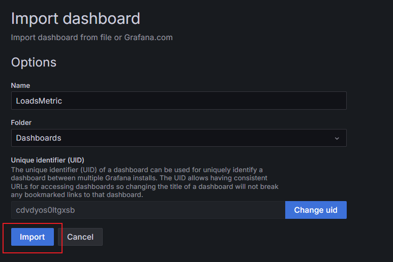

    5. The dashboard is displayed.

        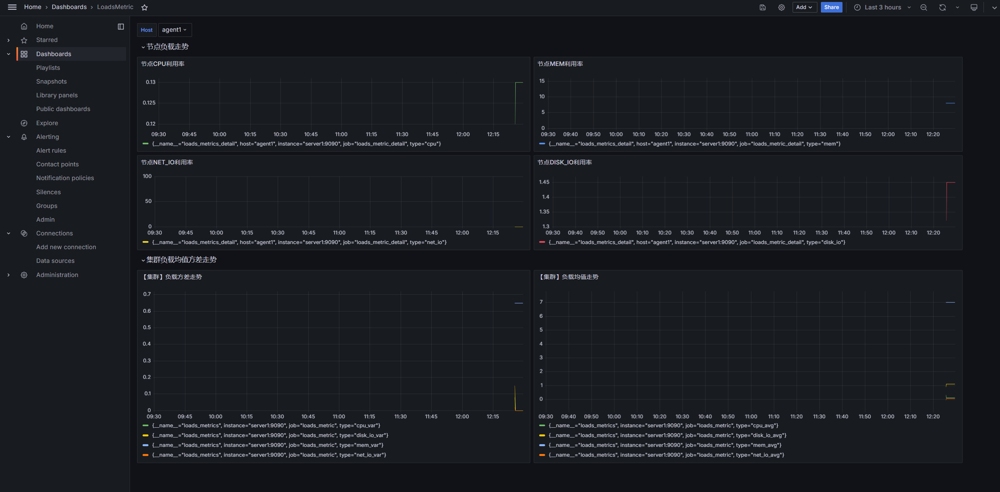

        > **NOTICE:** 
        >-   To display target data on the dashboard, ensure that LoadsMetricApplication and Prometheus are running on the  **server1**  node and Node Exporter is running on the agent nodes.
        >-   If no data is displayed, the open source software has a bug. To resolve this problem, restart Grafana.

8. To view data, log in to  **server1:3000**, click  **Dashboards**, and select  **LoadsMetric**.

    

9. Stops the Grafana service.
    1. Find the process ID of the Grafana service.

        ```
        ps -aux | grep grafana
        ```

    2. Run the  **kill**  command to stop Grafana.

        ```
        kill ID
        ```

Install Grafana on the server1 node only.


## References<a name="EN-US_TOPIC_0000002520291882"></a>

**Table  1**  loadsmetric\_configfile.properties

|Parameter Name|Value Range and Default Value|Description|
|--|--|--|
|version|0.0.1-SNAPSHOT|Software version.|
|user|hadoop|Installation user.|
|install.type|Default value: **server**|Installation Type|
|client.type|Default value: **node-exporter**|Metric data source.|
|server.port|9090|**server** service port.|
|client.lost.time|2000|Heartbeat loss duration of a node, in milliseconds.|
|logical-resource-usage.levels.mem|Value range: **0** to **100**Default value: **5**|Utilization level of the logical resource: virtual memory.A larger value indicates a higher level.|
|logical-resource-usage.levels.vcores|Value range: **0** to **100**Default value: **5**|Utilization level of the logical resource: virtual cores.A larger value indicates a higher level.|
|load.limit.cpu|Value range: **0** to **100**Default value: **80**|CPU usage threshold (unit: **%**). If the CPU usage of a node exceeds the threshold, that node is considered overloaded and no resources will be scheduled from that node.|
|load.limit.mem|Value range: **0** to **100**Default value: **80**|Memory usage threshold (unit: **%**). If the memory usage of a node exceeds the threshold, that node is considered overloaded and no resources will be scheduled from that node.|
|load.limit.diskio|Value range: **0** to **100**Default value: **80**|Disk I/O usage threshold (unit: **%**). If the disk I/O usage of a node exceeds the threshold, that node is considered overloaded and no resources will be scheduled from that node.|
|load.limit.netio|Value range: **0** to **100**Default value: **80**|Network I/O usage threshold (unit: **%**). If the network I/O usage of a node exceeds the threshold, that node is considered overloaded and no resources will be scheduled from that node.|
|load.weight.cpu|0.3|CPU, memory, disk I/O, and network I/O usage weight coefficient (the sum of the coefficients is 1). Nodes are sorted based on the weighted usage result.Weighted usage of a node = CPU usage x CPU weight + memory usage x memory weight + disk I/O usage x disk I/O weight + network I/O usage x network I/O weightA larger resource usage weight coefficient indicates a larger proportion of the impact on the sorting result.|
|load.weight.mem|0.3|CPU, memory, disk I/O, and network I/O usage weight coefficient (the sum of the coefficients is 1). Nodes are sorted based on the weighted usage result.Weighted usage of a node = CPU usage x CPU weight + memory usage x memory weight + disk I/O usage x disk I/O weight + network I/O usage x network I/O weightA larger resource usage weight coefficient indicates a larger proportion of the impact on the sorting result.|
|load.weight.diskio|0.2|CPU, memory, disk I/O, and network I/O usage weight coefficient (the sum of the coefficients is 1). Nodes are sorted based on the weighted usage result.Weighted usage of a node = CPU usage x CPU weight + memory usage x memory weight + disk I/O usage x disk I/O weight + network I/O usage x network I/O weightA larger resource usage weight coefficient indicates a larger proportion of the impact on the sorting result.|
|load.weight.netio|0.2|CPU, memory, disk I/O, and network I/O usage weight coefficient (the sum of the coefficients is 1). Nodes are sorted based on the weighted usage result.Weighted usage of a node = CPU usage x CPU weight + memory usage x memory weight + disk I/O usage x disk I/O weight + network I/O usage x network I/O weightA larger resource usage weight coefficient indicates a larger proportion of the impact on the sorting result.|
|time.windowsize|Value range: **1** to **300**Default value: **5**|Size of the window for calculating the average resource usage.|
|overload.filter.able|Value: **true** or **false**Default value: **true**|Indicates whether resource usage is overloaded.|
|loads-metric-server.address|server1:9090|IP address and port of a server.|
|client.heartbeat.interval|1000|Heartbeat detection interval of a client node, in milliseconds.|
|net.compute.type|Value options: **max**, **send**, **receive**, and **average**Default value: **max**|Network I/O calculation method (maximum value/send/receive/average).|
|node-exporter.pull.enable|true|Retain the default settings for Node Exporter.|
|node-exporter.pull.protocol|http|Retain the default settings for Node Exporter.|
|node-exporter.pull.port|9100|Retain the default settings for Node Exporter.|
|node-exporter.pull.thread-pool.size|1000|Retain the default settings for Node Exporter.|


