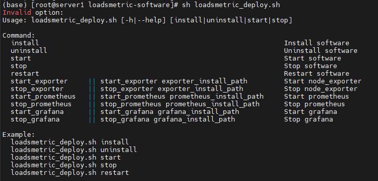

# OmniScheduler<a name="EN-US_TOPIC_0000002520333564"></a>

## Using the Feature<a name="EN-US_TOPIC_0000002520013624"></a>

### Using LoadsMetric<a name="EN-US_TOPIC_0000002520333568"></a>

LoadsMetric is a cluster load collection and analysis tool. It can be installed, uninstalled, started, and stopped. In addition, it allows starting and stopping other software such as Prometheus, Node Exporter, and Grafana with one click.

**Viewing Commands<a name="en-us_topic_0000002161905900_section151109571067"></a>**

1. Go to the  **/home/hadoop/loadsmetric-software**  directory on the  **server1**  node.

    ```
    cd /home/hadoop/loadsmetric-software
    ```

2. Run the  **sh loadsmetric\_deploy.sh**  command to view the script execution method.

    ```
    sh loadsmetric_deploy.sh
    ```

    

**Basic Usage of LoadsMetric<a name="en-us_topic_0000002161905900_section188892817419"></a>**

You are advised to run the script in the directory where the script is stored.

```
cd /home/hadoop/loadsmetric-software/
```

- Installing LoadsMetric

    ```
    sh loadsmetric_deploy.sh install
    ```

- Uninstalling LoadsMetric

    ```
    sh loadsmetric_deploy.sh uninstall
    ```

- Starting LoadsMetric

    ```
    sh loadsmetric_deploy.sh start
    ```

- Stopping LoadsMetric

    ```
    sh loadsmetric_deploy.sh stop
    ```

- Restarting LoadsMetric

    ```
    sh loadsmetric_deploy.sh restart
    ```

**LoadsMetric Log Configuration<a name="en-us_topic_0000002161905900_section77551892051"></a>**

1. Open the log configuration file.

    ```
    vi /home/hadoop/loadsmetric-install/loadsmetric-server/etc/logback.xml
    ```

2. Press  **i**  to enter the insert mode and modify the following parameters:

    ```
    <!--LOG FILE RETENTION DAYS -->   # Set the number of days for retaining historical log files.
    <MaxHistory>30</MaxHistory>
    <!-- LOG FILE MAX SIZE -->        # Set the maximum size of an individual log file.
    <MaxFileSize>2000MB</MaxFileSize>
    <!-- LOG FILE TOTAL SIZE CAP -->    # Set the maximum drive space used to store all log files.
    <TotalSizeCap>20GB</TotalSizeCap>
    ```

3. Press  **Esc**, type  **:wq!**, and press  **Enter**  to save the file and exit.

**Starting and Stopping Prometheus, Node Exporter, and Grafana Using LoadsMetric<a name="en-us_topic_0000002161905900_section11313142953"></a>**

[Table 1](#en-us_topic_0000002161905900_table6515133412584)  describes the commands of starting and stopping Prometheus, Node Exporter, and Grafana with one click.

**Table  1**  Starting and stopping Prometheus, Node Exporter, and Grafana using the LoadsMetric service with one click

|**Function**|**Command**|**Description**|
|--|--|--|
|Starting Node Exporter with one click|**sh loadsmetric_deploy.sh start_exporter**|When the Node Exporter installation directory is the default directory /opt/prometheus/node_exporter-1.7.0.linux-arm64/, start Node Exporter on all agent nodes with one click.|
|Starting Node Exporter with one click|**sh loadsmetric_deploy.sh start_exporter "Installation_directory"**Example: **sh loadsmetric_deploy.sh start_exporter "/opt/prometheus/node_exporter-1.7.0.linux-arm64"**|When the Node Exporter installation directory is another directory, start Node Exporter on all agent nodes with one click.|
|Stopping Node Exporter with one click|**sh loadsmetric_deploy.sh stop_exporter**|Stop Node Exporter on all agent nodes with one click.|
|Starting Prometheus with one click|**sh loadsmetric_deploy.sh start_prometheus**|When the Prometheus installation directory is the default directory /opt/prometheus/prometheus-2.45.4.linux-arm64/, start Prometheus on the server node with one click.|
|Starting Prometheus with one click|**sh loadsmetric_deploy.sh start_prometheus "Installation_directory"**Example: **sh loadsmetric_deploy.sh start_prometheus "/opt/prometheus/prometheus-2.45.4.linux-arm64"**|When the Prometheus installation directory is another directory, start Prometheus on all server nodes with one click.|
|Stopping Prometheus with one click|**sh loadsmetric_deploy.sh stop_prometheus**|Stop Prometheus on all server nodes with one click.|
|Starting Grafana with one click|**sh loadsmetric_deploy.sh start_grafana**|When the Grafana installation directory is the default directory /opt/prometheus/grafana-v10.4.2/bin/, start Grafana on all server nodes with one click.|
|Starting Grafana with one click|**sh loadsmetric_deploy.sh start_grafana "Installation_directory"**Example: **sh loadsmetric_deploy.sh start_grafana "/opt/prometheus/grafana-v10.4.2/bin"**|When the Grafana installation directory is another directory, start Grafana on all server nodes with one click.|
|Stopping Grafana with one click|**sh loadsmetric_deploy.sh stop_grafana**|Stop Grafana on all server nodes with one click.|


### Using OmniScheduler<a name="EN-US_TOPIC_0000002551413723"></a>

1. Go to the  **/home/hadoop/loadsmetric-install/loadsmetric-server/etc**  directory.

    ```
    cd /home/hadoop/loadsmetric-install/loadsmetric-server/etc
    ```

2. Modify the LoadsMetric configuration items as required. \(Ignore those configuration items that are already correctly set.\)
    1. Open the configuration file.

        ```
        vim application.properties
        ```

    2. Press  **i**  to enter the insert mode. Modify the usage threshold and usage weight as required. The former affects the determination of overloaded nodes in the cluster, and the latter affects the node load sorting result. For details about the parameters, see  [en-us\_topic\_0000002551533573.md](en-us_topic_0000002551533573.md).

        ```
        # limits for multi resource usage
        load.limit.cpu=80
        load.limit.mem=80
        load.limit.diskio=80
        load.limit.netio=80
        
        # weights for multi resource usage
        load.weight.cpu=0.3
        load.weight.mem=0.3
        load.weight.diskio=0.2
        load.weight.netio=0.2
        ```

    3. Press  **Esc**, type  **:wq!**, and press  **Enter**  to save the file and exit.

3. Restart LoadsMetric to make the updated configuration items take effect.

    ```
    cd /home/hadoop/loadsmetric-software
    sh loadsmetric_deploy.sh restart
    ```

4. Run a computing task \(for example a Spark task\) and start Yarn resource scheduling:

    ```
    spark-sql --deploy-mode client --driver-cores 8 --driver-memory 20g --num-executors 3 --executor-cores 7 --executor-memory 26g --master yarn  --conf spark.task.cpus=1 --conf spark.sql.orc.impl=native --conf spark.sql.shuffle.partitions=1000 --conf spark.network.timeout=600  --conf spark.sql.adaptive.enabled=true --conf spark.sql.adaptive.skewedJoin.enabled=true --conf spark.serializer=org.apache.spark.serializer.KryoSerializer --conf spark.sql.autoBroadcastJoinThreshold=100M --properties-file /home/spark.conf --database tpcds_bin_partitioned_decimal_orc_3000
    ```


## Maintaining the Feature<a name="EN-US_TOPIC_0000002520013630"></a>

Follow the operating instructions when upgrading or uninstalling OmniScheduler.

**Upgrading OmniScheduler<a name="section1773319019218"></a>**

> **NOTICE:** 
>The upgrade cannot be performed using the tool. Therefore, you need to download the installation package and reinstall the software.

Contact Huawei technical support to download the OmniScheduler Yarn software installation package for the upgrade.

**Uninstalling OmniScheduler<a name="section14513115042212"></a>**

> **NOTICE:** 
>These steps are not mandatory for deploying OmniScheduler.

1. Stop the Prometheus, Grafana, and Node Exporter services on target nodes, and then delete the installation packages from the  **/opt/prometheus**  directory on all nodes.

    ```
    cd /opt/prometheus
    rm -rf *
    ```

2. Uninstall LoadsMetric.

    Stop the LoadsMetricApplication process and run the uninstallation script. After the uninstallation is complete, delete all content from the  **/home/hadoop**  directory.

    ```
    cd /home/hadoop/loadsmetric-software
    sh loadsmetric_deploy.sh stop
    sh loadsmetric_deploy.sh uninstall
    cd ..
    rm -rf *
    ```

3. Uninstall OmniScheduler.
    1. Delete the OmniScheduler JAR package from the  **server1**  node.

        ```
        cd ${HADOOP_HOME}/share/hadoop/yarn/lib
        rm -rf boostkit-yarn-schedule-load-evolution-1.0.0.jar
        ```

    2. Comment out the new configuration items in the  **yarn-site.xml**  and  **capacity-scheduler.xml**  files on the  **server1**  node, or delete them. For details about the new configuration items, see  [en-us\_topic\_0000002520013706.md](en-us_topic_0000002520013706.md).
    3. Synchronize the two configuration items on the  **server1**  node to the other nodes.
    4. Restart the Yarn cluster for the configurations to take effect.

        ```
        ${HADOOP_HOME}/sbin/stop-yarn.sh
        ${HADOOP_HOME}/sbin/start-yarn.sh
        ```

Follow the operating instructions when upgrading or uninstalling OmniScheduler.

