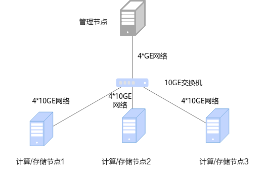
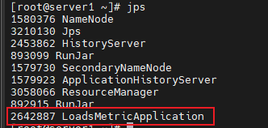
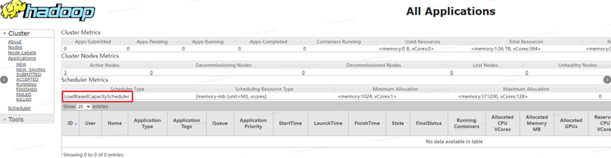
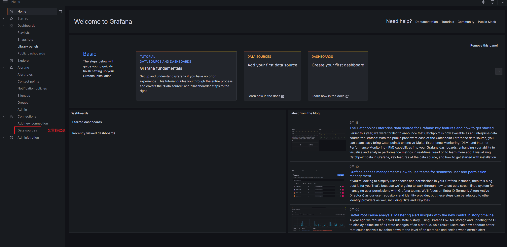
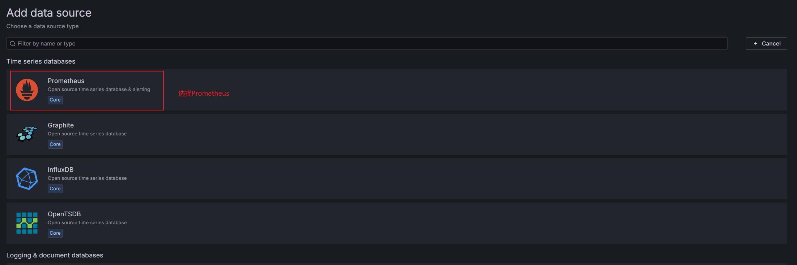
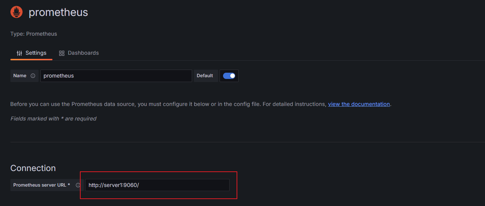
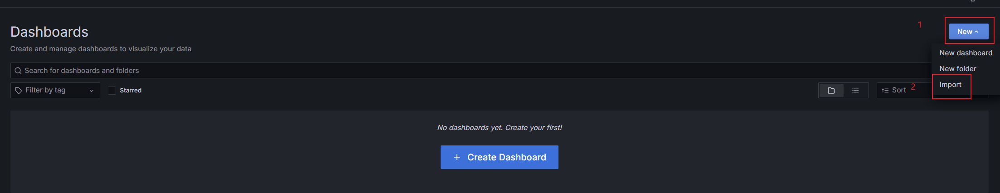
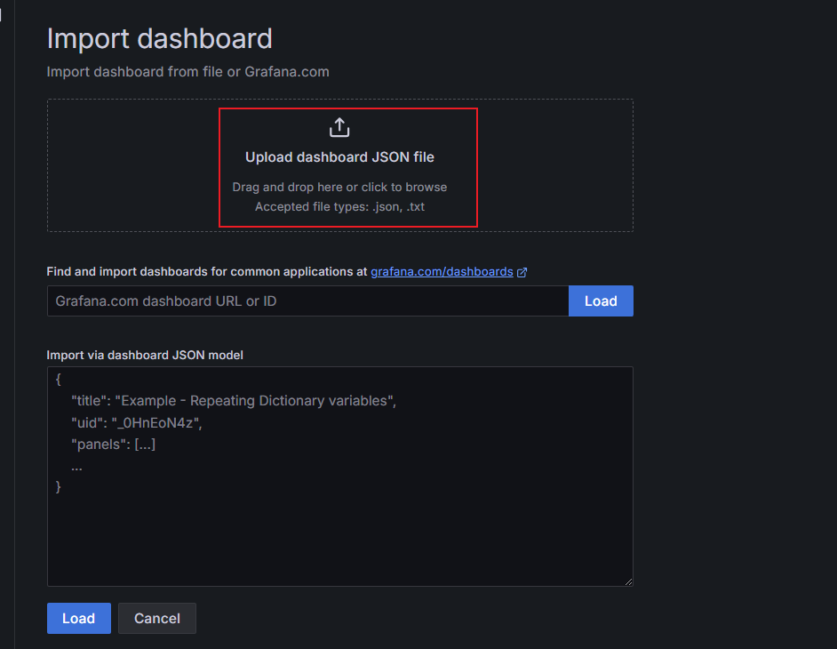
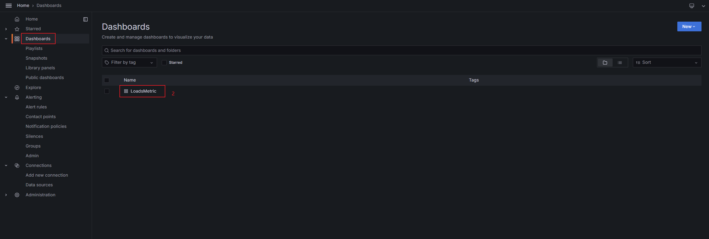

# 安装指南<a name="ZH-CN_TOPIC_0000002551411851"></a>

## 安装简介<a name="ZH-CN_TOPIC_0000002551412039"></a>

### 组网规划<a name="ZH-CN_TOPIC_0000002519971848"></a>

建议采用存算一体组网，即存储节点和计算节点共用，充分发挥OmniScheduler Yarn负载调度算法特性在大数据场景的负载均衡效果。

OmniScheduler Yarn负载调度算法组网规划的环境由4台服务器组成，使用存算一体的组网，分别是管理节点（1台）、计算节点（3台）。以存储节点为HDFS进行举例说明，其中：

- 管理节点为server1，用于管理任务，以及运行Prometheus、Grafana和LoadsMetric。
- 计算节点为agent1、agent2和agent3，用于运行计算服务以及Node Exporter。

**图 1** 安装组网图<a name="zh-cn_topic_0000002197227009_fig734218245342"></a><a id="安装组网图"></a><br>


### 环境要求<a name="ZH-CN_TOPIC_0000002551411963"></a>

安装OmniScheduler Yarn负载调度算法特性前，请参见本节内容，提前准备软硬件安装环境，以确保后续安装操作顺利进行。

**硬件要求<a name="zh-cn_topic_0000002161905896_section197116445713"></a>**

集群中各节点硬件要求如[**表 1** 硬件要求](#硬件要求)所示。

**表 1** 硬件要求<a id="硬件要求"></a>

|硬件环境|管理/计算/存储节点|
|--|--|
|处理器|鲲鹏920 5250处理器|
|内存大小|384GB（12 * 32GB）|
|内存频率|2666MHz|
|网络|业务网络10GE管理网络1GE|
|硬盘|系统盘：1 * RAID 0（1 * 1.2TB SAS HDD）数据盘：12 * RAID 0（12 * 8TB SATA HDD）|
|RAID控制卡|LSI SAS3508|


**操作系统和软件要求<a name="zh-cn_topic_0000002161905896_zh-cn_topic_0000001843026488_zh-cn_topic_0000001664980070_section12083304460"></a>**

集群中各节点操作系统和软件要求如[**表 2** 操作系统和软件要求](#操作系统和软件要求)所示。

**表 2** 操作系统和软件要求<a id="操作系统和软件要求"></a>

|项目|版本|说明|管理节点|计算/存储节点|
|--|--|--|--|--|
|操作系统|openEuler 22.03 LTS SP3|无特殊说明。|√|√|
|JDK|毕昇JDK 1.8.0_342|毕昇JDK安装指南请参见《毕昇JDK 8 安装指南》|√|√|
|Hadoop|3.3.4|部署指南请参见《Hadoop 集群部署（CentOS 7.6&openEuler 20.03）》。|√|√|
|Spark|3.1.1/3.3.1|部署指南请参见《Spark 部署指南（CentOS 7.6&openEuler 20.03）》。|√|-|
|Hive|3.1.0|部署指南请参见《Hive部署指南（CentOS 7.6&openEuler 20.03）》。|√|-|
|Prometheus|2.45.4|从官网链接下载：获取链接|√|-|
|Grafana|10.4.2|从官网链接下载：获取链接|√|-|
|Node Exporter|1.7.0|从官网链接下载：获取链接|-|√|
|Go|1.22.2|从官网链接下载：获取链接|√|√|
|Node|19.9.0|从官网链接下载：获取链接|√|√|
|Python|3.6.0及以上|无特殊说明。|√|-|


> **须知：** 
>-   √：表示对应节点需要安装该项目。
>-   -：表示对应节点不需要安装该项目。
>-   当前特性仅支持Hadoop 3.3.4版本，对其他版本Hadoop暂不兼容。

**软件安装包获取<a name="zh-cn_topic_0000002161905896_section6777173841917"></a>**

**表 3** OmniScheduler Yarn负载调度算法软件获取列表<a id="OmniScheduler Yarn负载调度算法软件获取列表"></a>

|名称|包名|发布类型|说明|获取地址|
|--|--|--|--|--|
|OmniSchedulerYarn负载调度算法|BoostKit-loadsmetric-1.0.0-aarch64.zip|开源|OmniSchedulerYarn负载调度算法软件安装包。|获取链接|


## 安装特性<a name="ZH-CN_TOPIC_0000002520291900"></a>

### 配置域名与IP地址关系<a name="ZH-CN_TOPIC_0000002551412031"></a>

该配置在所有节点均需执行。

1. 打开`/etc/hosts`文件。

    ```
    vi /etc/hosts
    ```

2. 按`i`进入编辑模式，在文件中修改以下内容，IP地址需修改为节点对应的IP地址。

    ```
    server1 IP地址
    agent1 IP地址
    agent2 IP地址
    agent3 IP地址
    ```

3. 按`Esc`键，输入:**wq!**，按`Enter`保存并退出编辑。

### 安装LoadsMetric<a name="ZH-CN_TOPIC_0000002519971998"></a>

LoadsMetric是负载采集与分析工具，负责从Node Exporter中获取机器指标信息，进行分析处理后，将集群负载信息与均衡性数据上报给Prometheus进行存储。安装LoadsMetric步骤仅需在server1节点执行。

1. 如果hadoop用户不存在，首先创建用户hadoop。

    ```
    useradd hadoop
    ```

2. 新建安装目录`/home/hadoop/loadsmetric-software`，从[**表 3** OmniScheduler Yarn负载调度算法软件获取列表](#OmniScheduler Yarn负载调度算法软件获取列表)获取软件安装所需依赖配置，上传到该目录下，并解压。

    ```
    mkdir -p /home/hadoop/loadsmetric-software
    cd /home/hadoop/loadsmetric-software
    unzip BoostKit-loadsmetric-1.0.0-aarch64.zip
    ```

3. 观察解压后是否包含如下文件。

    ```
    workers
    loadsmetric_configfile.properties
    loadsmetric_deploy.sh
    loadsmetric-server-1.0.0-SNAPSHOT-aarch64.tar.gz
    boostkit-yarn-schedule-load-evolution-1.0.0.jar
    LoadMetric.json
    ```

4. 修改workers为计算节点列表。
    1. 打开workers文件。

        ```
        vi workers
        ```

    2. 按`i`进入编辑模式，按需修改文件中的内容。

        ```
        agent1
        agent2
        agent3
        ```

    3. 按`Esc`键，输入:**wq!**，按`Enter`保存并退出编辑。

5. 修改loadsmetric\_configfile.properties，配置相关含义见[相关参考](相关参考.md)。
    1. 打开loadsmetric\_configfile.properties文件。

        ```
        vi loadsmetric_configfile.properties
        ```

    2. 按`i`进入编辑模式，在文件中添加以下内容。

        ```
        # bash properties
        ## software version
        version=1.0.0-SNAPSHOT
        ## install user
        user=hadoop
        ## install type, default: server
        install.type=server
        ## client support resource, default: node-exporter
        client.type=node-exporter
        
        # server properties
        ## server port
        server.port=9090
        ##client lost time
        client.lost.time=2000
        
        # logical resource usage levels, legal range from 0 to 100
        logical-resource-usage.levels.mem=5
        logical-resource-usage.levels.vcores=5
        
        ## limits for multi resource usage
        load.limit.cpu=80
        load.limit.mem=80
        load.limit.diskio=80
        load.limit.netio=80
        ## weights for multi resource usage
        load.weight.cpu=0.3
        load.weight.mem=0.3
        load.weight.diskio=0.2
        load.weight.netio=0.2
        ## window size for usage average calculate, legal range is from 1 to 300
        time.windowsize=5
        ## whether to enable overload determination: true/false
        overload.filter.able=true
        
        # client properties
        ## client post loads-metric-server address
        loads-metric-server.address=server1:9090
        ## client monitor interval
        client.heartbeat.interval=1000
        ## client net compute type(max, send, receive, average)
        net.compute.type=max
        
        # node exporter params
        node-exporter.pull.enable=true
        node-exporter.pull.protocol=http
        node-exporter.pull.port=9100
        node-exporter.pull.thread-pool.size=1000
        ```

    3. 按`Esc`键，输入:**wq!**，按`Enter`保存并退出编辑。

6. 执行安装命令。

    ```
    cd /home/hadoop/loadsmetric-software
    sh loadsmetric_deploy.sh install
    ```

7. 观察是否安装成功。

    回显存在对应目录及安装成功。

    ```
    ll /home/hadoop/loadsmetric-install/loadsmetric-server
    ```

    

8. 启动LoadsMetric。

    ```
    sh loadsmetric_deploy.sh start
    ```

9. 使用**jps**命令查看是否启动成功，出现LoadsMetricApplication进程为启动成功。

    

> **说明：** 
>LoadsMetric服务支持安装、卸载、启动、停止等操作，同时支持一键启停Prometheus、Node Exporter、Grafana等其他相关软件，基本运维命令见[zh-cn\_topic\_0000002520291910.md](zh-cn_topic_0000002520291910.md)。

### 安装OmniScheduler<a name="ZH-CN_TOPIC_0000002519971980"></a>

安装OmniScheduler Yarn负载调度算法步骤在server1节点执行，在安装前需要在所有节点部署Hadoop 3.3.4。

**说明<a name="zh-cn_topic_0000002197112573_section18971141383916"></a>**

OmniScheduler Yarn负载调度算法以JAR包形式进行插件化部署，对Hadoop开源版本对应类进行覆盖。

覆盖Hadoop开源版本对应类请参见[**表 1** 覆盖Hadoop开源版本对应类](#覆盖Hadoop开源版本对应类)。

**表 1** 覆盖Hadoop开源版本对应类<a id="覆盖Hadoop开源版本对应类"></a>

|类名|所属JAR包|JAR包目录|
|--|--|--|
|org.apache.hadoop.yarn.server.resourcemanager.scheduler.capacity.CapacityScheduler|hadoop-yarn-server-resourcemanager-3.3.4.jar|${HADOOP_HOME}/share/hadoop/yarn/|
|org.apache.hadoop.yarn.server.resourcemanager.webapp.dao.SchedulerInfo|hadoop-yarn-server-resourcemanager-3.3.4.jar|${HADOOP_HOME}/share/hadoop/yarn/|


**安装步骤<a name="zh-cn_topic_0000002197112573_section1792964311399"></a>**

1. 将OmniScheduler Yarn负载调度算法插件化JAR包放置到Hadoop对应目录中。

    ```
    cp /home/hadoop/loadsmetric-software/boostkit-yarn-schedule-load-evolution-1.0.0.jar ${HADOOP_HOME}/share/hadoop/yarn/lib
    ```

2. 修改yarn-site.xml配置文件。
    1. 打开配置文件。

        ```
        vi ${HADOOP_HOME}/etc/hadoop/yarn-site.xml
        ```

    2. 按`i`进入编辑模式，在yarn-site.xml文件中追加如下内容。

        ```
        <!-- 设定rm使用LoadBasedCapacityScheduler -->
        <property>
          <name>yarn.resourcemanager.scheduler.class</name>
          <value>org.apache.hadoop.yarn.server.resourcemanager.scheduler.capacity.LoadBasedCapacityScheduler</value>
        </property>
        ```

    3. 按`Esc`键，输入:**wq!**，按`Enter`保存并退出编辑。

3. 修改capacity-scheduler.xml配置文件。
    1. 打开配置文件。

        ```
        vi ${HADOOP_HOME}/etc/hadoop/capacity-scheduler.xml
        ```

    2. 按`i`进入编辑模式，在capacity-scheduler.xml中追加如下内容。

        ```
        <!-- 是否开启异步调度 -->
        <property>
          <name>yarn.scheduler.capacity.schedule-asynchronously.enable</name>
          <value>true</value>
        </property>
        <!-- 异步调度周期 -->
        <property>
          <name>yarn.scheduler.capacity.schedule-asynchronously.scheduling-interval-ms</name>
          <value>1000</value>
        </property>
        <!-- 平铺nm分配container的百分比 -->
        <property>
          <name>yarn.scheduler.capacity.schedule-asynchronously.global.allocate-percent</name>
          <value>50.0</value>
        </property>
        <!-- 请求LOADS_METRIC_SERVER间隔，默认1000毫秒 -->
        <property>
          <name>yarn.scheduler.capacity.loads-metric-server.request-interval-ms</name>
          <value>1000</value>
        </property>
        <!-- 请求LOADS_METRIC_SERVER的地址（域名:端口），例如server1:9090-->
        <property>
          <name>yarn.scheduler.capacity.loads-metric-server.address</name>
          <value>server1:9090</value>
        </property>
        ```

    3. 按`Esc`键，输入:**wq!**，按`Enter`保存并退出编辑。

4. 将上述配置文件同步到集群其他节点。

    ```
    scp ${HADOOP_HOME}/etc/hadoop/yarn-site.xml agent1:${HADOOP_HOME}/etc/hadoop/
    scp ${HADOOP_HOME}/etc/hadoop/capacity-scheduler.xml agent1:${HADOOP_HOME}/etc/hadoop/
    scp ${HADOOP_HOME}/etc/hadoop/yarn-site.xml agent2:${HADOOP_HOME}/etc/hadoop/
    scp ${HADOOP_HOME}/etc/hadoop/capacity-scheduler.xml agent2:${HADOOP_HOME}/etc/hadoop/
    scp ${HADOOP_HOME}/etc/hadoop/yarn-site.xml agent3:${HADOOP_HOME}/etc/hadoop/
    scp ${HADOOP_HOME}/etc/hadoop/capacity-scheduler.xml agent3:${HADOOP_HOME}/etc/hadoop/
    ```

5. 重启Yarn集群。

    ```
    ${HADOOP_HOME}/sbin/stop-yarn.sh
    ${HADOOP_HOME}/sbin/start-yarn.sh
    ```

6. 验证OmniScheduler Yarn负载调度算法JAR包是否生效，观察Hadoop管理界面http://_server1_:8088/，Scheduler Type显示为LoadBasedCapacityScheduler。

    

### 安装Prometheus、Grafana、Node Exporter<a name="ZH-CN_TOPIC_0000002551411931"></a>

#### 软件包放置说明<a name="ZH-CN_TOPIC_0000002519971948"></a>

软件包放置仅需在server1节点执行。

其中：

- Prometheus是一个开源的监控系统和时间序列数据库，广泛用于监控各种服务和基础设施。
- Node Exporter是Prometheus生态系统中的一个组件，用于收集和暴露机器级别的指标（metrics），包括但不限于CPU使用率、内存使用情况、磁盘I/O、网络I/O和文件系统信息等。
- Grafana是从Prometheus获取负载信息和均衡性数据，并将其可视化为图表和仪表板，进行前端UI展示。

1. 在server1创建目录`/opt/prometheus`，并下载[**表 2** 操作系统和软件要求](#操作系统和软件要求)要求的Go、Node、Prometheus、Node Exporter、Grafana等软件安装包，放置于该目录下。

    ```
    mkdir -p /opt/prometheus
    cd /opt/prometheus
    wget --no-check-certificate https://go.dev/dl/go1.22.2.linux-arm64.tar.gz
    wget --no-check-certificate https://cdn.npmmirror.com/binaries/node/v19.9.0/node-v19.9.0-linux-arm64.tar.xz
    wget --no-check-certificate https://github.com/prometheus/prometheus/releases/download/v2.45.4/prometheus-2.45.4.linux-arm64.tar.gz
    wget --no-check-certificate https://github.com/prometheus/node_exporter/releases/download/v1.7.0/node_exporter-1.7.0.linux-arm64.tar.gz
    wget --no-check-certificate https://dl.grafana.com/enterprise/release/grafana-enterprise-10.4.2.linux-arm64.tar.gz
    ```

    下载完成后目录`/opt/prometheus/`下将包含如下压缩包。

    ```
    go1.22.2.linux-arm64.tar.gz
    grafana-enterprise-10.4.2.linux-arm64.tar.gz
    node_exporter-1.7.0.linux-arm64.tar.gz
    node-v19.9.0-linux-arm64.tar.xz
    prometheus-2.45.4.linux-arm64.tar.gz
    ```

2. 将所有压缩包解压。

    ```
    tar -zxvf go1.22.2.linux-arm64.tar.gz
    tar -zxvf grafana-enterprise-10.4.2.linux-arm64.tar.gz
    tar -zxvf node_exporter-1.7.0.linux-arm64.tar.gz
    tar -xvf node-v19.9.0-linux-arm64.tar.xz
    tar -zxvf  prometheus-2.45.4.linux-arm64.tar.gz
    ```

    解压后包含如下目录。

    ```
    go
    grafana-v10.4.2
    node_exporter-1.7.0.linux-arm64
    node-v19.9.0-linux-arm64
    prometheus-2.45.4.linux-arm64
    ```

3. 将`/opt/prometheus/`目录下Go、Node Exporter、Node安装目录复制到其他节点的`/opt/prometheus/`目录下，其他节点若无该目录请先创建。

    ```
    #目录列表
    node_exporter-1.7.0.linux-arm64
    node-v19.9.0-linux-arm64
    go
    #复制到其他节点
    scp -r node_exporter-1.7.0.linux-arm64 node-v19.9.0-linux-arm64 go agent1:/opt/prometheus/
    scp -r node_exporter-1.7.0.linux-arm64 node-v19.9.0-linux-arm64 go agent2:/opt/prometheus/
    scp -r node_exporter-1.7.0.linux-arm64 node-v19.9.0-linux-arm64 go agent3:/opt/prometheus/
    ```

#### 部署Go环境<a name="ZH-CN_TOPIC_0000002551411955"></a>

所有节点均需部署Go环境。

1. 打开环境变量配置文件。

    ```
    vi /etc/profile
    ```

2. 按`i`进入编辑模式，末尾写入如下内容。

    ```
    export GO_HOME=/opt/prometheus/go
    export PATH=$GO_HOME/bin:$PATH
    ```

3. 按`Esc`键，输入:**wq!**，按`Enter`保存并退出编辑。
4. 刷新环境变量。

    ```
    source /etc/profile
    ```

5. 查看版本号验证是否安装成功。

    ```
    go version
    ```

#### 安装Node Exporter<a name="ZH-CN_TOPIC_0000002519971964"></a>

Node Exporter需要在所有计算节点上部署，按照软件包放置说明章节将相关安装包放置到`/opt/prometheus/`目录即可。

**启动服务<a name="zh-cn_topic_0000002161746160_section17887248101712"></a>**

1. 进入Node Exporter的目录。

    ```
    cd /opt/prometheus/node_exporter-1.7.0.linux-arm64/
    ```

2. 执行启动命令。

    ```
    nohup ./node_exporter --web.listen-address="0.0.0.0:9100" &
    ```

3. 验证启动是否成功。

    登录地址http://$\{IP\}:9100/metrics，显示如下图表示启动成功。

    

**停止服务<a name="zh-cn_topic_0000002161746160_section151699211188"></a>**

1. 找到Node Exporter服务进程ID。

    ```
    ps -aux | grep node_exporter
    ```

2. 使用**kill**命令停止node\_exporter。

    ```
    kill ID
    ```

#### 安装Prometheus<a name="ZH-CN_TOPIC_0000002551132003"></a>

安装Prometheus仅需在server1上安装。

1. 进入Prometheus目录。

    ```
    cd /opt/prometheus/prometheus-2.45.4.linux-arm64/
    ```

2. 配置prometheus.yml。
    1. 打开文件。

        ```
        vi prometheus.yml
        ```

    2. 按`i`进入编辑模式，配置为如下内容。

        ```
        # my global config
        global:
          scrape_interval: 15s # Set the scrape interval to every 15 seconds. Default is every 1 minute.
          evaluation_interval: 15s # Evaluate rules every 15 seconds. The default is every 1 minute.
          # scrape_timeout is set to the global default (10s).
        # Alertmanager configuration
        alerting:
          alertmanagers:
            - static_configs:
                - targets:
                  # - alertmanager:9093
        # Load rules once and periodically evaluate them according to the global 'evaluation_interval'.
        rule_files:
          # - "first_rules.yml"
          # - "second_rules.yml"
        # A scrape configuration containing exactly one endpoint to scrape:
        # Here it's Prometheus itself.
        scrape_configs:
          # The job name is added as a label `job=<job_name>` to any timeseries scraped from this config.
          - job_name: "prometheus"
            # metrics_path defaults to '/metrics'
            # scheme defaults to 'http'.
            static_configs:
              - targets: ["localhost:9060"]
          - job_name: node_exporter
            honor_timestamps: true
            scrape_interval: 1s
            scrape_timeout: 1s
            metrics_path: /metrics
            scheme: http
            follow_redirects: true
            static_configs:
              - targets: ["agent1:9100","agent2:9100","agent3:9100"]
          - job_name: 'loads_metric'
            static_configs:
              - targets: ['server1:9090']
            metrics_path: '/loadIndicator/get/byCurrTimeForPrometheus'
            scheme: 'http'
            honor_labels: true
            scrape_interval: 1s
          - job_name: 'loads_metric_detail'
            static_configs:
              - targets: ['server1:9090']
            metrics_path: '/loadStatus/get/byCurrTimeForPrometheus'
            scheme: 'http'
            honor_labels: true
            scrape_interval: 1s
        ```

        > **须知：** 
        >若计算节点不为agent1/agent2/agent3，请按照实际集群规划修改如下行。
        >```
        >- targets: ["agent1:9100","agent2:9100","agent3:9100"]
        >```

    3. 按`Esc`键，输入:**wq!**，按`Enter`保存并退出编辑。

3. 启动Prometheus。

    ```
    nohup ./prometheus --web.listen-address="0.0.0.0:9060" &
    ```

4. 验证部署是否成功。

    ```
    # 调用接口
    http://server1:9060/targets
    ```

    

    显示界面如上，loads\_metric、loads\_metric\_detail以及node\_exporter均为UP状态。

    > **说明：** 
    >在server1的LoadsMetricApplication进程和计算节点Node Exporter已启动的情况下，Prometheus界面如上接口应均为UP状态。

5. 停止Prometheus服务。
    1. 找到Prometheus服务进程ID。

        ```
        ps -aux | grep prometheus
        ```

    2. 使用**kill**命令停止Prometheus。

        ```
        kill ID
        ```

#### 安装Grafana<a name="ZH-CN_TOPIC_0000002551131869"></a>

安装Grafana仅需在server1上进行。

1. 进入Grafana目录。

    ```
    cd /opt/prometheus/grafana-v10.4.2/bin
    ```

2. 启动Grafana。

    ```
    nohup ./grafana server &
    ```

3. 验证部署是否成功，访问页面http://$\{server1\}:3000，页面可成功显示。

    

4. 首次登录账号/密码为admin/admin，输入账号密码后单击`Log in`。

    

5. 要求修改密码，输入新密码，或者可以单击`Skip`跳过密码重置环节。

    

6. 进入主页配置数据源。
    1. 选择`Datasource`。

        

    2. 单击`Add data source`添加新的数据源。

        

    3. 选择Prometheus。

        

    4. 配置Prometheus的URL为http://server1:9060/。

        

    5. 页面下拉选择`Save&test`。

        

    6. 成功后显示如下提示。

        

        

        > **须知：** 
        >配置数据源时请确保Prometheus已启动，否则会连接失败。

7. 配置面板。
    1. `Dashboards`。

        

    2. 页面单击右上角`New`后单击`Import`。

        

    3. 从[**表 3** OmniScheduler Yarn负载调度算法软件获取列表](#OmniScheduler Yarn负载调度算法软件获取列表)获取BoostKit-loadsmetric-1.0.0-aarch64.zip中的LoadMetric.json文件上传到此处。

        

    4. 上传后单击`Import`。

        

    5. 出现面板。

        

        > **须知：** 
        >-   面板显示数据需要确保server1的LoadsMetricApplication进程已启动，Prometheus已启动，其他agent节点Node Exporter均启动。
        >-   如果显示不了数据，是因为开源软件Bug导致，可以尝试重启Grafana。

8. 查看数据，登录server1:3000，选择Dashboards，选择`LoadsMetric`。

    

9. 停止Grafana服务。
    1. 找到Grafana服务进程ID。

        ```
        ps -aux | grep grafana
        ```

    2. 使用**kill**命令停止Grafana。

        ```
        kill ID
        ```


## 相关参考<a name="ZH-CN_TOPIC_0000002520291882"></a>

**表 1** loadsmetric\_configfile.properties<a id="loadsmetric\_configfile.properties"></a>

|参数|取值范围和默认值|参数说明|
|--|--|--|
|version|0.0.1-SNAPSHOT|软件版本。|
|user|hadoop|安装用户。|
|install.type|默认值：server|安装类型。|
|client.type|默认值：node-exporter|指标数据来源。|
|server.port|9090|server服务端口。|
|client.lost.time|2000|节点心跳丢失时间（单位：ms）。|
|logical-resource-usage.levels.mem|取值：0到100默认值：5|逻辑资源利用率等级——虚拟内存。取值越大，等级越高。|
|logical-resource-usage.levels.vcores|取值：0到100默认值：5|逻辑资源利用率等级——虚拟核。取值越大，等级越高。|
|load.limit.cpu|取值：0到100默认值：80|CPU资源利用率阈值（单位：%），节点CPU资源利用率超过该值，该节点将被判断为超载节点，不会进行资源调度。|
|load.limit.mem|取值：0到100默认值：80|内存资源利用率阈值（单位：%），节点内存资源利用率超过该值，该节点将被判断为超载节点，不会进行资源调度。|
|load.limit.diskio|取值：0到100默认值：80|磁盘IO资源利用率阈值（单位：%），节点磁盘IO资源利用率超过该值，该节点将被判断为超载节点，不会进行资源调度。|
|load.limit.netio|取值：0到100默认值：80|网络IO资源利用率阈值（单位：%），节点网络IO资源利用率超过该值，该节点将被判断为超载节点，不会进行资源调度。|
|load.weight.cpu|0.3|CPU/MEM/Disk_IO/Net_IO资源利用率权重系数（系数和为1），各节点通过**加权利用率**结果进行综合排序。节点加权利用率计算方法：加权利用率 = cpu利用率*cpu_weight + mem利用率*mem_weight + diskio利用率*diskio_weight + netio利用率*netio_weight资源利用率权重系数越大，在排序结果的影响中占比越大。|
|load.weight.mem|0.3|CPU/MEM/Disk_IO/Net_IO资源利用率权重系数（系数和为1），各节点通过**加权利用率**结果进行综合排序。节点加权利用率计算方法：加权利用率 = cpu利用率*cpu_weight + mem利用率*mem_weight + diskio利用率*diskio_weight + netio利用率*netio_weight资源利用率权重系数越大，在排序结果的影响中占比越大。|
|load.weight.diskio|0.2|CPU/MEM/Disk_IO/Net_IO资源利用率权重系数（系数和为1），各节点通过**加权利用率**结果进行综合排序。节点加权利用率计算方法：加权利用率 = cpu利用率*cpu_weight + mem利用率*mem_weight + diskio利用率*diskio_weight + netio利用率*netio_weight资源利用率权重系数越大，在排序结果的影响中占比越大。|
|load.weight.netio|0.2|CPU/MEM/Disk_IO/Net_IO资源利用率权重系数（系数和为1），各节点通过**加权利用率**结果进行综合排序。节点加权利用率计算方法：加权利用率 = cpu利用率*cpu_weight + mem利用率*mem_weight + diskio利用率*diskio_weight + netio利用率*netio_weight资源利用率权重系数越大，在排序结果的影响中占比越大。|
|time.windowsize|取值：1到300默认值：5|资源利用率平均值计算窗口大小。|
|overload.filter.able|取值：true/false默认值：true|资源利用率过载判断开关。|
|loads-metric-server.address|server1:9090|server服务地址+端口。|
|client.heartbeat.interval|1000|client节点心跳检测间隔（单位:ms）。|
|net.compute.type|取值：max/send/receive/average默认值：max|net_io计算方式（最大值/发/收/平均）。|
|node-exporter.pull.enable|true|node_exporter相关配置，保持默认即可。|
|node-exporter.pull.protocol|http|node_exporter相关配置，保持默认即可。|
|node-exporter.pull.port|9100|node_exporter相关配置，保持默认即可。|
|node-exporter.pull.thread-pool.size|1000|node_exporter相关配置，保持默认即可。|


