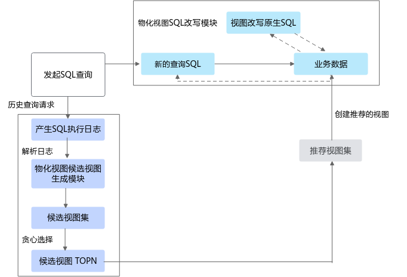

# OmniMV介绍<a name="ZH-CN_TOPIC_0000002521018266"></a>

## 最新消息<a name="ZH-CN_TOPIC_0000002520858274"></a>

- \[2025.03.30\]：发布OmniMV 1.2.0。新增支持Spark 3.4.3版本。
- \[2023.07.11\]：发布OmniMV 1.1.0。支持ClickHouse引擎物化视图智能推荐。 基于ClickHouse引擎，完成候选视图生成、成本评估模型训练和视图选择模型训练。 优化AI算法推荐模块。
- \[2022.12.30\]：发布OmniMV 1.0.0。鲲鹏BoostKit大数据OmniRuntime OmniMV物化视图特性通过AI算法从历史SQL查询中推荐出最优物化视图，并会自动对用户SQL进行物化视图匹配，将匹配成功的物化视图替换到用户SQL的执行计划中，大幅减少重复计算，提升查询性能。


## 项目简介<a name="ZH-CN_TOPIC_0000002552098237"></a>

### 简介<a name="ZH-CN_TOPIC_0000002552058249"></a>

大数据OmniRuntime通过插件化的形式，端到端提升数据加载、数据计算和数据交换的性能，从而提升大数据分析性能。

随着互联网的发展，数据规模出现了爆炸式的增长，需要处理的数据量越来越大，CPU算力的增长远远滞后于数据的增长。大数据开源生态也越来越丰富，但多样化的计算引擎和开源组件也同时带来了全生命周期数据处理性能提升难的问题。不同的大数据引擎采用各自独特的优化策略和技术来提高性能和效率，但有些优化项会在多个引擎中重复应用，可能存在差异或冲突，导致计算性能下降。此外，重复应用相同的优化项可能导致资源竞争和冲突，降低整体计算性能。

大数据OmniRuntime是鲲鹏BoostKit大数据面向应用加速推出的一系列特性，通过插件化的形式，端到端提升数据加载、数据计算和数据交换的性能，从而提升大数据分析的性能。

OmniMV物化视图为OmniRuntime的特性之一。OmniMV物化视图通过AI算法从历史SQL查询中推荐出最优物化视图，并在Spark中自动对用户SQL进行物化视图匹配，将匹配成功的物化视图替换用户执行计划的部分SQL，减少重复计算，提升查询性能。该特性支持用户将SQL任务提交给Spark集群，集群管理节点进行任务分配，分发多个子任务到对应的多个计算节点执行。

已适配的开源组件及版本有：

- Spark 3.1.1
- Spark 3.4.3
- Hive 3.1.0
- ClickHouse 22.3.6.5


### 架构介绍<a name="ZH-CN_TOPIC_0000002552058257"></a>

介绍OmniMV物化视图特性架构。

OmniMV物化视图特性是通过AI算法从历史SQL查询中推荐出最优物化视图，并在Spark中自动对用户SQL进行物化视图匹配，将匹配成功的物化视图替换用户执行计划的部分SQL，减少重复计算，提升查询性能。该特性支持用户将SQL任务提交给Spark集群，集群管理节点进行任务分配，分发多个子任务到对应的多个计算节点执行。

OmniMV物化视图架构如[**图 1** OmniMV物化视图软件架构](#OmniMV物化视图软件架构)所示。

**图 1** OmniMV物化视图软件架构<a name="zh-cn_topic_0000002543922601_fig1354413504399"></a><a id="OmniMV物化视图软件架构"></a><br>


OmniMV物化视图主要包含两大模块：物化视图候选视图生成模块、物化视图SQL改写模块。

- 物化视图候选视图生成模块：生成候选视图。
- 物化视图SQL改写模块：修改SQL的物理执行计划。

OmniMV物化视图的使用流程如下。

1. 收集历史查询日志，例如Yarn logs的日志。
2. <a name="zh-cn_topic_0000002543922601_zh-cn_topic_0000001713099745_li04271433183"></a>从历史日志中解析得到SQL相关的信息，包括SQL文本、SQL执行计划、SQL运行时间等。
3. 从[2](#zh-cn_topic_0000002543922601_zh-cn_topic_0000001713099745_li04271433183)得到的信息中，进行候选视图生成，然后使用贪心选择TOP N的候选视图。

介绍OmniMV物化视图特性架构。
### 应用场景<a name="ZH-CN_TOPIC_0000002520858278"></a>

大数据OmniMV物化视图特性适用于数仓中SQL分析任务中存在较多相同的子查询的场景，对这些子查询重复地进行计算会浪费大量的计算资源，影响查询效率。通过AI算法从历史SQL查询中推荐出最优物化视图，并自动对用户SQL进行物化视图匹配，将匹配成功的物化视图替换到用户SQL的执行计划中，减少重复计算，提升查询性能。


## 约束与限制<a name="ZH-CN_TOPIC_0000002552098247"></a>

针对Spark引擎，OmniMV物化视图不支持重写或者提取OmniMV物化视图的场景规则如[**表 1** Spark SQL引擎不支持重写或提取视图的场景规则](#Spark SQL引擎不支持重写或提取视图的场景规则)所示。

**表 1** Spark SQL引擎不支持重写或提取视图的场景规则<a id="Spark SQL引擎不支持重写或提取视图的场景规则"></a>

|场景|规则|说明|
|--|--|--|
|不支持重写|基本规则|查询需要的数据，视图无法满足，不支持重写。例如：查询：c1>=2，视图：c1>2，不支持重写。IN、LIKE需要查询和视图条件完全匹配，不满足则不支持重写。例如：查询：in(2,3) ，视图： in(1,2,3)，不支持重写。查询SQL中已经使用了视图，不支持重写。|
|不支持重写|Join规则|只支持Inner-Join类型的重写，其他类型的Join在大部分场景下不支持重写。例如Outer-Join类型，只有当查询和视图完全一致时，才可以重写。通过isValidPlan检查当前匹配的查询和视图的逻辑计划树是否满足最小单元的要求，只包含以下类型算子，不满足则不支持重写。LogicalRelationHiveTableRelationProjectFilterJoinSubqueryAlias|
|不支持重写|Aggregate规则|视图逻辑计划树根节点必须是Aggregate算子。像order by、having的根节点是Sort、Filter，这种视图不支持重写。查询和视图逻辑计划树匹配，两边根节点都必须是Aggregate算子，然后会通过isValidPlan检查子树是否满足最小单元的要求，不满足则不支持重写。查询中出现了视图中不存在的聚合函数，不支持重写。查询group by字段是视图group by字段的子集，只支持对以下聚合函数（不带distinct，min/max除外）rollup，不满足则不支持重写。SUMMINMAXCOUNT|
|不支持提取视图|查询逻辑过于单一或者过于复杂|不支持从单表查询中提取物化视图。查询中如果出现了多层嵌套子查询，只支持从最内层子查询中提取视图，而不支持从外层子查询提取物化视图。不支持从含有临时表的子查询中提取物化视图。|


## 目录结构<a name="ZH-CN_TOPIC_0000002521018262"></a>

项目全量目录层级介绍如下：

```
├── docs                                                      # 项目文档目录
│   └── zh                                                   # 中文文档目录
│       ├── figures                                          # 中文文档图片资源目录
│       ├── release_notes.md                                 # OmniMV版本说明书
│       ├── installation_guide.md                            # OmniMV安装指导
│       ├── user_guide.md                                    # OmniMV使用指导
│       ├── faq.md                                           # OmniMV安装使用常见问题
│   └── en                                                   # 中文文档目录
│       ├── figures                                          # 中文文档图片资源目录
│       ├── release_notes.md                                 # OmniMV版本说明书
│       ├── installation_guide.md                            # OmniMV安装指导
│       ├── user_guide.md                                    # OmniMV使用指导
│       ├── faq.md                                           # OmniMV安装使用常见问题
├── omnimv-recommend                                         # OmniMV视图推荐模块
│   ├── config                                               # 配置文件目录
│   ├── src                                                  # 推荐代码目录
│   ├── test                                                 # 单元测试目录
│   ├── build.sh                                             # 编译脚本
│   ├── main.py                                              # 主程序脚本
│   ├── omnimv_logging.py                                    # 日志模块脚本
│   ├── SPARK_README.md                                      # Spark README文件
│   ├── spark_task.py                                        # Spark任务脚本
├── omnimv-spark-extension                                   # OmniMV Spark插件模块
│   ├── dev                                                  # 配置文件目录
│   ├── log-parser                                           # 日志解析代码目录
│   ├── plugin                                               # 插件代码目录
│   ├── shims                                                # 适配不同Spark版本的代码目录
│   ├── ut                                                   # 单元测试目录
│   ├── build.sh                                             # 编译脚本
│   ├── pom.xml                                              # Maven项目配置文件
│   ├── README.md                                            # 项目README文件
│   ├── scalastyle-config.xml                                # Scala代码风格配置文件

```


## 版本说明<a name="ZH-CN_TOPIC_0000002521018268"></a>

每个版本的特性变更详细信息，请参见[版本说明书](./docs/zh/release_notes.md)。


## 环境部署<a name="ZH-CN_TOPIC_0000002552058253"></a>

介绍OmniMV的环境依赖及安装方式，具体请参见[安装指南](./docs/zh/installation_guide.md)。


## 快速入门<a name="ZH-CN_TOPIC_0000002520858280"></a>

无。


## 学习文档<a name="ZH-CN_TOPIC_0000002552058261"></a>

|名称| 路径                                                      |简介|
|--|---------------------------------------------------------|--|
|版本说明书| [版本说明书](./docs/zh/release_notes.md)          |提供OmniMV每个发布版本的基础信息和特性更新信息。|
|安装指南| [安装指南](./docs/zh/installation_guide.md) |提供安装OmniMV的详细指导。|
|使用指南| [使用指南](./docs/zh/user_guide.md)                |提供使用OmniMV的详细指导。|
|常见问题| [常见问题](./docs/zh/faq.md)                              |提供OmniMV安装、使用过程的常见问题和解决方法。|
|视频课程| OmniRuntime特性大揭秘                                        |提供操作视频，帮助开发者在鲲鹏服务器上了解、使能OmniRuntime特性。|
|技术干货| 大数据OmniMV ClickHouse 性能测试指南通过AI算法在Apache Spark上智能推荐高性能物化视图 |提供大数据平台在组件部署、应用加速与性能调优方面的实战经验。|


## 安全声明<a name="ZH-CN_TOPIC_0000002552058251"></a>

### 防病毒软件例行检查<a name="ZH-CN_TOPIC_0000002552098243"></a>

定期开展对集群和Spark组件的防病毒扫描，防病毒例行检查会帮助集群免受病毒、恶意代码、间谍软件以及恶意程序，降低系统瘫痪、信息泄露等风险。建议使用业界主流防病毒软件进行防病毒检查。


### 日志控制<a name="ZH-CN_TOPIC_0000002552098239"></a>

- 检查系统是否可以限制单个日志文件的大小。
- 检查日志空间占满后，是否存在机制进行清理。


### 漏洞修复<a name="ZH-CN_TOPIC_0000002552098241"></a>

为保证生产环境的安全，降低被攻击的风险，请开启防火墙，并定期修复以下漏洞。

- 操作系统漏洞
- JDK漏洞
- Hadoop及Spark漏洞
- ZooKeeper漏洞
- Kerberos漏洞
- OpenSSL漏洞
- 其他相关组件漏洞

    以CVE-2021-37137为例。

    漏洞描述：

    Netty 4.1.17版本存在两个Content-Length的http header可能会发生混淆的风险通告，漏洞编号：CVE-2021-37137。

    本系统使用hdfs-ceph（version 3.2.0）服务作为存算分离的存储对象，它因依赖aws-java-sdk-bundle-1.11.375.jar而涉及该漏洞。建议用户及时更新漏洞补丁进行防护，以免遭受黑客攻击。

    影响范围：

    Netty 4.1.68及以前版本。

    修复建议：

    目前厂商已发布升级补丁以修复漏洞，请参见[Github](https://github.com/netty/netty/security/advisories/GHSA-9vjp-v76f-g363)修复漏洞。


### SSH加固<a name="ZH-CN_TOPIC_0000002521018258"></a>

在部署安装过程中，需要通过SSH连接服务器。由于root用户拥有最高权限，直接使用root用户登录服务器可能会存在安全风险。建议您使用普通用户登录服务器进行安装部署，并建议您通过配置禁止root用户SSH登录的选项，来提升系统安全性。操作步骤：

用户登录系统后检查“/etc/ssh/sshd\_config”配置项“PermitRootLogin“。

- 如果显示no，说明禁止了root用户SSH登录。
- 如果显示yes，说明需要修改PermitRootLogin为no。


### 公网地址声明<a name="ZH-CN_TOPIC_0000002552058259"></a>

**表 1** 公网地址声明<a id="公网地址声明"></a>

<a name="zh-cn_topic_0000002547269015_table5591719574"></a>
<table><tbody><tr id="zh-cn_topic_0000002547269015_row13592819778"><th class="firstcol" valign="top" width="30%" id="mcps1.2.3.1.1"><p id="zh-cn_topic_0000002547269015_p559212199711"><a name="zh-cn_topic_0000002547269015_p559212199711"></a><a name="zh-cn_topic_0000002547269015_p559212199711"></a>开源软件/第三方软件</p>
</th>
<td class="cellrowborder" valign="top" width="70%" headers="mcps1.2.3.1.1 "><p id="zh-cn_topic_0000002547269015_p1259291919710"><a name="zh-cn_topic_0000002547269015_p1259291919710"></a><a name="zh-cn_topic_0000002547269015_p1259291919710"></a>GCC</p>
</td>
</tr>
<tr id="zh-cn_topic_0000002547269015_row959213199719"><th class="firstcol" valign="top" width="30%" id="mcps1.2.3.2.1"><p id="zh-cn_topic_0000002547269015_p25928193714"><a name="zh-cn_topic_0000002547269015_p25928193714"></a><a name="zh-cn_topic_0000002547269015_p25928193714"></a>类型</p>
</th>
<td class="cellrowborder" valign="top" width="70%" headers="mcps1.2.3.2.1 "><p id="zh-cn_topic_0000002547269015_p259214193711"><a name="zh-cn_topic_0000002547269015_p259214193711"></a><a name="zh-cn_topic_0000002547269015_p259214193711"></a>开源软件</p>
</td>
</tr>
<tr id="zh-cn_topic_0000002547269015_row15921819775"><th class="firstcol" valign="top" width="30%" id="mcps1.2.3.3.1"><p id="zh-cn_topic_0000002547269015_p145921119774"><a name="zh-cn_topic_0000002547269015_p145921119774"></a><a name="zh-cn_topic_0000002547269015_p145921119774"></a>公网IP地址/公网URL地址/域名/邮箱地址</p>
</th>
<td class="cellrowborder" valign="top" width="70%" headers="mcps1.2.3.3.1 "><p id="zh-cn_topic_0000002547269015_p8592141918714"><a name="zh-cn_topic_0000002547269015_p8592141918714"></a><a name="zh-cn_topic_0000002547269015_p8592141918714"></a><a href="https://gcc.gnu.org/bugs/" target="_blank" rel="noopener noreferrer">https://gcc.gnu.org/bugs/</a></p>
</td>
</tr>
<tr id="zh-cn_topic_0000002547269015_row559214191971"><th class="firstcol" valign="top" width="30%" id="mcps1.2.3.4.1"><p id="zh-cn_topic_0000002547269015_p1359219191070"><a name="zh-cn_topic_0000002547269015_p1359219191070"></a><a name="zh-cn_topic_0000002547269015_p1359219191070"></a>所在文件类型</p>
</th>
<td class="cellrowborder" valign="top" width="70%" headers="mcps1.2.3.4.1 "><p id="zh-cn_topic_0000002547269015_p1059214191475"><a name="zh-cn_topic_0000002547269015_p1059214191475"></a><a name="zh-cn_topic_0000002547269015_p1059214191475"></a>二进制</p>
</td>
</tr>
<tr id="zh-cn_topic_0000002547269015_row185922197711"><th class="firstcol" valign="top" width="30%" id="mcps1.2.3.5.1"><p id="zh-cn_topic_0000002547269015_p7593619372"><a name="zh-cn_topic_0000002547269015_p7593619372"></a><a name="zh-cn_topic_0000002547269015_p7593619372"></a>文件名</p>
</th>
<td class="cellrowborder" valign="top" width="70%" headers="mcps1.2.3.5.1 "><p id="zh-cn_topic_0000002547269015_p1559317198713"><a name="zh-cn_topic_0000002547269015_p1559317198713"></a><a name="zh-cn_topic_0000002547269015_p1559317198713"></a>libboostkit-omniop-vector-2.0.0-aarch64.so</p>
</td>
</tr>
<tr id="zh-cn_topic_0000002547269015_row0593141917711"><th class="firstcol" valign="top" width="30%" id="mcps1.2.3.6.1"><p id="zh-cn_topic_0000002547269015_p1459319197711"><a name="zh-cn_topic_0000002547269015_p1459319197711"></a><a name="zh-cn_topic_0000002547269015_p1459319197711"></a>用途描述</p>
</th>
<td class="cellrowborder" valign="top" width="70%" headers="mcps1.2.3.6.1 "><p id="zh-cn_topic_0000002547269015_p2059320191370"><a name="zh-cn_topic_0000002547269015_p2059320191370"></a><a name="zh-cn_topic_0000002547269015_p2059320191370"></a>对应的邮箱地址为GCC开源组件官网地址，为编译开源组件时被动引入，产品实际未使用。</p>
</td>
</tr>
<tr id="zh-cn_topic_0000002547269015_row259317197712"><th class="firstcol" valign="top" width="30%" id="mcps1.2.3.7.1"><p id="zh-cn_topic_0000002547269015_p195931919976"><a name="zh-cn_topic_0000002547269015_p195931919976"></a><a name="zh-cn_topic_0000002547269015_p195931919976"></a>软件包</p>
</th>
<td class="cellrowborder" valign="top" width="70%" headers="mcps1.2.3.7.1 "><p id="zh-cn_topic_0000002547269015_p12877016104"><a name="zh-cn_topic_0000002547269015_p12877016104"></a><a name="zh-cn_topic_0000002547269015_p12877016104"></a>BoostKit-omniop_2.0.0.zip</p>
<p id="zh-cn_topic_0000002547269015_p1959311194714"><a name="zh-cn_topic_0000002547269015_p1959311194714"></a><a name="zh-cn_topic_0000002547269015_p1959311194714"></a>boostkit-omniop-operator-2.0.0-aarch64-centos.tar.gz</p>
</td>
</tr>
</tbody>
</table>


## 免责声明<a name="ZH-CN_TOPIC_0000002552058255"></a>

**致OmniMV使用者**

- 本工具仅供调试和开发之用，使用者需自行承担使用风险，并理解以下内容：
    - 数据处理及删除：用户在使用本工具过程中产生的数据属于用户责任范畴。建议用户在使用完毕后及时删除相关数据，以防信息泄露。
    - 数据保密与传播：使用者了解并同意不得将通过本工具产生的数据随意外发或传播。对于由此产生的信息泄露、数据泄露或其他不良后果，本工具及其开发者概不负责。
    - 用户输入安全性：用户需自行保证输入的命令行的安全性，并承担因输入不当而导致的任何安全风险或损失。对于输入命令行不当所导致的问题，本工具及其开发者概不负责。

- 免责声明范围：本免责声明适用于所有使用本工具的个人或实体。使用本工具即表示您同意并接受本声明的内容，并愿意承担因使用该功能而产生的风险和责任，如有异议请停止使用本工具。
- 在使用本工具之前，请**谨慎阅读并理解以上免责声明的内容**。对于使用本工具所产生的任何问题或疑问，请及时联系开发者。

**致数据所有者**

如果您不希望您的模型或数据集等信息在OmniMV中被提及，或希望更新OmniMV中有关的描述，请在GitCode提交issue，我们将根据您的issue要求删除或更新您相关描述。衷心感谢您对OmniMV的理解和贡献。


## License<a name="ZH-CN_TOPIC_0000002552098245"></a>

OmniMV产品的使用许可证，具体请参见[LICENSE](../LICENSE)文件。

OmniMV docs目录下的文档适用CC-BY 4.0许可证，具体请参见[LICENSE](../LICENSE)文件。


## 贡献声明<a name="ZH-CN_TOPIC_0000002520858272"></a>

1. 提交错误报告：如果您在OmniMV中发现了一个不存在安全问题的漏洞，请在OmniMV仓库中的Issues中搜索，以防该漏洞被重复提交，如果找不到漏洞可以创建一个新的Issues。如果发现了一个安全问题请不要将其公开，请参阅安全问题处理方式。提交错误报告时应该包含完整信息。
2. 安全问题处理：本项目中对安全问题处理的形式，请通过邮箱通知项目核心人员确认编辑。
3. 解决现有问题：通过查看仓库的Issues列表可以发现需要处理的问题信息，可以尝试解决其中的某个问题。
4. 如何提出新功能：请使用Issues的Feature标签进行标记，我们会定期处理和确认开发。
5. 开始贡献：
    1. Fork本项目的仓库。
    2. Clone到本地。
    3. 创建开发分支。
    4. 本地测试：提交前请通过所有单元测试，包括新增的测试用例。
    5. 提交代码。
    6. 新建Pull Request。
    7. 代码检视：您需要根据评审意见修改代码，并重新提交更新。此流程可能涉及多轮迭代。
    8. 当您的PR获得足够数量的检视者批准后，Committer会进行最终审核。
    9. 审核和测试通过后，CI会将您的PR合并入到项目的主干分支。


## 法律声明<a name="ZH-CN_TOPIC_0000002521018260"></a>


## 建议与交流<a name="ZH-CN_TOPIC_0000002521018264"></a>

欢迎大家为社区做贡献。如果有任何疑问或建议，请提交[Issues](https://gitcode.com/boostkit/boostkit-bigdata/tree/main/omnimv/omnimv-spark-extension)，我们会尽快回复。感谢您的支持。


## 致谢<a name="ZH-CN_TOPIC_0000002520858276"></a>

OmniMV由华为公司的下列部门联合贡献：

鲲鹏计算BoostKit开发部

感谢来自社区的每一个PR，欢迎贡献OmniMV！


