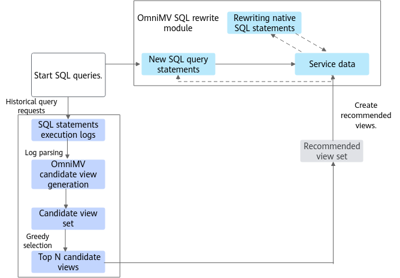

# Introduction to OmniMV<a name="EN-US_TOPIC_0000002521018266"></a>

## What's New<a name="EN-US_TOPIC_0000002520858274"></a>

- \[2025-03-30\]: Released OmniMV 1.2.0. Added support for Spark 3.4.3.
- \[2023-07-11\]: Released OmniMV 1.1.0. Added intelligent recommendation of materialized views on the ClickHouse engine. Added functions such as candidate view generation, cost estimation model training, and view selection model training on the ClickHouse engine. Optimized the AI algorithm recommendation module.
- \[2022-12-30\]: Released OmniMV 1.0.0. The OmniMV feature of Kunpeng BoostKit for Big Data uses AI algorithms to recommend the optimal materialized view from historical SQL queries, automatically matches user SQL statements with a materialized view, and uses the matched materialized view in the SQL execution plan. This feature greatly reduces repeated calculations and increases the query efficiency.


## Introduction to the Project<a name="EN-US_TOPIC_0000002552098237"></a>

### Overview<a name="EN-US_TOPIC_0000002552058249"></a>

The big data features of OmniRuntime are presented in the form of plugins to improve the performance of data loading, computing, and exchange from end to end.

Data volumes generated from Internet services have been growing much faster than CPUs' computing power. The open-source big data ecosystem is also developing on a fast track. However, diversified computing engines and open source components make it difficult to improve data processing performance throughout the lifecycle. Different big data engines use their own unique tuning policies and technologies to improve performance and efficiency. Some tuning items may be applied across multiple engines, which may cause resource contention and conflicts, reducing overall computing performance.

OmniRuntime  consists of a series of features provided by Kunpeng BoostKit for Big Data in terms of application acceleration. It aims to improve the performance of end-to-end data loading, computing, and exchange through plugins, thereby improving the performance of big data analytics.

OmniMV is a subfeature of OmniRuntime. It uses AI algorithms to recommend the optimal materialized view from historical SQL queries, automatically matches SQL statements with a materialized view in Spark, and replaces part of the SQL statements in an execution plan with the matched materialized view. This feature reduces repeated calculations and increases query efficiency. You can submit an SQL task to a Spark cluster. The cluster management node distributes the task to multiple compute nodes as subtasks for execution.

Compatible open source components and versions:

- Spark 3.1.1
- Spark 3.4.3
- Hive 3.1.0
- ClickHouse 22.3.6.5


### Architecture<a name="EN-US_TOPIC_0000002552058257"></a>

This section describes the OmniMV architecture.

OmniMV uses AI algorithms to recommend the optimal materialized view from historical SQL queries, automatically matches SQL statements with a materialized view in Spark, and replaces part of the SQL statements in an execution plan with the matched materialized view. This feature reduces repeated calculations and increases query efficiency. You can submit an SQL task to a Spark cluster. The cluster management node distributes the task to multiple compute nodes as subtasks for execution.

[Figure 1](#en-us_topic_0000002543922601_fig1354413504399)  shows the architecture.

**Figure  1**  Software architecture of OmniMV<a name="en-us_topic_0000002543922601_fig1354413504399"></a>


OmniMV consists of two modules: candidate view generation module and SQL rewrite module.

- Candidate view generation module: generates candidate views.
- SQL rewrite module: modifies the physical execution plan of SQL statements.

Use OmniMV in the following process:

1. Collect historical query logs, such as Yarn logs.
2. <a name="en-us_topic_0000002543922601_en-us_topic_0000001713099745_li04271433183"></a>Parse historical logs to obtain SQL information, including the SQL text, SQL execution plan, and SQL running time.
3. Generate candidate views based on the information obtained in  [2](#en-us_topic_0000002543922601_en-us_topic_0000001713099745_li04271433183), and then use the greedy selection policy to select top N candidate views.

This section describes the OmniMV architecture.
### Application Scenarios<a name="EN-US_TOPIC_0000002520858278"></a>

The OmniMV feature is designed for scenarios where SQL analysis tasks in a data warehouse have many identical subqueries. Repeated calculations on these subqueries waste a large number of computing resources and decrease the query efficiency. This feature uses AI algorithms to recommend the optimal materialized view from historical SQL queries, automatically matches SQL statements with a materialized view, and replaces the SQL statements with the matched materialized view in an execution plan. This feature reduces repeated calculations and increases the query efficiency.


## Constraints<a name="EN-US_TOPIC_0000002552098247"></a>

For Spark,  [Table 1](#en-us_topic_0000002543922575_table1497943022517)  describes the scenarios and rules in which OmniMV does not allow rewriting or extracting materialized views.

**Table  1**  Scenarios and rules on Spark

|Scenario|Rule|Description|
|--|--|--|
|Rewriting is not supported.|Basic rules|When required data is queried, if the view condition does not match the query condition, rewriting is not supported. For example, when the query condition is **c1>=2** and the view condition is **c1>2**, rewriting is not supported.The **IN** and **LIKE** statements require that the query and view conditions be completely matched. If not, rewriting is not supported. For example, when the query condition is **in(2,3)** and the view condition is **in(1,2,3)**, rewriting is not supported.When a view has been used in the SQL query statements, rewriting is not supported.|
|Rewriting is not supported.|Join rules|Only the Inner-Join type supports rewriting. Other Join types does not support rewriting in most scenarios. For example, the Outer-Join type can be rewritten only when the query condition is the same as the view condition.**isValidPlan** is used to check whether the logical plan tree of the currently matched query and view meets the minimum unit requirement, which requires that only the following operators be included. If the requirement is not met, rewriting is not supported.LogicalRelationHiveTableRelationProjectFilterJoinSubqueryAlias|
|Rewriting is not supported.|Aggregate rules|The root node of the logical plan tree in the view must be the Aggregate operator. For example, the root nodes of **order by** and **having** are Sort and Filter respectively, and these views do not support rewriting.The query must match the logical plan tree of the view. The root nodes on both sides must be the Aggregate operator. Then, **isValidPlan** is used to check whether the subtree meets the minimum unit requirement. If the subtree does not meet the requirement, rewriting is not supported.If the query contains aggregate functions that do not exist in the view, rewriting is not supported.The **group by** field in the query is a subset of the **group by** field in the view. Only the following aggregate functions (without **distinct**, except for min and max) can be rolled up. If the condition is not met, rewriting is not supported.SUMMINMAXCOUNT|
|Materialized views cannot be extracted.|The query logic is too simple or complex.|Materialized views cannot be extracted from single-table queries.If multi-layer nested subqueries exist in a query, views can be extracted only from the innermost subqueries, but not from the outer subqueries.Materialized views cannot be extracted from subqueries that contain temporary tables.|


## Directory Structure<a name="EN-US_TOPIC_0000002521018262"></a>

The full project directory structure is as follows:

```
├── docs                                                      # Project document directory
│   └── zh                                                   # English document directory
│       ├── figures                                          # Directory of images in English documents
│       ├── release_notes.md                                 # OmniMV Release Notes
│       ├── installation_guide.md                            # OmniMV Installation Guide
│       ├── user_guide.md                                    # OmniMV User Guide
│       ├── faq.md                                           # OmniMV Installation FAQs
│   └── en                                                   # English document directory
│       ├── figures                                          # Directory of images in English documents
│       ├── release_notes.md                                 # OmniMV Release Notes
│       ├── installation_guide.md                            # OmniMV Installation Guide
│       ├── user_guide.md                                    # OmniMV User Guide
│       ├── faq.md                                           # OmniMV Installation FAQs
├── omnimv-recommend                                         # OmniMV view recommendation module
│   ├── config                                               # Configuration file directory
│   ├── src                                                  # Recommendation code directory
│   ├── test                                                 # Unit test directory
│   ├── build.sh                                             # Compilation script
│   ├── main.py                                              # Main program script
│   ├── omnimv_logging.py                                    # Log module script
│   ├── SPARK_README.md                                      # Spark README file
│   ├── spark_task.py                                        # Spark task script
├── omnimv-spark-extension                                   # OmniMV Spark plugin module
│   ├── dev                                                  # Configuration file directory
│   ├── log-parser                                           # Log parsing code directory
│   ├── plugin                                               # Plugin code directory
│   ├── shims                                                # Code directory for adapting different Spark versions
│   ├── ut                                                   # Unit test directory
│   ├── build.sh                                             # Compilation script
│   ├── pom.xml                                              # Maven project configuration file
│   ├── README.md                                            # Project README file
│   ├── scalastyle-config.xml                                # Scala code style configuration file
```


## Release Notes<a name="EN-US_TOPIC_0000002521018268"></a>

For details about feature changes in each version, see [release_notes.md](./docs/zh/release_notes.md).


## Environment Deployment<a name="EN-US_TOPIC_0000002552058253"></a>

For details about the environment dependencies and installation methods of OmniMV, see [installation_guide.md](./docs/en/installation_guide.md).


## Quick Start<a name="EN-US_TOPIC_0000002520858280"></a>

None.


## Helpful Links<a name="EN-US_TOPIC_0000002552058261"></a>

|Name|Path|Overview|
|--|--|--|
|Release Notes|[Release Notes](./docs/en/release_notes.md)|Provides basic information and feature updates of each OmniMV version.|
|Installation Guide|[Installation Guide](./docs/en/installation_guide.md)|Describes how to install OmniMV.|
|User Guide|[User Guide](./docs/en/user_guide.md)|Provides details about how to use OmniMV.|
|FAQs|[FAQs](./docs/en/faq.md)|Provides answers to frequently asked questions (FAQs) about installing and using OmniMV.|


## Security Statement<a name="EN-US_TOPIC_0000002552058251"></a>

### Routine Antivirus Software Check<a name="EN-US_TOPIC_0000002552098243"></a>

Periodically scan clusters and Spark components for viruses. This protects clusters from viruses, malicious code, spyware, and malicious programs, reducing risks such as system breakdown and information leakage. Mainstream antivirus software can be recommended for antivirus check.


### Log Control<a name="EN-US_TOPIC_0000002552098239"></a>

- Check whether the system can limit the size of a single log file.
- Check whether there is a mechanism for clearing logs when the log space is used up.


### Vulnerability Fixing<a name="EN-US_TOPIC_0000002552098241"></a>

To ensure the security of the production environment and reduce the risk of attacks, enable the firewall and periodically fix the following vulnerabilities:

- OS vulnerabilities
- JDK vulnerabilities
- Hadoop and Spark vulnerabilities
- ZooKeeper vulnerabilities
- Kerberos vulnerabilities
- OpenSSL vulnerabilities
- Vulnerabilities in other components

    The following uses CVE-2021-37137 as an example.

    Vulnerability description:

    Netty 4.1.17 has two Content-Length HTTP headers that may be confused. The vulnerability ID is CVE-2021-37137.

    The system uses the hdfs-ceph \(version 3.2.0\) service as the storage object with decoupled storage and compute. This service depends on  **aws-java-sdk-bundle-1.11.375.jar**  and involves this vulnerability. You are advised to update the vulnerability patch in a timely manner to prevent hacker attacks.

    Impact:

    Netty 4.1.68 and earlier versions

    Handling suggestion:

    Currently, the vendor has released an upgrade patch to fix the vulnerability. For details, visit  [GitHub](https://github.com/netty/netty/security/advisories/GHSA-9vjp-v76f-g363).


### SSH Hardening<a name="EN-US_TOPIC_0000002521018258"></a>

During the installation and deployment, you need to connect to the server through SSH. The  **root**  user has all the operation permissions. Logging in to the server as the  **root**  user may pose security risks. You are advised to log in to the server as a common user for installation and deployment and disable  **root**  user login using SSH to improve system security. 

Check the  **PermitRootLogin**  configuration item in  **/etc/ssh/sshd\_config**.

- If the value is  no,  **root**  user login using SSH is disabled.
- If the value is  yes, change it to  no.


### Public Network Address Statement<a name="EN-US_TOPIC_0000002552058259"></a>

**Table  1**  Public network address statement

<a name="en-us_topic_0000002547269015_table5591719574"></a>
<table><tbody><tr id="en-us_topic_0000002547269015_row13592819778"><th class="firstcol" valign="top" width="30%" id="mcps1.2.3.1.1"><p id="en-us_topic_0000002547269015_p559212199711"><a name="en-us_topic_0000002547269015_p559212199711"></a><a name="en-us_topic_0000002547269015_p559212199711"></a>Open Source/Third-Party Software</p>
</th>
<td class="cellrowborder" valign="top" width="70%" headers="mcps1.2.3.1.1 "><p id="en-us_topic_0000002547269015_p1259291919710"><a name="en-us_topic_0000002547269015_p1259291919710"></a><a name="en-us_topic_0000002547269015_p1259291919710"></a>GCC</p>
</td>
</tr>
<tr id="en-us_topic_0000002547269015_row959213199719"><th class="firstcol" valign="top" width="30%" id="mcps1.2.3.2.1"><p id="en-us_topic_0000002547269015_p25928193714"><a name="en-us_topic_0000002547269015_p25928193714"></a><a name="en-us_topic_0000002547269015_p25928193714"></a>Type</p>
</th>
<td class="cellrowborder" valign="top" width="70%" headers="mcps1.2.3.2.1 "><p id="en-us_topic_0000002547269015_p259214193711"><a name="en-us_topic_0000002547269015_p259214193711"></a><a name="en-us_topic_0000002547269015_p259214193711"></a>Open source software</p>
</td>
</tr>
<tr id="en-us_topic_0000002547269015_row15921819775"><th class="firstcol" valign="top" width="30%" id="mcps1.2.3.3.1"><p id="en-us_topic_0000002547269015_p145921119774"><a name="en-us_topic_0000002547269015_p145921119774"></a><a name="en-us_topic_0000002547269015_p145921119774"></a>Public IP Address/Public URL/Domain Name/Email Address</p>
</th>
<td class="cellrowborder" valign="top" width="70%" headers="mcps1.2.3.3.1 "><p id="en-us_topic_0000002547269015_p8592141918714"><a name="en-us_topic_0000002547269015_p8592141918714"></a><a name="en-us_topic_0000002547269015_p8592141918714"></a><a href="https://gcc.gnu.org/bugs/" target="_blank" rel="noopener noreferrer">https://gcc.gnu.org/bugs/</a></p>
</td>
</tr>
<tr id="en-us_topic_0000002547269015_row559214191971"><th class="firstcol" valign="top" width="30%" id="mcps1.2.3.4.1"><p id="en-us_topic_0000002547269015_p1359219191070"><a name="en-us_topic_0000002547269015_p1359219191070"></a><a name="en-us_topic_0000002547269015_p1359219191070"></a>File Type</p>
</th>
<td class="cellrowborder" valign="top" width="70%" headers="mcps1.2.3.4.1 "><p id="en-us_topic_0000002547269015_p1059214191475"><a name="en-us_topic_0000002547269015_p1059214191475"></a><a name="en-us_topic_0000002547269015_p1059214191475"></a>Binary</p>
</td>
</tr>
<tr id="en-us_topic_0000002547269015_row185922197711"><th class="firstcol" valign="top" width="30%" id="mcps1.2.3.5.1"><p id="en-us_topic_0000002547269015_p7593619372"><a name="en-us_topic_0000002547269015_p7593619372"></a><a name="en-us_topic_0000002547269015_p7593619372"></a>File Name</p>
</th>
<td class="cellrowborder" valign="top" width="70%" headers="mcps1.2.3.5.1 "><p id="en-us_topic_0000002547269015_p1559317198713"><a name="en-us_topic_0000002547269015_p1559317198713"></a><a name="en-us_topic_0000002547269015_p1559317198713"></a>libboostkit-omniop-vector-2.0.0-aarch64.so</p>
</td>
</tr>
<tr id="en-us_topic_0000002547269015_row0593141917711"><th class="firstcol" valign="top" width="30%" id="mcps1.2.3.6.1"><p id="en-us_topic_0000002547269015_p1459319197711"><a name="en-us_topic_0000002547269015_p1459319197711"></a><a name="en-us_topic_0000002547269015_p1459319197711"></a>Usage</p>
</th>
<td class="cellrowborder" valign="top" width="70%" headers="mcps1.2.3.6.1 "><p id="en-us_topic_0000002547269015_p2059320191370"><a name="en-us_topic_0000002547269015_p2059320191370"></a><a name="en-us_topic_0000002547269015_p2059320191370"></a>This email address is the official address of the open source component GCC, and is used only to compile the open source component. This email address is not used inside this product.</p>
</td>
</tr>
<tr id="en-us_topic_0000002547269015_row259317197712"><th class="firstcol" valign="top" width="30%" id="mcps1.2.3.7.1"><p id="en-us_topic_0000002547269015_p195931919976"><a name="en-us_topic_0000002547269015_p195931919976"></a><a name="en-us_topic_0000002547269015_p195931919976"></a>Software Package</p>
</th>
<td class="cellrowborder" valign="top" width="70%" headers="mcps1.2.3.7.1 "><p id="en-us_topic_0000002547269015_p12877016104"><a name="en-us_topic_0000002547269015_p12877016104"></a><a name="en-us_topic_0000002547269015_p12877016104"></a>BoostKit-omniop_2.0.0.zip</p>
<p id="en-us_topic_0000002547269015_p1959311194714"><a name="en-us_topic_0000002547269015_p1959311194714"></a><a name="en-us_topic_0000002547269015_p1959311194714"></a>boostkit-omniop-operator-2.0.0-aarch64-centos.tar.gz</p>
</td>
</tr>
</tbody>
</table>


## Disclaimer<a name="EN-US_TOPIC_0000002552058255"></a>

**To OmniMV users**

- This tool is intended solely for debugging and development. You are responsible for any risks and should carefully review the following information:
    - Data processing and deletion: Users are responsible for managing and deleting any data generated while using this tool. You are advised to promptly delete any related data after use to prevent information leaks.
    - Data confidentiality and transmission: Users understand and agree not to share or transmit any data generated by this tool. Neither the tool nor its developers are responsible for any information leaks, data breaches, or other negative consequences.
    - User input security: Users are responsible for the security of any commands they enter and for any risks or losses resulting from improper input. The tool and its developers are not liable for issues caused by incorrect command usage.

- Disclaimer scope: This disclaimer applies to all individuals and entities using this tool. By using the tool, you acknowledge and accept this statement and assume all risks and responsibilities arising from its use. If you do not agree, please stop using the tool immediately.
- Before using this tool,  **please read and understand the preceding disclaimer**. If you have any questions, contact the developer.

**To data owners**

If you do not want your model or dataset to be mentioned in OmniMV, or if you wish to update its description, please submit an issue on GitCode. We will delete or update your description according to your request. Thank you for your understanding and contribution to OmniMV.


## License<a name="EN-US_TOPIC_0000002552098245"></a>

For the OmniMV product license, see the [LICENSE](../LICENSE) file for details.

The documents in the docs directory of OmniMV are licensed under CC-BY 4.0. See the [LICENSE](../LICENSE) file for details.


## Contribution Statement<a name="EN-US_TOPIC_0000002520858272"></a>

1. Submit an error report: If you discover a vulnerability in OmniMV that is not a security issue, first search the Issues in the OmniMV repository to avoid submitting duplicates. If the vulnerability is not listed, create a new issue. If you discover a security-related problem, do not disclose it publicly. Please refer to the security handling guidelines for details. All error reports must include complete information about the issue.
2. Security issue handling: For guidance on handling security issues in this project, please contact the core team via email for instructions.
3. Resolving existing issues: Review the repository's issue list to identify issues that need attention, and attempt to resolve them.
4. How to propose new functions: Use the  **Feature**  tag when creating an issue for a new function. We will review and confirm proposals periodically.
5. How to contribute:
    1. Fork the repository of the project.
    2. Clone it to your local machine.
    3. Create a development branch.
    4. Local testing: All unit tests, including any new test cases, must pass before submission.
    5. Commit your code.
    6. Create a pull request \(PR\).
    7. Code review: Modify the code according to review comments and resubmit your changes. This process may involve multiple rounds of iterations.
    8. After your PR is approved by the required number of reviewers, the committer will conduct the final review.
    9. After your PR is approved and all tests pass, the CI system will merge it into the project's main branch.


## Legal Statement<a name="EN-US_TOPIC_0000002521018260"></a>


## Suggestions and Feedback<a name="EN-US_TOPIC_0000002521018264"></a>

You are welcome to contribute to the community. If you have any questions or suggestions, please submit an  [issue](https://gitcode.com/boostkit/boostkit-bigdata/tree/main/omnimv/omnimv-spark-extension). We will respond as soon as possible. Thank you for your support.


## Acknowledgments<a name="EN-US_TOPIC_0000002520858276"></a>

OmniMV is jointly developed by the following Huawei departments:

Kunpeng Computing BoostKit Development Dept

Thank you to everyone in the community for your PRs. We warmly welcome contributions to OmniMV!


