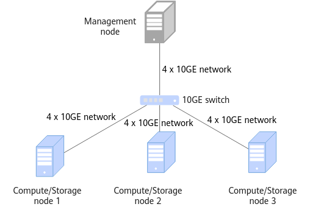

# Installation Guide<a name="EN-US_TOPIC_0000002551410827"></a>

## Installation Overview<a name="EN-US_TOPIC_0000002519970740"></a>

### Network Planning<a name="EN-US_TOPIC_0000002551410855"></a>

You are advised to use a storage and compute coupled network, that is, use nodes as both storage and compute nodes.

The environment planned in this document for OmniMV consists of four servers, which are one management node and three compute nodes. A storage and compute coupled network is used. In the following, we will be using HDFS on the storage nodes for illustration:

- The management node is server1, which is used to manage tasks.
- The compute nodes are agent1, agent2, and agent3, which are used to run OmniMV query engine services and store datasets.

A server can function as a management node and a compute node at the same time. In single-node mode, operations performed on the management node or compute node mentioned in the following sections are performed on the same node.  [Figure 1](#networking-diagram)  shows the networking diagram.

**Figure  1**  Networking diagram<a id="networking-diagram"></a>  


### Environment Requirements<a name="EN-US_TOPIC_0000002551410733"></a>

Before installing OmniMV, prepare the hardware and software environments to facilitate subsequent installation operations.

**Hardware Requirements<a name="en-us_topic_0000001665139878_section197116445713"></a>**

[Table 1](#hardware_requirements)  lists the hardware requirements for each node in the cluster.

**Table  1**  Hardware requirements<a id="hardware_requirements"></a>

|Item|Management/Compute/Storage Node|
|--|--|
|Processor|Kunpeng 920 5250 processor/New Kunpeng 920 processor model|
|Memory size|384 GB (12 x 32 GB)|
|Memory frequency|2666 MHz|
|Network|Service network: 10GE <br>Management network: 1GE|
|Drive|System drive: 1 x RAID 0 (1 x 1.2 TB SAS HDD) <br>Data drive: 12 x RAID 0 (12 x 8 TB SATA HDD)|
|RAID controller card|LSI SAS3508|


**OS and Software Requirements<a name="en-us_topic_0000001665139878_section112781416185717"></a>**

[Table 2](#os_software_requirements)  lists the OS and software requirements for each node in the cluster.

**Table  2**  OS and software requirements<a id="os_software_requirements"></a>

|Item|Version|Description|Management Node (Server)|Compute/Storage Node|
|--|--|--|--|--|
|OS|openEuler 22.03 LTS SP1|None|√|√|
|JDK|[BiSheng JDK 1.8.0_342](https://mirror.iscas.ac.cn/kunpeng/archive/compiler/bisheng_jdk/bisheng-jdk-8u342-linux-aarch64.tar.gz)|For details about how to install the BiSheng JDK, see [BiSheng JDK 8 Installation Guide](https://gitee.com/openeuler/bishengjdk-8/wikis/English%20Documentation/BiSheng%20JDK%208%20Installation%20Guide#installation-guide).|√|√|
|Hadoop|3.2.0|See [Hadoop Deployment Guide (CentOS 7.6 & openEuler 20.03)](https://www.hikunpeng.com/document/detail/en/kunpengbds/ecosystemEnable/Hadoop/kunpenghadoop_04_0001.html).|√|√|
|Spark|3.1.1/3.4.3|See [Spark Deployment Guide (CentOS 7.6 & openEuler 20.03)](https://www.hikunpeng.com/document/detail/en/kunpengbds/ecosystemEnable/Spark/kunpengspark_04_0001.html).|√|-|
|ZooKeeper|3.6.2 or later|See [ZooKeeper Deployment Guide (CentOS 7.6 & openEuler 20.03)](https://www.hikunpeng.com/document/detail/en/kunpengbds/ecosystemEnable/ZooKeeper/kunpengzookeeper_04_0001.html).|-|√|
|Python|3.10.2 or later|None|√|√|


> **NOTE:** 
>-   √: indicates that the item is required on the node.
>-   -: indicates that the item is not required on the node.
>-   If the preceding third-party software has vulnerabilities, fix the vulnerabilities based on official instructions.
>-   The preceding component versions may be different from those in the  _Deployment Guide_. The  _Deployment Guide_  is for reference only.

**Obtaining Software<a name="en-us_topic_0000001665139878_section73341541215"></a>**

[Table 3](#software) describes the OmniMV software packages and how to obtain them.

**Table  3**  Software required for OmniMV<a id="software"></a>

<table border="1" cellpadding="6" cellspacing="0">
  <thead>
    <tr>
      <th>Software Name</th>
      <th>Package Name</th>
      <th>Release Type</th>
      <th>Description</th>
      <th>Download URL</th>
    </tr>
  </thead>
  <tbody>
    <tr>
      <td>OmniMV software installation package</td>
      <td>BoostKit-omnimv_1.2.0.zip</td>
      <td>Open source</td>
      <td>-</td>
      <td><a href="https://gitcode.com/boostkit/boostkit-bigdata/releases/download/25.0.RC1-OmniMV-release/BoostKit-omnimv_1.2.0.zip" target="_blank">Link</a></td>
    </tr>
    <tr>
      <td rowspan="2">OmniMV plugin JAR package</td>
      <td>boostkit-omnimv-spark-3.1.1-1.2.0-aarch64.jar</td>
      <td>Open source</td>
      <td>Spark extension package for using the OmniMV feature.</td>
      <td><a href="https://gitcode.com/boostkit/boostkit-bigdata/releases/download/25.0.RC1-OmniMV-release/boostkit-omnimv-spark-3.1.1-1.2.0-aarch64.jar" target="_blank">Link</a></td>
    </tr>
    <tr>      
      <td>boostkit-omnimv-spark-3.4.3-1.2.0-aarch64.jar</td>
      <td>Open source</td>
      <td>Spark extension package for using the OmniMV feature.</td>
      <td><a href="https://gitcode.com/boostkit/boostkit-bigdata/releases/download/25.0.RC1-OmniMV-release/boostkit-omnimv-spark-3.4.3-1.2.0-aarch64.jar" target="_blank">Link</a></td>
    </tr>
    <tr>
      <td rowspan="2">OmniMV log parser JAR package</td>
      <td>boostkit-omnimv-logparser-spark-3.1.1-1.2.0-aarch64.jar</td>
      <td>Open source</td>
      <td>Function package for OmniMV to parse Spark logs.</td>
      <td><a href="https://gitcode.com/boostkit/boostkit-bigdata/releases/download/25.0.RC1-OmniMV-release/boostkit-omnimv-logparser-spark-3.1.1-1.2.0-aarch64.jar" target="_blank">Link</a></td>
    </tr>
    <tr>      
      <td>boostkit-omnimv-logparser-spark-3.4.3-1.2.0-aarch64.jar</td>
      <td>Open source</td>
      <td>Function package for OmniMV to parse Spark logs.</td>
      <td><a href="https://gitcode.com/boostkit/boostkit-bigdata/releases/download/25.0.RC1-OmniMV-release/boostkit-omnimv-logparser-spark-3.4.3-1.2.0-aarch64.jar" target="_blank">Link</a></td>
    </tr>
    <tr>
      <td>hive-testbench</td>
      <td>hive-testbench-hdp3.zip</td>
      <td>Open source</td>
      <td>TestBench source package used for generating TPC-DS/TPC-H data.</td>
      <td><a href="https://github.com/hortonworks/hive-testbench/archive/refs/heads/hdp3.zip" target="_blank">Link</a></td>
    </tr>
  </tbody>
</table>


**Verifying the Software Package Integrity<a name="en-us_topic_0000001665139878_section16501429204018"></a>**

After downloading a software package from the Kunpeng community, verify the software package to ensure that it is consistent with the original one on the website.

Verify a software package as follows:

1. Obtain the digital certificate and software.
2. Obtain the  [verification tool and guide](https://support.huawei.com/enterprise/en/tool/pgp-verify-TL1000000054).
3. Verify the package integrity by following the procedure described in the  _OpenPGP Signature Verification Guide_  obtained from the URL.


## Installing the Feature<a name="EN-US_TOPIC_0000002551130865"></a>

### Installation Node Requirements<a name="EN-US_TOPIC_0000002551130815"></a>

Check that the configuration of each node meets the OmniMV installation requirements. Before compiling the source code, install GCC/G++, make, CMake, and glibc on each node and ensure that they meet the version requirements. Before installing OmniMV, prepare the cluster environment and those components required for installing the Spark engine based on the OS and software requirements.

- Before using the source code for compilation, install GCC/G++, Make, CMake, and glibc on each node. The version requirements are listed in  [Table 1](#table_1).

    **Table  1**  Software required for source code compilation<a id="table_1"></a>

|Software Name|Software Version|
|--|--|
|GCC/G++|7.3.0|
|make|4.2.1 or later|
|CMake|3.13.4 or later|
|glibc|2.25 or later|


- Before installing OmniMV, install related components in the cluster environment based on  [Table 2](#Table_2)  lists the components required by the Spark engine.

    **Table  2**  Required components<a id="Table_2"></a>

|Engine Using OmniMV|Required Components|
|--|--|
|Spark|OS, JDK, Hadoop, Spark, Hive, and HDFS|


    > **NOTE:** 
    >You can select a cluster mode based on the application scenario requirements. The secure mode \(Kerberos\) is recommended if the storage mode is HDFS.


### Installing OmniMV<a name="EN-US_TOPIC_0000002551410763"></a>

To install OmniMV on openEuler 22.03, install Conda and create an OmniMV virtual environment. Then use  **pip**  to download the Python dependency library, including the dependency packages of the Spark engine. After that, download and extract the OmniMV recommendation algorithm software package, and remove other user groups' read and execute permissions.

1. Download the Conda software package and activate the Conda virtual environment.
    1. Download Conda.

        ```
        cd /opt
        wget -k https://repo.anaconda.com/archive/Anaconda3-2022.05-Linux-aarch64.sh
        ```

    2. Install Conda, for example, in the  **/opt/anaconda3**  directory.

        ```
        bash Anaconda3-2022.05-Linux-aarch64.sh
        ```

    3. Initialize Conda.

        ```
        source /opt/anaconda3/etc/profile.d/conda.sh
        ```

    4. Create a Conda virtual environment named  **omnimv**.

        ```
        conda create -n omnimv python=3.11
        ```

    5. Activate the Conda virtual environment.

        ```
        conda activate omnimv
        ```

2. Use pip to download the Python dependencies.
    - Spark 3.1.1 dependency packages

        ```
        pip install Cython==0.29.24
        pip install pandas==1.3.5
        pip install PyYAML==6.0
        pip install mo-sql-parsing
        pip install sql-metadata==2.6.0
        pip install scikit-learn==1.5.2
        pip install xgboost==1.7.3
        pip install pyspark==3.1.1
        pip install pydoop==2.0.0
        pip install numpy==1.23.3
        ```

    - Spark 3.4.3 dependency packages

        ```
        pip install Cython==0.29.24
        pip install pandas==1.3.5
        pip install PyYAML==6.0
        pip install mo-sql-parsing
        pip install sql-metadata==2.6.0
        pip install scikit-learn==1.5.2
        pip install xgboost==1.7.3
        pip install pyspark==3.4.3
        pip install pydoop==2.0.0
        pip install numpy==1.23.3
        ```

3. Download the OmniMV recommendation algorithm software package.

    Spark engine: Download the OmniMV recommendation algorithm software package, and save the JAR package of the Spark SQL plugin and log parser JAR package to the server node of the Spark cluster. For details about how to obtain the software packages, see [Table 3](#software). There is no special requirement on the software package paths. For example, you can save them in  **/opt/omnimv**.

    - Spark 3.1.1

        ```
        mkdir -p /opt/omnimv
        mv boostkit-omnimv-spark-3.1.1-1.2.0-aarch64.jar /opt/omnimv
        mv boostkit-omnimv-logparser-spark-3.1.1-1.2.0-aarch64.jar /opt/omnimv
        mv BoostKit-omnimv_1.2.0.zip /opt/omnimv
        ```

    - Spark 3.4.3

        ```
        mkdir -p /opt/omnimv
        mv boostkit-omnimv-spark-3.4.3-1.2.0-aarch64.jar /opt/omnimv
        mv boostkit-omnimv-logparser-spark-3.4.3-1.2.0-aarch64.jar /opt/omnimv
        mv BoostKit-omnimv_1.2.0.zip /opt/omnimv
        ```

4. Extract the OmniMV component package and remove the read and execute permissions of other user groups on the generated folder.

    ```
    cd /opt/omnimv
    unzip BoostKit-omnimv_1.2.0.zip
    chmod -R o-r BoostKit-omnimv_1.2.0
    ```

    > **NOTE:** 
    >You are advised to extract the package as a non-root user so that the generated directory has the minimum permission to prevent files from being replaced.


