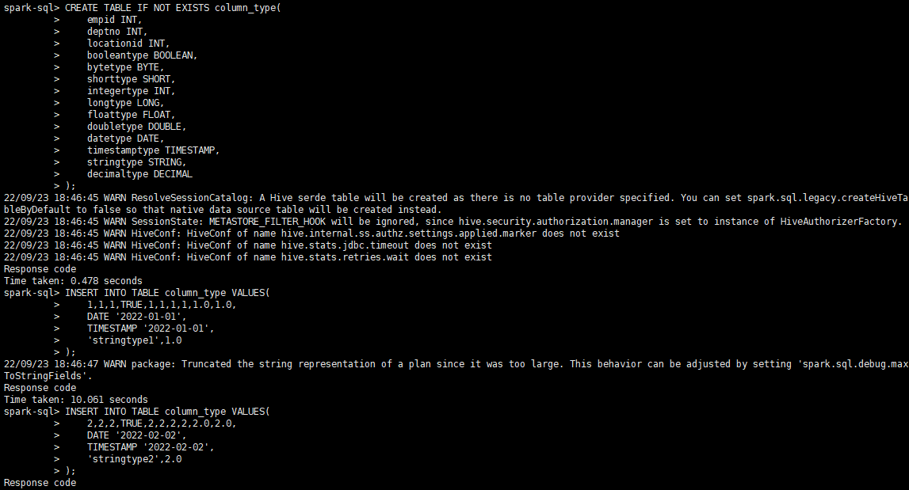
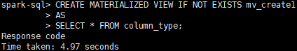
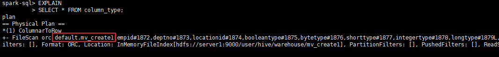

# User Guide<a name="EN-US_TOPIC_0000002520361124"></a>

## Using Spark to Execute SQL Statements<a name="EN-US_TOPIC_0000002520361118"></a>

You can use the OmniMV Spark engine to execute SQL statements in either of the two methods. After the SQL statements are executed, the physical SQL execution plan is rewritten.

**Prerequisites<a name="en-us_topic_0000001664980174_section2080521443512"></a>**

Install OmniMV by following instructions in  [Installation Guide]((./docs/en/installation_guide.md))  and deploy Spark by following instructions in  [Spark Deployment Guide](https://www.hikunpeng.com/document/detail/en/kunpengbds/ecosystemEnable/Spark/kunpengspark_04_0001.html).

**Methods<a name="en-us_topic_0000001664980174_en-us_topic_0000001518847449_section18710143819163"></a>**

You can use the OmniMV Spark engine to execute SQL statements in either of the following ways. After the SQL statements are executed, the execution plan is automatically rewritten.

- <a name="en-us_topic_0000001518847449_li4881163716166"></a>Method 1: Log in to the spark-sql client and manually run SQL statements.
    1. Log in to the client.
        - Spark 3.1.1

            ```
            spark-sql \
            --deploy-mode client \
            --driver-cores 5 \
            --driver-memory 5g \
            --num-executors 18 \
            --executor-cores 21 \
            --executor-memory 55g \
            --master yarn \
            --database Database_name \
            --name Task_name \
            --jars /opt/omnimv/boostkit-omnimv-spark-3.1.1-1.2.0-aarch64.jar \
            --conf 'spark.sql.extensions=com.huawei.boostkit.spark.OmniMV' \
            --conf spark.sql.omnimv.metadata.path=/omnimv/plugin_metadata \
            ```

        - Spark 3.4.3

            ```
            spark-sql \
            --deploy-mode client \
            --driver-cores 5 \
            --driver-memory 5g \
            --num-executors 18 \
            --executor-cores 21 \
            --executor-memory 55g \
            --master yarn \
            --database Database_name \
            --name Task_name \
            --jars /opt/omnimv/boostkit-omnimv-spark-3.4.3-1.2.0-aarch64.jar \
            --conf 'spark.sql.extensions=com.huawei.boostkit.spark.OmniMV' \
            --conf spark.sql.omnimv.metadata.path=/omnimv/plugin_metadata \
            ```

    2. Adjust the Spark parameters based on the cluster configuration.
    3. Manually execute the SQL statements.

- Method 2: Use a script to execute SQL statements in a batch.

    Adjust the Spark parameters based on the cluster configuration. The  **-f**  parameter is used to invoke the SQL file. You can customize a script to execute SQL statements in a batch by referring to the example. For example:

    - Spark 3.1.1

        ```
        spark-sql \
        --deploy-mode client \
        --driver-cores 5 \
        --driver-memory 5g \
        --num-executors 18 \
        --executor-cores 21 \
        --executor-memory 55g \
        --master yarn \
        --database Database_name \
        --name Task_name \
        --jars /opt/omnimv/boostkit-omnimv-spark-3.1.1-1.2.0-aarch64.jar \
        --conf 'spark.sql.extensions=com.huawei.boostkit.spark.OmniMV' \
        --conf spark.sql.omnimv.metadata.path=/omnimv/plugin_metadata \
        -f SQL_file_path
        ```

    - Spark 3.4.3

        ```
        spark-sql \
        --deploy-mode client \
        --driver-cores 5 \
        --driver-memory 5g \
        --num-executors 18 \
        --executor-cores 21 \
        --executor-memory 55g \
        --master yarn \
        --database Database_name \
        --name Task_name \
        --jars /opt/omnimv/boostkit-omnimv-spark-3.4.3-1.2.0-aarch64.jar \
        --conf 'spark.sql.extensions=com.huawei.boostkit.spark.OmniMV' \
        --conf spark.sql.omnimv.metadata.path=/omnimv/plugin_metadata \
        -f SQL_file_path
        ```

**Syntax Supported by Spark for OmniMV<a name="en-us_topic_0000001664980174_en-us_topic_0000001518847449_section10546184118151"></a>**

**Table  1**  Syntax Supported by Spark for OmniMV

|Operation|Syntax|
|--|--|
|Create MV (creating a materialized view)|CREATE MATERIALIZED VIEW [IF NOT EXISTS] [db_name.]mv_name[DISABLE REWRITE][COMMENT 'mv_comment'][PARTITIONED BY (col_name, ...)]AS<query>;|
|Drop MV (deleting a materialized view)|DROP MATERIALIZED VIEW [IF EXISTS] [db_name.]mv_name;|
|Show MVS (enumerating materialized views)|SHOW MATERIALIZED VIEWS [ON [db_name.]mv_name];|
|Alter MV rewrite (specifying whether to enable rewriting)|ALTER MATERIALIZED VIEW [db_name.]mv_name ENABLE|DISABLE REWRITE;|
|Refresh MV (refreshing a materialized view)|REFRESH MATERIALIZED VIEW [db_name.]mv_name;|
|WASH OUT MATERIALIZED VIEW (eliminating a materialized view)**--ALL**: eliminates all views.**--UNUSED_DAYS**: eliminates views that have not been used for *${UNUSED_DAYS}* days. This is the default policy.**--RESERVE_QUANTITY_BY_VIEW_COUNT**: reserves top *${RESERVE_QUANTITY_BY_VIEW_COUNT}* frequently used views.**--DROP_QUANTITY_BY_SPACE_CONSUMED**: eliminates top *${DROP_QUANTITY_BY_SPACE_CONSUMED}* views that occupy the most memory space.|WASH OUT [ALL] MATERIALIZED VIEW [USING[UNUSED_DAYS,][RESERVE_QUANTITY_BY_VIEW_COUNT,][DROP_QUANTITY_BY_SPACE_CONSUMED]]|


**Spark Startup Parameters of OmniMV<a name="section1817324859"></a>**

**Table  2**  Spark Startup Parameters of OmniMV

|Parameter|Default Value|Description|
|--|--|--|
|spark.sql.omnimv.enable|true|Indicates whether to enable rewrite in OmniMV.**true**: yes**false**: no|
|spark.sql.omnimv.show.length|50|Maximum characters of the materialized view information printed by the **show materialized views** command.|
|spark.sql.omnimv.default.datasource|orc|Storage format of materialized views. The options are **orc** and **parquet**.|
|spark.sql.omnimv.logLevel|DEBUG|Log level for materialized views. The options are **DEBUG**, **INFO**, **WARN**, and **ERROR**.|
|spark.sql.omnimv.log.enable|true|Indicates whether to export parsed SQL statements to event logs.**true**: yes**false**: no|
|spark.sql.omnimv.metadata.path|/omnimv/plugin_metadata|HDFS path of materialized view metadata.|
|spark.sql.omnimv.metadata.initbyquery.enable|false|Indicates whether to load only the materialized view metadata related to the table used by a query SQL statement. This parameter can be used to accelerate the loading.**true**: loads only the materialized view metadata related to the table used by a query SQL statement.**false**: loads all the materialized view metadata.|
|spark.sql.omnimv.dbs|No default value. Set it based on your requirements.|Indicates whether to load only the materialized view metadata in specified databases. This parameter can be used to accelerate the loading. This parameter can be set to **omnimv**, **omnimv1**, or another desired value.|
|spark.sql.omnimv.washout.automatic.enable|false|Indicates whether to enable automatic elimination of historical materialized views. The default policy is **UNUSED_DAYS**.**true**: yes**false**: no|
|spark.sql.omnimv.washout.unused.day|30|**UNUSED_DAYS** policy (default). It eliminates materialized views that have not been used in the past 30 days.|
|spark.sql.omnimv.washout.reserve.quantity.byViewCnt|25|**RESERVE_QUANTITY_BY_VIEW_COUNT** policy. It retains only the top 25 views after sorting the materialized views by usage frequency in descending order, and eliminates the others.|
|spark.sql.omnimv.washout.drop.quantity.bySpaceConsumed|3|**DROP_QUANTITY_BY_SPACE_CONSUMED** policy. It eliminates the top 3 views after sorting the materialized views by used storage space in descending order.|
|spark.sql.omnimv.washout.automatic.time.interval|35|Number of days between two adjacent automatic eliminations of materialized views.|
|spark.sql.omnimv.washout.automatic.checkTime.interval|3600|Interval for automatic eliminations within a session, in seconds.|
|spark.sql.omnimv.washout.automatic.view.quantity|20|Minimum number of views that trigger an automatic elimination.|
|spark.sql.omnimv.detect-rewrite-sqls.enable|false|Indicates whether to accelerate metadata loading only for rewritable SQL statements of materialized views. This can reduce the performance deterioration caused by the time-consuming metadata loading of SQL statements that do not take effect.**true**: enables acceleration of metadata loading only for rewritable SQL statements of materialized views.**false**: enables acceleration of metadata loading for all SQL statements.|


**Kryo Parameters of OmniMV<a name="section2231112814185"></a>**

When OmniMV uses Kryo to serialize materialized view metadata, the user's configuration may be incompatible with OmniMV. Therefore, a fixed configuration is used to avoid affecting Spark functions.

**Table  3**  Kryo parameters of OmniMV

|Parameter Name|Fixed Value|Description|
|--|--|--|
|spark.kryo.unsafe|false|Does not use the **unsafe** mode of Kryo.|
|spark.kryo.registrationRequired|false|It is not required to register all classes that need to be serialized with Kryo.|
|spark.kryo.registrator|""|Does not specify a custom Kryo registrar class.|
|spark.kryo.classesToRegister|""|Does not specify the list of classes to be registered.|
|spark.kryo.pool|true|Enables the Kryo instance pool.|
|spark.kryo.referenceTracking|true|Enables reference tracking.|
|spark.kryoserializer.buffer|64k|Sets the initial size of the Kryo serialization buffer.|
|spark.kryoserializer.buffer.max|64m|Sets the maximum size of the Kryo serialization buffer.|


**Checking Whether the OmniMV Spark Engine Is Successfully Loaded<a name="section214462292214"></a>**

1. Log in to the Spark SQL client and manually execute SQL statements \([Method 1](#en-us_topic_0000001518847449_li4881163716166)\).
2. Run the command of showing views. If the following information is displayed, the plugin is successfully loaded.

    ```
    SHOW MATERIALIZED VIEWS;
    ```

    

3. Create a sample base table and a sample view.

    ```
    CREATE TABLE IF NOT EXISTS column_type(
        empid INT,
        deptno INT,
        locationid INT,
        booleantype BOOLEAN,
        bytetype BYTE,
        shorttype SHORT,
        integertype INT,
        longtype LONG,
        floattype FLOAT,
        doubletype DOUBLE,
        datetype DATE,
        timestamptype TIMESTAMP,
        stringtype STRING,
        decimaltype DECIMAL
    );
    INSERT INTO TABLE column_type VALUES(
        1,1,1,TRUE,1,1,1,1,1.0,1.0,
        DATE '2022-01-01',
        TIMESTAMP '2022-01-01',
        'stringtype1',1.0
    );
    INSERT INTO TABLE column_type VALUES(
        2,2,2,TRUE,2,2,2,2,2.0,2.0,
        DATE '2022-02-02',
        TIMESTAMP '2022-02-02',
        'stringtype2',2.0
    );
    ```

    

4. Create a materialized view.

    ```
    CREATE MATERIALIZED VIEW IF NOT EXISTS mv_create1
    AS
    SELECT * FROM column_type;
    ```

    

5. Use the EXPLAIN statement to check whether the execution plan of the query is rewritten.

    ```
    EXPLAIN
    SELECT * FROM column_type;
    ```

    

## Recommended Views<a name="EN-US_TOPIC_0000002520361126"></a>

You can provide data tables as required and use OmniMV to obtain the recommended view set.

In this example, the TPC-DS data table is used as the test table.

1. Modify the configuration file.

    1. Open the  **config/omnimv\_config\_spark.cfg**  file.

        ```
        cd /opt/omnimv/BoostKit-omnimv_1.2.0
        vi config/omnimv_config_spark.cfg
        ```

    2. Press  **i**  to enter the insert mode and modify the file as follows:
        - Spark 3.1.1

            ```
            database = tpcds_bin_partitioned_varchar_orc_3000
            logparser_jar_path = /opt/omnimv/boostkit-omnimv-logparser-spark-3.1.1-1.2.0-aarch64.jar
            cache_plugin_jar_path = /opt/omnimv/boostkit-omnimv-spark-3.1.1-1.2.0-aarch64.jar
            hdfs_input_path = hdfs://server1:9000/spark2-history
            sqls_path = hdfs://server1:9000/omnimv/tpcds
            ```

        - Spark 3.4.3

            ```
            database = tpcds_bin_partitioned_varchar_orc_3000
            logparser_jar_path = /opt/omnimv/boostkit-omnimv-logparser-spark-3.4.3-1.2.0-aarch64.jar
            cache_plugin_jar_path = /opt/omnimv/boostkit-omnimv-spark-3.4.3-1.2.0-aarch64.jar
            hdfs_input_path = hdfs://server1:9000/spark2-history
            sqls_path = hdfs://server1:9000/omnimv/tpcds
            ```

    3. Press  **Esc**, type  **:wq!**, and press  **Enter**  to save the file and exit.

    **Table  1**  OmniMV configuration items

|Configuration Item|Description|Reference Value|
|--|--|--|
|database|Name of the database used for the test.|-|
|logparser_jar_path|Path to the log parser JAR package.|/opt/omnimv/boostkit-omnimv-logparser-spark-3.1.1-1.2.0-aarch64.jar/opt/omnimv/boostkit-omnimv-logparser-spark-3.4.3-1.2.0-aarch64.jar|
|cache_plugin_jar_path|Path to the OmniMV JAR package.|/opt/omnimv/boostkit-omnimv-spark-3.1.1-1.2.0-aarch64.jar/opt/omnimv/boostkit-omnimv-spark-3.4.3-1.2.0-aarch64.jar|
|hdfs_input_path|Address for accessing Spark task run logs in HDFS.|hdfs://server1:9000/spark2-history|
|sqls_path|Address for accessing the test SQL statements in HDFS.|hdfs://server1:9000/omnimv/tpcds|


2. Obtain test SQL statements \(for example, TPC-DS\).
    1. Download the  [Spark source code](https://github.com/apache/spark)  and extract it. Obtain the TPC-DS test SQL statements from  **spark-master/sql/core/src/test/resources/tpcds/**.
    2. Upload the test SQL statements to HDFS \(the path is the value of  **sqls\_path**  in the configuration file\).

        ```
        hdfs dfs -mkdir -p hdfs://server1:9000/omnimv/tpcds
        hdfs dfs -put /Spark_source_code_directory/sql/core/src/test/resources/tpcds/* hdfs://server1:9000/omnimv/tpcds/
        ```

3. Initialize the database. This is to obtain the table creation information of the target table for creating recommended views.

    If the message "init\_database succeed!" is displayed, the execution is successful.

    ```
    python main.py spark init_database
    ```

4. Run the test SQL statements. \(The TPC-DS test SQL statements are used as an example.\)

    If the message "run\_original\_sqls succeed!" is displayed, the execution is successful.

    ```
    python main.py spark run_original_sqls
    ```

5. Parse run logs.
    1. Use the  **http://ip:18080**  address to access the Spark history server and view the start time and end time of the SQL task.
    2. Open the  **config/omnimv\_config\_spark.cfg**  file.

        ```
        vi config/omnimv_config_spark.cfg
        ```

    3. Press  **i**  to enter the insert mode and modify the file as follows:

        ```
        # Time when the test SQL statements start to run
        q_log_start_time = 2022-09-15 11:58
        # Time when the test SQL statements end
        q_log_end_time = 2022-09-15 17:15
        ```

    4. Press  **Esc**, type  **:wq!**, and press  **Enter**  to save the file and exit.
    5. Run the script for parsing the logs.

        If the message "parse\_query\_logs succeed!" is displayed, the execution is successful.

        ```
        python main.py spark parse_query_logs
        ```

6. Generate candidate views.
    1. Open the  **config/omnimv\_config\_spark.cfg**  file.

        ```
        vi config/omnimv_config_spark.cfg
        ```

    2. Press  **i**  to enter the insert mode and modify the file as follows:

        ```
        # Maximum number of top candidate materialized views. The number of recommended materialized views is less than or equal to the value of this parameter.
        mv_limit = 10
        ```

    3. Press  **Esc**, type  **:wq!**, and press  **Enter**  to save the file and exit.
    4. Run the script.

        If "greedy recommend for candidate mv" is displayed, the execution is successful.

        ```
        python main.py spark generate_views
        ```

7. Create top N views.

    Manual confirmation is required to determine whether to create candidate views.

    ```
    python main.py spark create_greedy_views
    ```

## Maintaining the Feature<a name="EN-US_TOPIC_0000002520361120"></a>

To upgrade OmniMV, delete all library files, including binary SO files and OmniMV files. Then upload the latest package and install it. Perform the following steps on the management node. Ensure that no task is being executed on the upper-layer engine of OmniMV. Uninstalling the OmniMV software requires deleting the configuration file, binary SO files, and OmniMV files. Perform the following steps only on the management node. You can run the command to query the OmniMV version.

**Upgrading OmniMV<a name="en-us_topic_0000001664980122_section5436016134"></a>**

1. Delete binary SO files and OmniMV files. The installation directory  **/opt/omnimv**  is used as an example.

    ```
    rm -rf /opt/omnimv
    ```

2. Download and upload the latest OmniMV installation package to the management node. Then installing OmniMV by following instructions in [Installation Guide](./docs/en/installation_guide.md).
3. After the Spark version is updated, update the materialized view metadata. If the Spark version is not updated, skip this step.
    1. Delete the materialized view metadata.
        1. Set the database name.

            ```
            DATABASE="tpcds_bin_partitioned_varchar_orc_3000"
            ```

        2. Delete the materialized view metadata.

            ```
            hdfs dfs -rm -r -f /omnimv/plugin_metadata/${DATABASE}
            hdfs dfs -rm -r -f /omnimv/plugin_metadata/mock
            ```

    2. Update the materialized view metadata of Spark 3.1.1 in the database.
        1. Obtain the command for updating the materialized view metadata.

            ```
            sqls=""
            mvs=`spark-sql --master local -e "SHOW MATERIALIZED VIEWS" --conf spark.sql.extensions=com.huawei.boostkit.spark.OmniMV --jars /opt/omnimv/boostkit-omnimv-spark-3.1.1-1.2.0-aarch64.jar --database ${DATABASE} | grep -P "^${DATABASE}" |awk -F "\t" '{print $2}' |grep -v "partition"` ; \
            for mv in `echo "$mvs"|tr -s '|' ' '`;do sqls="ALTER MATERIALIZED VIEW $mv ENABLE REWRITE;$sqls" ; done
            echo $sqls|tr -s ';' '\n'
            ```

        2. Run the command.

            ```
            spark-sql --master local --database ${DATABASE} --jars /opt/omnimv/boostkit-omnimv-spark-3.1.1-1.2.0-aarch64.jar --conf 'spark.sql.extensions=com.huawei.boostkit.spark.OmniMV' -e "$sqls"
            ```

    3. Update the materialized view metadata of Spark 3.4.3 in the database.
        1. Obtain the command for updating the materialized view metadata.

            ```
            sqls=""
            mvs=`spark-sql --master local -e "SHOW MATERIALIZED VIEWS" --conf spark.sql.extensions=com.huawei.boostkit.spark.OmniMV --jars /opt/omnimv/boostkit-omnimv-spark-3.4.3-1.2.0-aarch64.jar --database ${DATABASE} | grep -P "^${DATABASE}" |awk -F "\t" '{print $2}' |grep -v "partition"` ; \
            for mv in `echo "$mvs"|tr -s '|' ' '`;do sqls="ALTER MATERIALIZED VIEW $mv ENABLE REWRITE;$sqls" ; done
            echo $sqls|tr -s ';' '\n'
            ```

        2. Run the command.

            ```
            spark-sql --master local --database ${DATABASE} --jars /opt/omnimv/boostkit-omnimv-spark-3.4.3-1.2.0-aarch64.jar --conf 'spark.sql.extensions=com.huawei.boostkit.spark.OmniMV' -e "$sqls"
            ```

**Uninstalling OmniMV<a name="en-us_topic_0000001664980122_section17545201134"></a>**

> **NOTICE:** 
>These steps are not mandatory for deploying OmniMV.

1. Delete OmniMV. The installation directory  **/opt/omnimv**  is used as an example.

    ```
    rm -rf /opt/omnimv
    ```

2. Delete the Python environment. The installation directory  **/opt/anaconda3**  is used as an example.

    ```
    rm -rf /opt/anaconda3
    ```

3. You can run the  **version.txt**  command to query the OmniMV version.

    ```
    cat /opt/omnimv/BoostKit-omnimv_1.2.0/version.txt
    ```