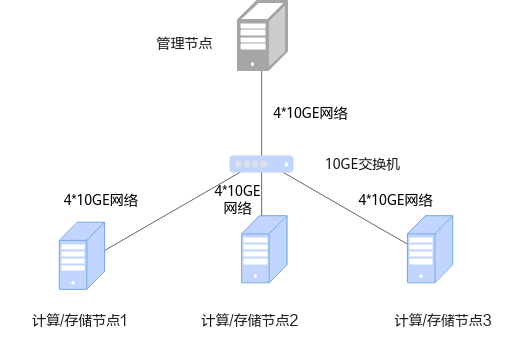

# 安装指南<a name="ZH-CN_TOPIC_0000002551410827"></a>

## 安装简介<a name="ZH-CN_TOPIC_0000002519970740"></a>

### 组网规划<a name="ZH-CN_TOPIC_0000002551410855"></a>

建议采用存算一体组网，即存储节点和计算节点共用。

OmniMV物化视图组网规划的环境由4台服务器组成，使用存算一体的组网，分别是管理节点（1台）、计算节点（3台）。以存储节点为HDFS进行举例说明，其中：

- 管理节点为server1，用于管理任务。
- 计算节点为agent1、agent2和agent3，用于运行OmniMV物化视图查询引擎服务以及存储数据集。

一台服务器可以同时充当管理节点、计算节点（如果是单机安装模式，后续文章中提到的在管理节点/计算节点上执行的操作，均需要在一个节点上执行），组网规划如[**图 1** 安装组网图](#安装组网图)所示。

**图 1** 安装组网图<a name="zh-cn_topic_0000001713019717_fig195021730155013"></a><a id="安装组网图"></a>


### 环境要求<a name="ZH-CN_TOPIC_0000002551410733"></a>

安装OmniMV物化视图特性前，请参见本节内容，提前准备软硬件安装环境，以确保后续安装操作顺利进行。

**硬件要求<a name="zh-cn_topic_0000001665139878_section197116445713"></a>**

集群中各节点硬件要求如[**表 1** 硬件要求](#硬件要求)所示。

**表 1** 硬件要求<a id="硬件要求"></a>

|硬件环境|管理/计算/存储节点|
|--|--|
|处理器|鲲鹏920 5250处理器/鲲鹏920新型号处理器|
|内存大小|384GB（12 * 32GB）|
|内存频率|2666MHz|
|网络|业务网络10GE<br>管理网络1GE|
|硬盘|系统盘：1 * RAID 0（1 * 1.2TB SAS HDD）<br>数据盘：12 * RAID 0（12 * 8TB SATA HDD）|
|RAID控制卡|LSI SAS3508|


**操作系统和软件要求<a name="zh-cn_topic_0000001665139878_section112781416185717"></a>**

集群中各节点操作系统和软件要求如[**表 2** 操作系统和软件要求](#操作系统和软件要求)所示。

**表 2** 操作系统和软件要求<a id="操作系统和软件要求"></a>

|项目|版本|说明|管理节点（Server）|计算/存储节点|
|--|--|--|--|--|
|操作系统|openEuler 22.03 LTS SP1|无特殊要求。|√|√|
|JDK|[毕昇JDK 1.8.0_342](https://mirror.iscas.ac.cn/kunpeng/archive/compiler/bisheng_jdk/bisheng-jdk-8u342-linux-aarch64.tar.gz)|毕昇JDK安装指南请参见《[毕昇JDK 8 安装指南](https://gitee.com/openeuler/bishengjdk-8/wikis/%E4%B8%AD%E6%96%87%E6%96%87%E6%A1%A3/%E6%AF%95%E6%98%87JDK%208%20%E5%AE%89%E8%A3%85%E6%8C%87%E5%8D%97)》。|√|√|
|Hadoop|3.2.0|部署指南请参见《[Hadoop 集群部署（CentOS 7.6&openEuler 20.03）](https://www.hikunpeng.com/document/detail/zh/kunpengbds/ecosystemEnable/Hadoop/kunpenghadoop_04_0001.html)》。|√|√|
|Spark|3.1.1/3.4.3|部署指南请参见《[Spark 部署指南（CentOS 7.6&openEuler 20.03）](https://www.hikunpeng.com/document/detail/zh/kunpengbds/ecosystemEnable/Spark/kunpengspark_04_0001.html)》。|√|-|
|ZooKeeper|3.6.2及以上|部署指南请参见《[ZooKeeper 部署指南（CentOS 7.6&openEuler 20.03）](https://www.hikunpeng.com/document/detail/zh/kunpengbds/ecosystemEnable/ZooKeeper/kunpengzookeeper_04_0001.html)》。|-|√|
|Python|3.10.2及以上|无特殊要求。|√|√|


> **说明：** 
>-   √：表示对应节点需要安装该项目。
>-   -：表示对应节点不需要安装该项目。
>-   以上第三方依赖版本如有漏洞请根据官方说明进行漏洞修复。
>-   以上组件版本，可能和部署指南中的组件版本不一致，部署指南仅供部署参考。

**软件获取<a name="zh-cn_topic_0000001665139878_section73341541215"></a>**

安装OmniMV物化视图所需软件安装包及其获取方式如[**表 3** OmniMV物化视图软件获取列表](#OmniMV物化视图软件获取列表)所示。

**表 3** OmniMV物化视图软件获取列表<a id="OmniMV物化视图软件获取列表"></a>

<table border="1" cellpadding="6" cellspacing="0">
  <thead>
    <tr>
      <th>名称</th>
      <th>包名</th>
      <th>发布类型</th>
      <th>说明</th>
      <th>获取地址</th>
    </tr>
  </thead>
  <tbody>
    <tr>
      <td>OmniMV物化视图软件安装包</td>
      <td>BoostKit-omnimv_1.2.0.zip</td>
      <td>开源</td>
      <td>-</td>
      <td><a href="https://gitcode.com/boostkit/boostkit-bigdata/releases/download/25.0.RC1-OmniMV-release/BoostKit-omnimv_1.2.0.zip" target="_blank">获取链接</a></td>
    </tr>
    <tr>
      <td rowspan="2">OmniMV Plugin的JAR包</td>
      <td>boostkit-omnimv-spark-3.1.1-1.2.0-aarch64.jar</td>
      <td>开源</td>
      <td>使用OmniMV物化视图能力时，Spark引擎扩展包。</td>
      <td><a href="https://gitcode.com/boostkit/boostkit-bigdata/releases/download/25.0.RC1-OmniMV-release/boostkit-omnimv-spark-3.1.1-1.2.0-aarch64.jar" target="_blank">获取链接</a></td>
    </tr>
    <tr>      
      <td>boostkit-omnimv-spark-3.4.3-1.2.0-aarch64.jar</td>
      <td>开源</td>
      <td>使用OmniMV物化视图能力时，Spark引擎扩展包。</td>
      <td><a href="https://gitcode.com/boostkit/boostkit-bigdata/releases/download/25.0.RC1-OmniMV-release/boostkit-omnimv-spark-3.4.3-1.2.0-aarch64.jar" target="_blank">获取链接</a></td>
    </tr>
    <tr>
      <td rowspan="2">OmniMV日志解析JAR包</td>
      <td>boostkit-omnimv-logparser-spark-3.1.1-1.2.0-aarch64.jar</td>
      <td>开源</td>
      <td>使用OmniMV物化视图解析Spark日志时使用的功能包。</td>
      <td><a href="https://gitcode.com/boostkit/boostkit-bigdata/releases/download/25.0.RC1-OmniMV-release/boostkit-omnimv-logparser-spark-3.1.1-1.2.0-aarch64.jar" target="_blank">获取链接</a></td>
    </tr>
    <tr>      
      <td>boostkit-omnimv-logparser-spark-3.4.3-1.2.0-aarch64.jar</td>
      <td>开源</td>
      <td>使用OmniMV物化视图解析Spark日志时使用的功能包。</td>
      <td><a href="https://gitcode.com/boostkit/boostkit-bigdata/releases/download/25.0.RC1-OmniMV-release/boostkit-omnimv-logparser-spark-3.4.3-1.2.0-aarch64.jar" target="_blank">获取链接</a></td>
    </tr>
    <tr>
      <td>hive-testbench</td>
      <td>hive-testbench-hdp3.zip</td>
      <td>开源</td>
      <td>生成TPC-DS/TPCH数据时使用的TestBench源码包。</td>
      <td><a href="https://github.com/hortonworks/hive-testbench/archive/refs/heads/hdp3.zip" target="_blank">获取链接</a></td>
    </tr>
  </tbody>
</table>


**软件安装包完整性校验<a name="zh-cn_topic_0000001665139878_section16501429204018"></a>**

从鲲鹏社区获取的软件安装包，下载软件安装包后需要校验软件安装包，确保与网站上的原始软件安装包一致。

校验方法：

1. 获取软件数字证书和软件安装包。
2. [获取校验工具和校验方法](https://support.huawei.com/enterprise/zh/tool/pgp-verify-TL1000000054)。
3. 参见上述链接下载的《OpenPGP签名验证指南》进行软件安装包完整性检查。


## 安装特性<a name="ZH-CN_TOPIC_0000002551130865"></a>

### 安装节点要求<a name="ZH-CN_TOPIC_0000002551130815"></a>

安装OmniMV物化视图特性之前，需要确保各节点的配置满足要求。在源码编译之前，需要在各节点安装GCC/G++、make、CMake和glibc，并满足相应的版本要求。在安装OmniMV物化视图之前，需要先按操作系统和软件要求准备好集群环境和安装Spark引擎所需必备组件。

- 使用源码编译前，需在各节点安装GCC/G++、make、CMake以及glibc，其版本要求请参见[**表 1** 源码编译前需要配置的软件](#源码编译前需要配置的软件)。

    **表 1** 源码编译前需要配置的软件<a id="源码编译前需要配置的软件"></a>

|名称|版本要求|
|--|--|
|GCC/G++|7.3.0|
|make|4.2.1及以上|
|CMake|3.13.4及以上|
|glibc|2.25及以上|


- 安装OmniMV物化视图前，集群环境请参见[**表 2** 操作系统和软件要求](#操作系统和软件要求)完成相关组件安装，Spark引擎所需组件请参见[**表 2** Spark引擎所需必备组件](#Spark引擎所需必备组件)。

    **表 2** Spark引擎所需必备组件<a id="Spark引擎所需必备组件"></a>

|使用OmniMV物化视图的引擎|集群必备组件|
|--|--|
|Spark|OS、JDK、Hadoop、Spark、Hive、HDFS|


    > **说明：** 
    >用户根据使用场景要求，选择安装相应的集群模式。若存储安装模式为HDFS，则建议使用安全模式（Kerberos）。

### 安装OmniMV<a name="ZH-CN_TOPIC_0000002551410763"></a>

在openEuler 22.03操作系统下安装OmniMV物化视图软件，主要步骤包括：安装Conda、创建OmniMV虚拟环境。然后使用**pip**下载Python依赖库，包括Spark引擎的依赖包。最后下载并解压OmniMV物化视图推荐算法软件安装包，并移除其他用户组的读取和可执行文件权限。

1. 下载Conda软件安装包，并激活Conda虚拟环境。
    1. 下载Conda。

        ```
        cd /opt
        wget -k https://repo.anaconda.com/archive/Anaconda3-2022.05-Linux-aarch64.sh
        ```

    2. 安装Conda，安装路径可以选择在“/opt/anaconda3“路径下面。

        ```
        bash Anaconda3-2022.05-Linux-aarch64.sh
        ```

    3. 初始化Conda。

        ```
        source /opt/anaconda3/etc/profile.d/conda.sh
        ```

    4. 创建Conda虚拟环境，名字是omnimv。

        ```
        conda create -n omnimv python=3.11
        ```

    5. 激活Conda虚拟环境。

        ```
        conda activate omnimv
        ```

2. 使用pip下载Python依赖库。
    - Spark 3.1.1引擎依赖包。

        ```
        pip install Cython==0.29.24
        pip install pandas==1.3.5
        pip install PyYAML==6.0
        pip install mo-sql-parsing
        pip install sql-metadata==2.6.0
        pip install scikit-learn==1.5.2
        pip install xgboost==1.7.3
        pip install pyspark==3.1.1
        pip install pydoop==2.0.0
        pip install numpy==1.23.3
        ```

    - Spark 3.4.3引擎依赖包。

        ```
        pip install Cython==0.29.24
        pip install pandas==1.3.5
        pip install PyYAML==6.0
        pip install mo-sql-parsing
        pip install sql-metadata==2.6.0
        pip install scikit-learn==1.5.2
        pip install xgboost==1.7.3
        pip install pyspark==3.4.3
        pip install pydoop==2.0.0
        pip install numpy==1.23.3
        ```

3. 下载OmniMV物化视图推荐算法软件安装包。

    Spark引擎下载OmniMV物化视图推荐算法软件安装包，并将Spark SQL Plugin的JAR包、日志解析JAR包放到Spark集群的server节点，软件安装包获取路径请参见[**表 3** OmniMV物化视图软件获取列表](#OmniMV物化视图软件获取列表)，软件安装包路径没有特殊要求。例如以“/opt/omnimv“为例。

    - Spark 3.1.1。

        ```
        mkdir -p /opt/omnimv
        mv boostkit-omnimv-spark-3.1.1-1.2.0-aarch64.jar /opt/omnimv
        mv boostkit-omnimv-logparser-spark-3.1.1-1.2.0-aarch64.jar /opt/omnimv
        mv BoostKit-omnimv_1.2.0.zip /opt/omnimv
        ```

    - Spark 3.4.3。

        ```
        mkdir -p /opt/omnimv
        mv boostkit-omnimv-spark-3.4.3-1.2.0-aarch64.jar /opt/omnimv
        mv boostkit-omnimv-logparser-spark-3.4.3-1.2.0-aarch64.jar /opt/omnimv
        mv BoostKit-omnimv_1.2.0.zip /opt/omnimv
        ```

4. 解压OmniMV物化视图组件包，并移除其他用户组的读取和可执行文件权限。

    ```
    cd /opt/omnimv
    unzip BoostKit-omnimv_1.2.0.zip
    chmod -R o-r BoostKit-omnimv_1.2.0
    ```

    > **说明：** 
    >建议使用非root用户进行解压，使得解压的目录获得尽可能小的权限，避免被替换文件。

