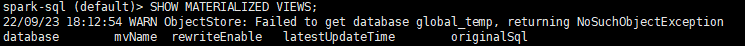

# 使用指南<a name="ZH-CN_TOPIC_0000002551561105"></a>

## 使用特性<a name="ZH-CN_TOPIC_0000002520361124"></a>

### 使用Spark引擎执行SQL<a name="ZH-CN_TOPIC_0000002520361118"></a>

为用户提供了两种使用OmniMV物化视图Spark引擎执行SQL的方式，均可用于重写SQL的物理执行计划。

**前提条件<a name="zh-cn_topic_0000001664980174_section2080521443512"></a>**

请参见[zh-cn\_topic\_0000002520041122.md](zh-cn_topic_0000002520041122.md)完成OmniMV物化视图安装，并参见《[Spark 部署指南](https://www.hikunpeng.com/document/detail/zh/kunpengbds/ecosystemEnable/Spark/kunpengspark_04_0001.html)》完成Spark的部署。

**使用OmniMV物化视图执行SQL的方式<a name="zh-cn_topic_0000001664980174_zh-cn_topic_0000001518847449_section18710143819163"></a>**

可以通过两种方式使用OmniMV物化视图Spark引擎执行SQL，均可自动进行执行计划重写。

- <a name="zh-cn_topic_0000001518847449_li4881163716166"></a>方式一：进入spark-sql客户端手动执行SQL。
    1. 进入客户端。
        - Spark 3.1.1。

            ```
            spark-sql \
            --deploy-mode client \
            --driver-cores 5 \
            --driver-memory 5g \
            --num-executors 18 \
            --executor-cores 21 \
            --executor-memory 55g \
            --master yarn \
            --database 数据库名称 \
            --name 任务名称 \
            --jars /opt/omnimv/boostkit-omnimv-spark-3.1.1-1.2.0-aarch64.jar \
            --conf 'spark.sql.extensions=com.huawei.boostkit.spark.OmniMV' \
            --conf spark.sql.omnimv.metadata.path=/omnimv/plugin_metadata \
            ```

        - Spark 3.4.3。

            ```
            spark-sql \
            --deploy-mode client \
            --driver-cores 5 \
            --driver-memory 5g \
            --num-executors 18 \
            --executor-cores 21 \
            --executor-memory 55g \
            --master yarn \
            --database 数据库名称 \
            --name 任务名称 \
            --jars /opt/omnimv/boostkit-omnimv-spark-3.4.3-1.2.0-aarch64.jar \
            --conf 'spark.sql.extensions=com.huawei.boostkit.spark.OmniMV' \
            --conf spark.sql.omnimv.metadata.path=/omnimv/plugin_metadata \
            ```

    2. Spark参数可根据集群配置进行调整。
    3. 手动执行SQL。

- 方式二：使用脚本批量执行SQL**。**

    Spark参数可根据集群配置进行调整。主要是通过-f调用写好的SQL文件，用户仿照此例自定义脚本，批量执行SQL。例如：

    - Spark 3.1.1。

        ```
        spark-sql \
        --deploy-mode client \
        --driver-cores 5 \
        --driver-memory 5g \
        --num-executors 18 \
        --executor-cores 21 \
        --executor-memory 55g \
        --master yarn \
        --database 数据库名称 \
        --name 任务名称 \
        --jars /opt/omnimv/boostkit-omnimv-spark-3.1.1-1.2.0-aarch64.jar \
        --conf 'spark.sql.extensions=com.huawei.boostkit.spark.OmniMV' \
        --conf spark.sql.omnimv.metadata.path=/omnimv/plugin_metadata \
        -f sql文件的实际路径
        ```

    - Spark 3.4.3。

        ```
        spark-sql \
        --deploy-mode client \
        --driver-cores 5 \
        --driver-memory 5g \
        --num-executors 18 \
        --executor-cores 21 \
        --executor-memory 55g \
        --master yarn \
        --database 数据库名称 \
        --name 任务名称 \
        --jars /opt/omnimv/boostkit-omnimv-spark-3.4.3-1.2.0-aarch64.jar \
        --conf 'spark.sql.extensions=com.huawei.boostkit.spark.OmniMV' \
        --conf spark.sql.omnimv.metadata.path=/omnimv/plugin_metadata \
        -f sql文件的实际路径
        ```

**OmniMV物化视图Spark引擎支持的语法<a name="zh-cn_topic_0000001664980174_zh-cn_topic_0000001518847449_section10546184118151"></a>**

**表 1** OmniMV物化视图Spark引擎支持的语法<a id="OmniMV物化视图Spark引擎支持的语法"></a>

|操作名称|操作语法|
|--|--|
|Create MV（创建视图）|CREATE MATERIALIZED VIEW [IF NOT EXISTS] [db_name.]mv_name[DISABLE REWRITE][COMMENT 'mv_comment'][PARTITIONED BY (col_name, ...)]AS<query>;|
|Drop MV（删除视图）|DROP MATERIALIZED VIEW [IF EXISTS] [db_name.]mv_name;|
|Show MVS（枚举视图）|SHOW MATERIALIZED VIEWS [ON [db_name.]mv_name];|
|Alter MV rewrite（更新视图配置，是否参与重写）|ALTER MATERIALIZED VIEW [db_name.]mv_name ENABLE|DISABLE REWRITE;|
|Refresh MV （更新视图数据）|REFRESH MATERIALIZED VIEW [db_name.]mv_name;|
|WASH OUT MATERIALIZED VIEW（淘汰视图）--ALL：淘汰所有视图--UNUSED_DAYS策略（默认）：淘汰${UNUSED_DAYS}未使用过的视图--RESERVE_QUANTITY_BY_VIEW_COUNT策略：保留使用次数前${RESERVE_QUANTITY_BY_VIEW_COUNT}的视图--DROP_QUANTITY_BY_SPACE_CONSUMED策略：淘汰占用空间前${DROP_QUANTITY_BY_SPACE_CONSUMED}的视图|WASH OUT [ALL] MATERIALIZED VIEW [USING[UNUSED_DAYS,][RESERVE_QUANTITY_BY_VIEW_COUNT,][DROP_QUANTITY_BY_SPACE_CONSUMED]]|


**OmniMV物化视图Spark启动参数信息<a name="section1817324859"></a>**

**表 2** OmniMV物化视图Spark启动参数信息<a id="OmniMV物化视图Spark启动参数信息"></a>

|启动参数名称|缺省值|含义|
|--|--|--|
|spark.sql.omnimv.enable|true|是否开启OmniMV物化视图改写。true：开启OmniMV物化视图改写。false：关闭OmniMV物化视图改写。|
|spark.sql.omnimv.show.length|50|show materialized views打印OmniMV物化视图信息的字符长度。|
|spark.sql.omnimv.default.datasource|orc|OmniMV物化视图的存储格式，orc、parquet。|
|spark.sql.omnimv.logLevel|DEBUG|OmniMV物化视图相关的日志级别，DEBUG、INFO、WARN、ERROR。|
|spark.sql.omnimv.log.enable|true|是否把解析的SQL输出到event log。true：把解析的SQL输出到event log。false：不把解析的SQL输出到event log。|
|spark.sql.omnimv.metadata.path|/omnimv/plugin_metadata|OmniMV物化视图元数据HDFS路径。|
|spark.sql.omnimv.metadata.initbyquery.enable|false|用于OmniMV物化视图元数据加载加速，是否只加载查询SQL用到的表相关的OmniMV物化视图元数据。true：只加载查询SQL用到的表相关的OmniMV物化视图元数据。false：加载查询所有的物化视图元数据。|
|spark.sql.omnimv.dbs|没有缺省值，请根据实际情况自行配置|用于OmniMV物化视图元数据加载加速，是否只加载某些数据库下的OmniMV物化视图元数据。可配置例如omnimv、omnimv1。|
|spark.sql.omnimv.washout.automatic.enable|false|是否开启OmniMV物化视图的自动淘汰，自动删除旧的物化视图，默认采取UNUSED_DAYS策略。true：开启OmniMV物化视图的自动淘汰。false：不开启OmniMV物化视图的自动淘汰。|
|spark.sql.omnimv.washout.unused.day|30|UNUSED_DAYS策略（默认），淘汰30天未被使用的视图。|
|spark.sql.omnimv.washout.reserve.quantity.byViewCnt|25|RESERVE_QUANTITY_BY_VIEW_COUNT策略，按视图使用次数降序排序后，淘汰25名之后的。|
|spark.sql.omnimv.washout.drop.quantity.bySpaceConsumed|3|DROP_QUANTITY_BY_SPACE_CONSUMED策略，按视图占用存储空间降序排序后，淘汰前3名。|
|spark.sql.omnimv.washout.automatic.time.interval|35|两次OmniMV物化视图的自动淘汰执行，间隔多少天。|
|spark.sql.omnimv.washout.automatic.checkTime.interval|3600|一个session里，尝试自动淘汰，间隔多少秒。|
|spark.sql.omnimv.washout.automatic.view.quantity|20|触发自动淘汰的最少视图数量。|
|spark.sql.omnimv.detect-rewrite-sqls.enable|false|用于OmniMV物化视图元数据加载加速，是否只针对视图可改写SQL生效，降低不生效SQL因元数据加载耗时带来的劣化。true：只针对OmniMV物化视图可改写SQL生效。false：针对所有SQL生效。|


**OmniMV物化视图使用到Kryo相关的参数信息<a name="section2231112814185"></a>**

OmniMV物化视图使用Kryo进行物化视图元数据序列化时，可能存在用户配置和OmniMV物化视图不兼容的情况，所以不使用用户的配置，使用固定配置，这并不影响Spark本身的功能。

**表 3** OmniMV物化视图内部使用到Kryo相关的参数信息<a id="OmniMV物化视图内部使用到Kryo相关的参数信息"></a>

|参数名称|固定值|含义|
|--|--|--|
|spark.kryo.unsafe|false|不使用Kryo的“unsafe”模式。|
|spark.kryo.registrationRequired|false|不强制要求所有需要序列化的类都必须在Kryo中注册。|
|spark.kryo.registrator|""|不指定自定义的Kryo注册器类。|
|spark.kryo.classesToRegister|""|不指定需要注册的类列表。|
|spark.kryo.pool|true|启用Kryo实例池。|
|spark.kryo.referenceTracking|true|启用引用追踪。|
|spark.kryoserializer.buffer|64k|设置Kryo序列化缓冲区的初始大小。|
|spark.kryoserializer.buffer.max|64m|设置Kryo序列化缓冲区的最大大小。|


**查看OmniMV物化视图Spark引擎是否加载成功<a name="section214462292214"></a>**

1. 使用[方式一](#zh-cn_topic_0000001518847449_li4881163716166)进入spark-sql客户端手动执行SQL。
2. 执行枚举视图命令，返回信息如下图所示，说明Plugin加载成功。

    ```
    SHOW MATERIALIZED VIEWS;
    ```

    

3. 创建样例基本表和样例视图。

    ```
    CREATE TABLE IF NOT EXISTS column_type(
        empid INT,
        deptno INT,
        locationid INT,
        booleantype BOOLEAN,
        bytetype BYTE,
        shorttype SHORT,
        integertype INT,
        longtype LONG,
        floattype FLOAT,
        doubletype DOUBLE,
        datetype DATE,
        timestamptype TIMESTAMP,
        stringtype STRING,
        decimaltype DECIMAL
    );
    INSERT INTO TABLE column_type VALUES(
        1,1,1,TRUE,1,1,1,1,1.0,1.0,
        DATE '2022-01-01',
        TIMESTAMP '2022-01-01',
        'stringtype1',1.0
    );
    INSERT INTO TABLE column_type VALUES(
        2,2,2,TRUE,2,2,2,2,2.0,2.0,
        DATE '2022-02-02',
        TIMESTAMP '2022-02-02',
        'stringtype2',2.0
    );
    ```

    

4. 创建物化视图。

    ```
    CREATE MATERIALIZED VIEW IF NOT EXISTS mv_create1
    AS
    SELECT * FROM column_type;
    ```

    

5. 通过EXPLAIN SQL，来查看查询的执行计划是否被重写。

    ```
    EXPLAIN
    SELECT * FROM column_type;
    ```

    

为用户提供了两种使用OmniMV物化视图Spark引擎执行SQL的方式，均可用于重写SQL的物理执行计划。
### 推荐视图<a name="ZH-CN_TOPIC_0000002520361126"></a>

用户可根据实际需要提供数据表，使用OmniMV物化视图最终得到推荐的视图集。

本次任务示例使用TPC-DS的数据表作为测试表。

1. 修改配置文件。

    1. 打开“config/omnimv\_config\_spark.cfg“文件。

        ```
        cd /opt/omnimv/BoostKit-omnimv_1.2.0
        vi config/omnimv_config_spark.cfg
        ```

    2. 按“i“进入编辑模式，参考如下内容修改。
        - Spark 3.1.1：

            ```
            database = tpcds_bin_partitioned_varchar_orc_3000
            logparser_jar_path = /opt/omnimv/boostkit-omnimv-logparser-spark-3.1.1-1.2.0-aarch64.jar
            cache_plugin_jar_path = /opt/omnimv/boostkit-omnimv-spark-3.1.1-1.2.0-aarch64.jar
            hdfs_input_path = hdfs://server1:9000/spark2-history
            sqls_path = hdfs://server1:9000/omnimv/tpcds
            ```

        - Spark 3.4.3：

            ```
            database = tpcds_bin_partitioned_varchar_orc_3000
            logparser_jar_path = /opt/omnimv/boostkit-omnimv-logparser-spark-3.4.3-1.2.0-aarch64.jar
            cache_plugin_jar_path = /opt/omnimv/boostkit-omnimv-spark-3.4.3-1.2.0-aarch64.jar
            hdfs_input_path = hdfs://server1:9000/spark2-history
            sqls_path = hdfs://server1:9000/omnimv/tpcds
            ```

    3. 按“Esc“键，输入**:wq!**，按“Enter“保存并退出编辑。

    **表 1** OmniMV物化视图部分配置<a id="OmniMV物化视图部分配置"></a>

|配置项|含义|参考值|
|--|--|--|
|database|用于测试的数据库名称。|-|
|logparser_jar_path|日志解析JAR包路径。|/opt/omnimv/boostkit-omnimv-logparser-spark-3.1.1-1.2.0-aarch64.jar/opt/omnimv/boostkit-omnimv-logparser-spark-3.4.3-1.2.0-aarch64.jar|
|cache_plugin_jar_path|OmniMV的JAR包路径。|/opt/omnimv/boostkit-omnimv-spark-3.1.1-1.2.0-aarch64.jar/opt/omnimv/boostkit-omnimv-spark-3.4.3-1.2.0-aarch64.jar|
|hdfs_input_path|Spark任务运行日志在HDFS上的访问地址。|hdfs://server1:9000/spark2-history|
|sqls_path|测试SQL在HDFS上的访问地址。|hdfs://server1:9000/omnimv/tpcds|


2. 获取测试SQL（以TPC-DS为例）。
    1. 下载[Spark源码](https://github.com/apache/spark)并解压，在“spark-master/sql/core/src/test/resources/tpcds/“路径下获取TPC-DS测试SQL。
    2. 将测试SQL传到HDFS上（路径为配置文件中sqls\_path的值）。

        ```
        hdfs dfs -mkdir -p hdfs://server1:9000/omnimv/tpcds
        hdfs dfs -put /spark源码目录/sql/core/src/test/resources/tpcds/* hdfs://server1:9000/omnimv/tpcds/
        ```

3. 初始化数据库。这一步主要是获取目标表的建表信息，用于后续创建推荐视图。

    屏幕打印“init\_database succeed!”说明执行成功。

    ```
    python main.py spark init_database
    ```

4. 运行测试SQL（以TPC-DS测试SQL为例）。

    屏幕打印“run\_original\_sqls succeed!”说明执行成功。

    ```
    python main.py spark run_original_sqls
    ```

5. 解析运行日志。
    1. 通过http://ip:18080地址访问Spark History Server查看SQL任务起止时间。
    2. 打开配置文件“config/omnimv\_config\_spark.cfg“。

        ```
        vi config/omnimv_config_spark.cfg
        ```

    3. 按“i“进入编辑模式，修改参数如下。

        ```
        # 测试SQL运行开始时间
        q_log_start_time = 2022-09-15 11:58
        # 测试SQL运行结束时间
        q_log_end_time = 2022-09-15 17:15
        ```

    4. 按“Esc“键，输入**:wq!**，按“Enter“保存并退出编辑。
    5. 运行日志解析脚本。

        屏幕打印“parse\_query\_logs succeed!”说明执行成功。

        ```
        python main.py spark parse_query_logs
        ```

6. 生成候选视图。
    1. 打开配置文件“config/omnimv\_config\_spark.cfg“。

        ```
        vi config/omnimv_config_spark.cfg
        ```

    2. 按“i“进入编辑模式，修改参数如下。

        ```
        # 候选TOP mv的数量限制，实际推荐数量小于等于该值
        mv_limit = 10
        ```

    3. 按“Esc“键，输入**:wq!**，按“Enter“保存并退出编辑。
    4. 运行脚本。

        屏幕打印“greedy recommend for candidate mv”说明执行成功。

        ```
        python main.py spark generate_views
        ```

7. 运行创建topN视图。

    需要人工确认，是否可以真实地创建这个候选的视图。

    ```
    python main.py spark create_greedy_views
    ```

用户可根据实际需要提供数据表，使用OmniMV物化视图最终得到推荐的视图集。


## 维护特性<a name="ZH-CN_TOPIC_0000002520361120"></a>

升级OmniMV物化视图软件需先删除所有的库文件，包括二进制SO以及OmniMV物化视图相关文件，然后上传最新的版本压缩包完成安装步骤，即可完成升级。升级步骤需在管理节点操作并确保OmniMV物化视图上层引擎处于没有任务执行的状态。卸载OmniMV物化视图软件删除配置文件、二进制SO文件以及OmniMV物化视图相关文件即可完成卸载。卸载步骤仅需在管理节点操作。可通过命令查询OmniMV物化视图相关版本信息。

**升级OmniMV<a name="zh-cn_topic_0000001664980122_section5436016134"></a>**

1. 删除二进制SO文件以及OmniMV物化视图相关文件，安装目录以“/opt/omnimv“为例。

    ```
    rm -rf /opt/omnimv
    ```

2. 下载并上传最新版本的OmniMV物化视图到管理节点，参见[zh-cn\_topic\_0000002520041116.md](zh-cn_topic_0000002520041116.md)完成安装。
3. 更新Spark版本后需刷新物化视图元数据，如Spark版本未更新则不需要执行。
    1. 删除物化视图元数据。
        1. 设置数据库名称。

            ```
            DATABASE="tpcds_bin_partitioned_varchar_orc_3000"
            ```

        2. 删除物化视图元数据。

            ```
            hdfs dfs -rm -r -f /omnimv/plugin_metadata/${DATABASE}
            hdfs dfs -rm -r -f /omnimv/plugin_metadata/mock
            ```

    2. 刷新Spark 3.1.1版本在数据库中的物化视图元数据。
        1. 获取刷新物化视图元数据命令。

            ```
            sqls=""
            mvs=`spark-sql --master local -e "SHOW MATERIALIZED VIEWS" --conf spark.sql.extensions=com.huawei.boostkit.spark.OmniMV --jars /opt/omnimv/boostkit-omnimv-spark-3.1.1-1.2.0-aarch64.jar --database ${DATABASE} | grep -P "^${DATABASE}" |awk -F "\t" '{print $2}' |grep -v "partition"` ; \
            for mv in `echo "$mvs"|tr -s '|' ' '`;do sqls="ALTER MATERIALIZED VIEW $mv ENABLE REWRITE;$sqls" ; done
            echo $sqls|tr -s ';' '\n'
            ```

        2. 执行刷新物化视图元数据命令。

            ```
            spark-sql --master local --database ${DATABASE} --jars /opt/omnimv/boostkit-omnimv-spark-3.1.1-1.2.0-aarch64.jar --conf 'spark.sql.extensions=com.huawei.boostkit.spark.OmniMV' -e "$sqls"
            ```

    3. 刷新Spark 3.4.3版本在数据库中的物化视图元数据。
        1. 获取刷新物化视图元数据命令。

            ```
            sqls=""
            mvs=`spark-sql --master local -e "SHOW MATERIALIZED VIEWS" --conf spark.sql.extensions=com.huawei.boostkit.spark.OmniMV --jars /opt/omnimv/boostkit-omnimv-spark-3.4.3-1.2.0-aarch64.jar --database ${DATABASE} | grep -P "^${DATABASE}" |awk -F "\t" '{print $2}' |grep -v "partition"` ; \
            for mv in `echo "$mvs"|tr -s '|' ' '`;do sqls="ALTER MATERIALIZED VIEW $mv ENABLE REWRITE;$sqls" ; done
            echo $sqls|tr -s ';' '\n'
            ```

        2. 执行刷新物化视图元数据命令。

            ```
            spark-sql --master local --database ${DATABASE} --jars /opt/omnimv/boostkit-omnimv-spark-3.4.3-1.2.0-aarch64.jar --conf 'spark.sql.extensions=com.huawei.boostkit.spark.OmniMV' -e "$sqls"
            ```

**卸载OmniMV<a name="zh-cn_topic_0000001664980122_section17545201134"></a>**

> **须知：** 
>当前步骤仅供需要卸载OmniMV时参考，不属于部署OmniMV的必要操作步骤。

1. 删除OmniMV，安装目录以“/opt/omnimv“为例。

    ```
    rm -rf /opt/omnimv
    ```

2. 删除Python环境，安装目录以“/opt/anaconda3“为例。

    ```
    rm -rf /opt/anaconda3
    ```

3. 可通过version.txt查询OmniMV的版本信息。

    ```
    cat /opt/omnimv/BoostKit-omnimv_1.2.0/version.txt
    ```

升级OmniMV物化视图软件需先删除所有的库文件，包括二进制SO以及OmniMV物化视图相关文件，然后上传最新的版本压缩包完成安装步骤，即可完成升级。升级步骤需在管理节点操作并确保OmniMV物化视图上层引擎处于没有任务执行的状态。卸载OmniMV物化视图软件删除配置文件、二进制SO文件以及OmniMV物化视图相关文件即可完成卸载。卸载步骤仅需在管理节点操作。可通过命令查询OmniMV物化视图相关版本信息。

