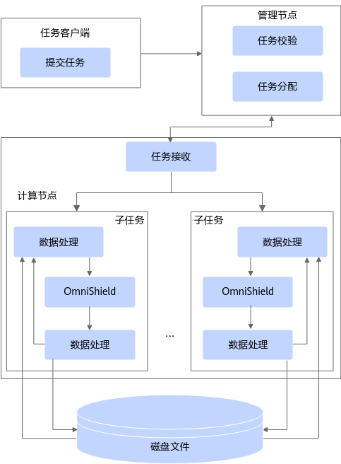

# OmniShield介绍<a name="ZH-CN_TOPIC_0000002551634289"></a>

## 最新消息<a name="ZH-CN_TOPIC_0000002520474308"></a>

- \[2024.12.30\]：发布OmniShield 1.1.0。OmniShield机密大数据支持远程证明。
- \[2024.09.30\]：发布OmniShield 1.0.0。OmniShield机密大数据作为大数据引擎Spark的插件，提供数据源加解密的功能，通过在基于硬件的TEE环境中执行计算过程的方式，为使用中的数据提供保护，保证数据在整个计算链路中的安全性。DataFrame CSV/JSON/text行式数据源读写支持AES加解密。Spark SQL数据源支持加解密。Spark SQL ORC数据源读写支持国密算法加解密。


## 项目简介<a name="ZH-CN_TOPIC_0000002551514287"></a>

### 简介<a name="ZH-CN_TOPIC_0000002520634294"></a>

大数据OmniRuntime通过插件化的形式，端到端提升数据加载、数据计算和数据交换的性能，从而提升大数据分析性能。

随着互联网的发展，数据规模出现了爆炸式的增长，需要处理的数据量越来越大，CPU算力的增长远远滞后于数据的增长。大数据开源生态也越来越丰富，但多样化的计算引擎和开源组件也同时带来了全生命周期数据处理性能提升难的问题。不同的大数据引擎采用各自独特的优化策略和技术来提高性能和效率，但有些优化项会在多个引擎中重复应用，可能存在差异或冲突，导致计算性能下降。此外，重复应用相同的优化项可能导致资源竞争和冲突，降低整体计算性能。

大数据OmniRuntime是鲲鹏BoostKit大数据面向应用加速推出的一系列特性，通过插件化的形式，端到端提升数据加载、数据计算和数据交换的性能，从而提升大数据分析的性能。

OmniShield机密大数据为OmniRuntime的特性之一。OmniShield机密大数据是一个大数据引擎Spark的机密计算组件，运行在客户数据中心的TEE环境内，通过在基于硬件的TEE环境中执行计算过程对数据进行加解密，保证数据在REE侧也是安全隐私的。在机密计算场景下，OmniShield机密大数据提供了DataFrame、SparkSQL应用的数据源加解密能力，并可以结合Arm的机密计算TEE套件能力为Spark应用提供端到端安全防护。

已适配的开源组件及版本有：

- Spark 3.3.1
- Hive 3.1.0


### 架构介绍<a name="ZH-CN_TOPIC_0000002520634296"></a>

OmniShield机密大数据特性是一个大数据引擎Spark的机密计算组件，运行在客户数据中心的TEE环境内，通过在基于硬件的TEE环境中执行计算过程对数据进行加解密，保证数据在REE侧也是安全隐私的。

OmniShield机密大数据作为Spark的机密计算组件，通过Spark提供的插件机制，实现Dataframe和Spark-SQL场景下对CSV、JSON和TXT行式数据源的加解密功能。通过对ORC代码的修改，实现在Spark-SQL场景下对ORC列式数据源加密的功能。通过对Spark加解密相关代码修改，实现磁盘和网络IO加解密SM4国密算法功能。通过对Spark Executor相关代码修改，实现Spark在Yarn资源管理模式下的远程证明功能。

OmniShield机密大数据架构如[**图 1** OmniShield机密大数据特性软件架构](#OmniShield机密大数据特性软件架构)所示。



**图 1** OmniShield机密大数据特性软件架构<a name="zh-cn_topic_0000002512402638_fig26911981620"></a><a id="OmniShield机密大数据特性软件架构"></a>

OmniShield机密大数据特性：

- 提供在DataFrame场景下CSV/JSON/TXT行式数据源加解密的功能，加密算法为AES/GCM/NOPadding，并提供接口支持Hadoop等主流KMS获取密钥。
- 提供在Spark-SQL场景下CSV/JSON/TXT行式数据源加解密的功能，加密算法支持AES/GCM/NOPadding和SM4/GCM/NOPadding，并提供接口支持Hadoop等主流KMS获取密钥。
- 提供在Spark-SQL场景下ORC列式数据源加解密的功能，加密算法为SM4/GCM/NOPadding。
- 提供Spark Shuffle磁盘和网络IO国密加解密能力，加密算法为SM4/GCM/NOPadding。
- 提供基于openEuler操作系统IMA（Integrity Measurement Architecture）度量的Spark on Yarn应用级远程证明，支持在Spark Executor启动时生成IMA度量报告，并进行远程证明。

OmniShield机密大数据特性是一个大数据引擎Spark的机密计算组件，运行在客户数据中心的TEE环境内，通过在基于硬件的TEE环境中执行计算过程对数据进行加解密，保证数据在REE侧也是安全隐私的。
### 应用场景<a name="ZH-CN_TOPIC_0000002551514295"></a>

在应用特性前，请先了解OmniShield机密大数据特性的应用场景，支持Spark 3.3.1引擎。

OmniShield机密大数据特性适用于安全多方计算领域的隐私集合求交，保证除集合交集结果外无任何额外元素信息的泄露。用户在提交Spark作业时，Executor会对应用进行远程证明，保证所运行环境和应用的可信，通过给定参数使用OmniShield机密大数据特性即可对数据源进行加解密，并打开网络和磁盘IO加解密配置SM4/GCM/NOPadding，保障安全隐私性。

在应用特性前，请先了解OmniShield机密大数据特性的应用场景，支持Spark 3.3.1引擎。
### 相关概念<a name="ZH-CN_TOPIC_0000002551634291"></a>

- REE（Rich Execution Environment）：指的是远程执行环境，通常指的是在一个相对不受信任的环境中执行计算任务的情况。
- TEE（Trusted Execution Environment）：指的是受信任执行环境，它提供了一种安全的硬件和软件环境，用于执行敏感计算任务。


## 约束与限制<a name="ZH-CN_TOPIC_0000002520474310"></a>

在特性配置前，请先了解OmniShield机密大数据特性的使用限制。

- 当前只支持AES/GCM/NOPadding 128位或256位密钥长度。
- 当前只支持SM4/GCM/NOPadding 128位密钥长度。
- OmniShield机密大数据不提供KMS服务，也不限定使用的KMS，需用户自己提供KMS服务和KMS的实现。
- OmniShield机密大数据不提供远程证明中Verifier和Attester等实现，需要用户自行对接。
- 在使用OmniShield机密大数据的“Spark-SQL ORC数据源国密加解密”特性时，需要关闭Spark的ORC谓词下推功能，设置Spark参数spark.sql.orc.filterPushdown=false。

在特性配置前，请先了解OmniShield机密大数据特性的使用限制。
## 目录结构<a name="ZH-CN_TOPIC_0000002551514291"></a>

项目全量目录层级介绍如下：

```
├── docs                                                     # 项目文档目录
│   └── zh                                                   # 中文文档目录
│       ├── figures                                          # 中文文档图片资源目录
│       ├── public_sys-resources                             # 中文文档公共资源目录
│       ├── installation_guide.md                            # 部署指南
│       ├── quick_start.md                                   # 快速入门
│       ├── user_guide.md                                    # OmniShield使用指导
├── script                                                   # 脚本目录
│   └── build.sh                                             # 项目构建脚本
├── src                                                      # 源码目录
│   ├── main                                                 # 特性源码目录
│   └── test                                                 # 单元测试目录
```


## 版本说明<a name="ZH-CN_TOPIC_0000002520474302"></a>

每个版本的特性变更详细信息，请参见\[quick\_start.md\]\(./docs/zh/quick\_start.md\)。


## 环境部署<a name="ZH-CN_TOPIC_0000002520634288"></a>

介绍OmniShield的环境依赖及安装方式，具体请参见\[installation\_guide.md\]\(./docs/zh/installation\_guide.md\)。


## 快速入门<a name="ZH-CN_TOPIC_0000002520634290"></a>

安装OmniShield后如何快速验证OmniShield是否生效，性能是否提升，具体请参见\[quick\_start.md\]\(./docs/zh/quick\_start.md\)。


## 学习文档<a name="ZH-CN_TOPIC_0000002551514289"></a>

|名称| 路径                                         |简介|
|--|--------------------------------------------|--|
|安装指南| [安装指南.md](./docs/zh/installation_guide.md) |提供安装OmniShield的详细指导。|
|快速入门| [快速入门.md](docs/zh/quick_start.md)          |提供快速使能并验证OmniShield加速能力的快速入门指导。|
|使用指南| [使用指南.md](./docs/zh/user_guide.md)         |提供使用OmniShield的详细指导。|
|视频课程| OmniRuntime特性大揭秘                           |提供操作视频，帮助开发者在鲲鹏服务器上了解、使能OmniRuntime特性。|


## 安全声明<a name="ZH-CN_TOPIC_0000002551517483"></a>

### 防病毒软件例行检查<a name="ZH-CN_TOPIC_0000002520477492"></a>

定期开展对集群和Spark组件的防病毒扫描，防病毒例行检查会帮助集群免受病毒、恶意代码、间谍软件以及恶意程序，降低系统瘫痪、信息泄露等风险。建议使用业界主流防病毒软件进行防病毒检查。


### 日志控制<a name="ZH-CN_TOPIC_0000002520637490"></a>

- 检查系统是否可以限制单个日志文件的大小。
- 检查日志空间占满后，是否存在机制进行清理。


### 设置登录会话超时时间<a name="ZH-CN_TOPIC_0000002520522492"></a>

登录会话30分钟（或更短）的时间内没有活动的情况下应该超时。具体操作步骤如下：

1. 登录安装Ascend-mindxdl-mindio组件的节点。
2. 执行以下命令，打开“/etc/profile“文件。

    ```
    vim /etc/profile
    ```

3. 按“i“进入编辑模式，在文件尾部增加以下内容。

    ```
    export TMOUT=1800
    readonly TMOUT
    ```

4. 按“Esc“键，输入**:wq!**，按“Enter“保存并退出编辑。


### 设置禁用history命令<a name="ZH-CN_TOPIC_0000002520682472"></a>

为了防止通过history查看历史操作信息，需要设置禁用history命令。具体操作步骤如下：

1. 登录安装Ascend-mindxdl-mindio组件的节点。
2. 执行以下命令，打开“/etc/profile“文件。

    ```
    vim /etc/profile
    ```

3. 按“i“进入编辑模式，在文件尾部增加以下内容。

    ```
    export HISTFILESIZE=0
    readonly HISTFILESIZE
    ```

4. 按“Esc“键，输入**:wq!**，按“Enter“保存并退出编辑。


### 设置umask<a name="ZH-CN_TOPIC_0000002551682471"></a>

建议用户服务器的umask设置为027\~777，调整文件权限。以设置umask为027为例，具体操作如下所示：

1. 以root用户登录服务器，打开“/etc/profile“文件。

    ```
    vim /etc/profile
    ```

2. 按“i“进入编辑模式，在文件末尾加上**umask 027**。
3. 按“Esc“键，输入:**wq!**，按“Enter“保存并退出编辑。
4. 执行如下命令使配置生效。

    ```
    source /etc/profile
    ```


### 缓冲区溢出安全保护<a name="ZH-CN_TOPIC_0000002551722491"></a>

为阻止缓冲区溢出攻击，建议使用ASLR（Address space layout randomization）技术，通过对堆、栈、共享库映射等线性区布局的随机化，增加攻击者预测目的地址的难度，防止攻击者直接定位攻击代码位置。该技术可作用于堆、栈、内存映射区（mmap基址、shared libraries、vdso页）。

开启方式：

**echo 2 \>/proc/sys/kernel/randomize\_va\_space**


### 漏洞修复<a name="ZH-CN_TOPIC_0000002551637469"></a>

为保证生产环境的安全，降低被攻击的风险，请开启防火墙，并定期修复以下漏洞。

- 操作系统漏洞
- JDK漏洞
- Hadoop及Spark漏洞
- ZooKeeper漏洞
- Kerberos漏洞
- OpenSSL漏洞
- 其他相关组件漏洞

    以CVE-2021-37137为例。

    漏洞描述：

    Netty 4.1.17版本存在两个Content-Length的http header可能会发生混淆的风险通告，漏洞编号：CVE-2021-37137。

    本系统使用hdfs-ceph（version 3.2.0）服务作为存算分离的存储对象，它因依赖aws-java-sdk-bundle-1.11.375.jar而涉及该漏洞。建议用户及时更新漏洞补丁进行防护，以免遭受黑客攻击。

    影响范围：

    Netty 4.1.68及以前版本。

    修复建议：

    目前厂商已发布升级补丁以修复漏洞，请参见[Github](https://github.com/netty/netty/security/advisories/GHSA-9vjp-v76f-g363)修复漏洞。


### SSH加固<a name="ZH-CN_TOPIC_0000002551517487"></a>

在部署安装过程中，需要通过SSH连接服务器。由于root用户拥有最高权限，直接使用root用户登录服务器可能会存在安全风险。建议您使用普通用户登录服务器进行安装部署，并建议您通过配置禁止root用户SSH登录的选项，来提升系统安全性。操作步骤：

用户登录系统后检查“/etc/ssh/sshd\_config”配置项“PermitRootLogin“。

- 如果显示no，说明禁止了root用户SSH登录。
- 如果显示yes，说明需要修改PermitRootLogin为no。


## 账户清单<a name="ZH-CN_TOPIC_0000002520477498"></a>


## 免责声明<a name="ZH-CN_TOPIC_0000002520474306"></a>

**致OmniShield使用者**

- 本工具仅供调试和开发之用，使用者需自行承担使用风险，并理解以下内容：
    - 数据处理及删除：用户在使用本工具过程中产生的数据属于用户责任范畴。建议用户在使用完毕后及时删除相关数据，以防信息泄露。
    - 数据保密与传播：使用者了解并同意不得将通过本工具产生的数据随意外发或传播。对于由此产生的信息泄露、数据泄露或其他不良后果，本工具及其开发者概不负责。
    - 用户输入安全性：用户需自行保证输入的命令行的安全性，并承担因输入不当而导致的任何安全风险或损失。对于输入命令行不当所导致的问题，本工具及其开发者概不负责。

- 免责声明范围：本免责声明适用于所有使用本工具的个人或实体。使用本工具即表示您同意并接受本声明的内容，并愿意承担因使用该功能而产生的风险和责任，如有异议请停止使用本工具。
- 在使用本工具之前，请**谨慎阅读并理解以上免责声明的内容**。对于使用本工具所产生的任何问题或疑问，请及时联系开发者。

**致数据所有者**

如果您不希望您的模型或数据集等信息在OmniShield中被提及，或希望更新OmniShield中有关的描述，请在GitCode提交issue，我们将根据您的issue要求删除或更新您相关描述。衷心感谢您对OmniShield的理解和贡献。


## License<a name="ZH-CN_TOPIC_0000002551634293"></a>

OmniShield的使用许可证，具体请参见[LICENSE](License.md)文件。

xxxdocs目录下的文档适用CC-BY 4.0许可证，具体请参见[LICENSE](License.md)文件。


## 贡献声明<a name="ZH-CN_TOPIC_0000002551634285"></a>

1. 提交错误报告：如果您在OmniShield中发现了一个不存在安全问题的漏洞，请在OmniShield仓库中的Issues中搜索，以防该漏洞被重复提交，如果找不到漏洞可以创建一个新的Issues。如果发现了一个安全问题请不要将其公开，请参阅安全问题处理方式。提交错误报告时应该包含完整信息。
2. 安全问题处理：本项目中对安全问题处理的形式，请通过邮箱通知项目核心人员确认编辑。
3. 解决现有问题：通过查看仓库的Issues列表可以发现需要处理的问题信息，可以尝试解决其中的某个问题。
4. 如何提出新功能：请使用Issues的Feature标签进行标记，我们会定期处理和确认开发。
5. 开始贡献：
    1. Fork本项目的仓库。
    2. Clone到本地。
    3. 创建开发分支。
    4. 本地测试：提交前请通过所有单元测试，包括新增的测试用例。
    5. 提交代码。
    6. 新建Pull Request。
    7. 代码检视：您需要根据评审意见修改代码，并重新提交更新。此流程可能涉及多轮迭代。
    8. 当您的PR获得足够数量的检视者批准后，Committer会进行最终审核。
    9. 审核和测试通过后，CI会将您的PR合并入到项目的主干分支。


## 法律声明<a name="ZH-CN_TOPIC_0000002520634292"></a>


## 建议与交流<a name="ZH-CN_TOPIC_0000002551634283"></a>

欢迎大家为社区做贡献。如果有任何疑问或建议，请提交[Issues](https://gitcode.com/boostkit/boostkit-bigdata/tree/main/omnishield)，我们会尽快回复。感谢您的支持。


## 致谢<a name="ZH-CN_TOPIC_0000002551514285"></a>

OmniShield由华为公司的下列部门联合贡献：

- 鲲鹏计算BoostKit开发部

感谢来自社区的每一个PR，欢迎贡献OmniShield！


