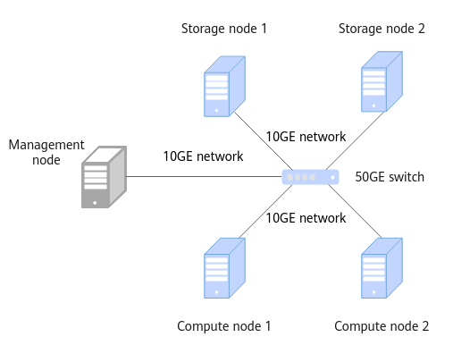

# Installation Guide<a name="EN-US_TOPIC_0000002520334680"></a>

## Installation Overview<a name="EN-US_TOPIC_0000002551414709"></a>

### Network Planning<a name="EN-US_TOPIC_0000002551414637"></a>

The OmniShield feature works on a storage-compute decoupled network, where storage nodes are separated from compute nodes to enhance data security in privacy computing.

[Figure 1](#fig1311646111411)  shows the OmniShield network. The storage-compute decoupled network consists of five nodes, including one management node, two compute nodes, and two storage nodes. A server can function as a management node and a compute node at the same time. In single-node mode, the operations on management and compute nodes mentioned in the following sections must be performed on the same node.

Where,

- The management node is  **server**, which manages tasks.
- A compute node runs compute services in the TEE.
- A storage node stores encrypted data in the REE.

**Figure  1**  Networking diagram<a name="fig1311646111411"></a>  


The OmniShield feature works on a storage-compute decoupled network, where storage nodes are separated from compute nodes to enhance data security in privacy computing.
### Environment Requirements<a name="EN-US_TOPIC_0000002520014778"></a>

Before installing OmniShield, prepare the hardware and software environments to facilitate subsequent installation operations.

**Hardware Requirements<a name="en-us_topic_0000001924407076_en-us_topic_0000001843026488_en-us_topic_0000001664980070_section4570887453"></a>**

[Table 1](#en-us_topic_0000001924407076_en-us_topic_0000001843026488_table7203101022718)  lists the hardware requirements for each node in the cluster.

**Table  1**  Hardware requirements

|Item|Management Node|Compute Node|Storage Node|
|--|--|--|--|
|Processor|Kunpeng 920 7260|Subject to the processor required by the TEE Kit|Kunpeng 920 7260|
|Memory size|512 GB|512 GB|512 GB|
|Memory frequency|2666 MHz|2666 MHz|2666 MHz|
|Network|Service network: 10GEManagement network: 1GE|Service network: 10GEManagement network: 1GE|Service network: 10GEManagement network: 1GE|
|Drive|System drive: 1 x RAID 0 (1 x 1.2 TB SAS HDD)Data drive: 12 x RAID 0 (12 x 8 TB SATA HDD)|System drive: 1 x RAID 0 (1 x 1.2 TB SAS HDD)Data drive: 12 x RAID 0 (12 x 8 TB SATA HDD)|System drive: 1 x RAID 0 (1 x 1.2 TB SAS HDD)Data drive: 12 x RAID 0 (12 x 8 TB SATA HDD)|
|RAID controller card|LSI SAS3508|LSI SAS3508|LSI SAS3508|


**OS and Software Requirements<a name="en-us_topic_0000001924407076_en-us_topic_0000001843026488_en-us_topic_0000001664980070_section12083304460"></a>**

[Table 2](#en-us_topic_0000001924407076_en-us_topic_0000001843026488_en-us_topic_0000001664980070_table564mcpsimp)  lists the OS and software requirements for each node in the cluster.

**Table  2**  OS and software requirements

|Item|Version|Description|Management Node|Compute/Storage Node|
|--|--|--|--|--|
|OS|openEuler 22.03 LTS SP4|None|√|√|
|JDK|BiSheng JDK 1.8.0_342|For details about how to install the BiSheng JDK, see BiSheng JDK 8 Installation Guide.|√|√|
|Bouncy Castle|1.64|Provides SM algorithms for the JDK.|√|√|
|Hadoop|3.3.1|See Hadoop Deployment Guide (CentOS 7.6 & openEuler 20.03).|√|√|
|Spark|3.3.1|See Spark Deployment Guide (CentOS 7.6 & openEuler 20.03).|√|-|
|Hive|3.1.0|See Hive Deployment Guide (CentOS 7.6 & openEuler 20.03).|√|-|


> **NOTE:** 
>-   √: indicates that the item is required on the node.
>-   -: indicates that the item is not required on the node.
>-   If the preceding third-party software has vulnerabilities, fix the vulnerabilities based on official instructions.
>-   The preceding component versions may be different from those in the  _Deployment Guide_. The  _Deployment Guide_  is for reference only.

**Obtaining the Software Package<a name="en-us_topic_0000001924407076_en-us_topic_0000001843026488_en-us_topic_0000001664980070_section3489574613"></a>**

**Table  3**  OmniShield software package

|Software Name|Package Name|Release Type|Description|Download URL|
|--|--|--|--|--|
|OmniShield|boostkit-omnishield-spark-3.3.1-1.1.0-aarch64.zip|Open source|OmniShield software package|Link|


**Verifying the Software Package Integrity<a name="en-us_topic_0000001924407076_en-us_topic_0000001843026488_en-us_topic_0000001664980070_section3857759151915"></a>**

After downloading a software package from the Kunpeng community, verify the software package to ensure that it is consistent with the original one on the website.

Verify a software package as follows:

1. Obtain the digital certificate and software.
2. Obtain the  [verification tool and guide](https://support.huawei.com/enterprise/en/tool/pgp-verify-TL1000000054).
3. Verify the package integrity by following the procedure described in the  _OpenPGP Signature Verification Guide_  obtained from the URL.

Before installing OmniShield, prepare the hardware and software environments to facilitate subsequent installation operations.


## Installing the Feature<a name="EN-US_TOPIC_0000002551414731"></a>

### Installing Dependencies<a name="EN-US_TOPIC_0000002551534623"></a>

When installing OmniShield in local mode, install the Bouncy Castle JAR package on the management node and all compute nodes and place the package in the JDK dependency directory.

1. Obtain the Bouncy Castle JAR package from  [Table 2](environment-requirements.md#en-us_topic_0000001924407076_en-us_topic_0000001843026488_en-us_topic_0000001664980070_table564mcpsimp), upload it to the  **/home**  directory, and copy it to the JDK dependency directory.

    ```
    cd /home
    mv bcprov-ext-jdk15on-1.64.jar $JAVA_HOME/jre/lib/ext
    ```

2. Open the JDK Security configuration file.

    ```
    vi $JAVA_HOME/jre/lib/security/java.security
    ```

3. Press  **i**  to enter the insert mode and add the Bouncy Castle content to the file:

    ```
    security.provider.10=org.bouncycastle.jce.provider.BouncyCastleProvider
    ```

4. Press  **Esc**, type  **:wq!**, and press  **Enter**  to save the file and exit.

When installing OmniShield in local mode, install the Bouncy Castle JAR package on the management node and all compute nodes and place the package in the JDK dependency directory.
### Installing OmniShield<a name="EN-US_TOPIC_0000002551414655"></a>

After installing the dependency packages, install the OmniShield software. Perform the following operations on the management node and all compute nodes.

1. Download the OmniShield installation package from  [Obtaining the Software Package](environment-requirements.md#en-us_topic_0000001924407076_en-us_topic_0000001843026488_en-us_topic_0000001664980070_section3489574613), save it to the  **/home/**  directory, and run the following command to extract the package:

    ```
    unzip boostkit-omnishield-spark-3.3.1-1.1.0-aarch64.zip
    ```

2. Copy the JAR package to the  **/opt**  directory.
    1. Copy the OmniShield JAR package to the  **/opt/omnishield**  directory.

        ```
        mkdir -p /opt/omnishield
        cp omnishield-1.0-SNAPSHOT.jar /opt/omnishield
        ```

    2. Copy the KMS JAR package to the  **/opt/omnishield**  directory. KMS users need to compile and build the JAR package based on the APIs provided by OmniShield.

        ```
        cp kms.jar /opt/omnishield
        ```

After installing the dependency packages, install the OmniShield software. Perform the following operations on the management node and all compute nodes.
### Installing the Confidential Computing TEE Kit<a name="EN-US_TOPIC_0000002520334770"></a>

OmniShield can be used in the REE. If you need the remote attestation function, install the Confidential Computing TEE Kit. For details, see  [Kunpeng BoostKit 24.0.0 Confidential Computing TEE Kit Feature Guide](https://support.huawei.com/enterprisesoftwareapply/docApplyAction?currentSelectDocId=EDOC1100405698&offeringId=PBI2-253662285).


