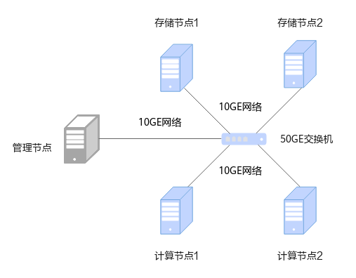

# 安装指南<a name="ZH-CN_TOPIC_0000002520334680"></a>

## 安装简介<a name="ZH-CN_TOPIC_0000002551414709"></a>

### 组网规划<a name="ZH-CN_TOPIC_0000002551414637"></a>

采用存算分离组网，即存储节点和计算节点分离，充分发挥OmniShield机密大数据特性在隐私计算场景下的安全性。

OmniShield机密大数据的组网规划采用存算分离架构，组网规划如[**图 1** 安装组网图](#安装组网图)所示。由5个节点构成，包括1个管理节点、2个计算节点和2个存储节点，一台服务器可以同时充当管理节点和计算节点（如果是单机安装模式，后续文章中提到的在管理节点/计算节点上执行的操作，均需要在一个节点上执行）。

其中：

- 管理节点为server，用于管理任务。
- 计算节点用于在TEE侧运行计算服务。
- 存储节点用于在REE侧存储加密数据。



**图 1** 安装组网图<a name="fig1311646111411"></a><a id="安装组网图"></a>

### 环境要求<a name="ZH-CN_TOPIC_0000002520014778"></a>

安装OmniShield机密大数据特性前，请参见本节内容，提前准备软硬件安装环境，以确保后续安装操作顺利进行。

**硬件要求<a name="zh-cn_topic_0000001924407076_zh-cn_topic_0000001843026488_zh-cn_topic_0000001664980070_section4570887453"></a>**

集群中各节点硬件要求如[**表 1** 硬件要求](#硬件要求)所示。

**表 1** 硬件要求<a id="硬件要求"></a>

|硬件环境|管理节点|计算节点|存储节点|
|--|--|--|--|
|处理器|鲲鹏920 7260处理器|依赖TEE套件所需处理器|鲲鹏920 7260处理器|
|内存大小|512GB|512GB|512GB|
|内存频率|2666MHz|2666MHz|2666MHz|
|网络|业务网络10GE管理网络1GE|业务网络10GE管理网络1GE|业务网络10GE管理网络1GE|
|硬盘|系统盘：1 * RAID 0（1 * 1.2T SAS HDD）数据盘：12 * RAID 0（12 * 8T SATA HDD）|系统盘：1 * RAID 0（1 * 1.2T SAS HDD）数据盘：12 * RAID 0（12 * 8T SATA HDD）|系统盘：1 * RAID 0（1 * 1.2T SAS HDD）数据盘：12 * RAID 0（12 * 8T SATA HDD）|
|RAID控制卡|LSI SAS3508|LSI SAS3508|LSI SAS3508|


**操作系统和软件要求<a name="zh-cn_topic_0000001924407076_zh-cn_topic_0000001843026488_zh-cn_topic_0000001664980070_section12083304460"></a>**

集群中各节点操作系统和软件要求如[**表 2** 操作系统和软件要求](#操作系统和软件要求)所示。

**表 2** 操作系统和软件要求<a id="操作系统和软件要求"></a>

|项目|版本|说明|管理节点|计算/存储节点|
|--|--|--|--|--|
|操作系统|openEuler 22.03 LTS SP4|无特殊说明。|√|√|
|JDK|毕昇JDK 1.8.0_342|毕昇JDK安装指南请参见[《毕昇JDK 8 安装指南》](https://gitee.com/openeuler/bishengjdk-8/wikis/%E4%B8%AD%E6%96%87%E6%96%87%E6%A1%A3/%E6%AF%95%E6%98%87JDK%208%20%E5%AE%89%E8%A3%85%E6%8C%87%E5%8D%97)|√|√|
|Bouncy Castle|1.64|Bouncy Castle用于为JDK提供国密算法。|√|√|
|Hadoop|3.3.1|部署指南请参见[《Hadoop 集群部署（CentOS 7.6&openEuler 20.03）》](https://www.hikunpeng.com/document/detail/zh/kunpengbds/ecosystemEnable/Hadoop/kunpenghadoop_04_0001.html)。|√|√|
|Spark|3.3.1|部署指南请参见[《Spark 部署指南（CentOS 7.6&openEuler 20.03）》](https://www.hikunpeng.com/document/detail/zh/kunpengbds/ecosystemEnable/Spark/kunpengspark_04_0001.html)。|√|-|
|Hive|3.1.0|部署指南请参见[《Hive部署指南（CentOS 7.6&openEuler 20.03）》](https://www.hikunpeng.com/document/detail/zh/kunpengbds/ecosystemEnable/Hive/kunpenghive_04_0001.html)|√|-|


> **说明：** 
>-   √：表示对应节点需要安装该项目。
>-   -：表示对应节点不需要安装该项目。
>-   以上第三方依赖版本如有漏洞请根据官方说明进行漏洞修复。
>-   以上组件版本，可能和部署指南中的组件版本不一致，部署指南仅供部署参考。

**软件安装包获取<a name="zh-cn_topic_0000001924407076_zh-cn_topic_0000001843026488_zh-cn_topic_0000001664980070_section3489574613"></a>**

**表 3** OmniShield机密大数据软件获取列表<a id="OmniShield机密大数据软件获取列表"></a>

|名称|包名|发布类型|说明|获取地址|
|--|--|--|--|--|
|OmniShield|boostkit-omnishield-spark-3.3.1-1.1.0-aarch64.zip|开源|OmniShield机密大数据软件安装包。|获取链接|


**软件安装包完整性校验<a name="zh-cn_topic_0000001924407076_zh-cn_topic_0000001843026488_zh-cn_topic_0000001664980070_section3857759151915"></a>**

从鲲鹏社区获取的软件安装包，下载软件安装包后需要校验软件安装包，确保与网站上的原始软件安装包一致。

校验方法：

1. 获取软件数字证书和软件安装包。
2. [获取校验工具和校验方法](https://support.huawei.com/enterprise/zh/tool/pgp-verify-TL1000000054)。
3. 参见上述链接下载的《OpenPGP签名验证指南》进行软件安装包完整性检查。

## 安装特性<a name="ZH-CN_TOPIC_0000002551414731"></a>

### 安装依赖<a name="ZH-CN_TOPIC_0000002551534623"></a>

通过本地方式安装OmniShield机密大数据，需在管理节点和所有计算节点安装Bouncy Castle的JAR包，并放在JDK的依赖目录。

1. 从[**表 2** 操作系统和软件要求](#操作系统和软件要求)获取Bouncy Castle的JAR包，上传到“/home“目录，将其复制到JDK的依赖目录下。

    ```
    cd /home
    mv bcprov-ext-jdk15on-1.64.jar $JAVA_HOME/jre/lib/ext
    ```

2. 打开JDK Security的配置文件。

    ```
    vi $JAVA_HOME/jre/lib/security/java.security
    ```

3. 按“i“进入编辑模式，添加bc库。

    ```
    security.provider.10=org.bouncycastle.jce.provider.BouncyCastleProvider
    ```

4. 按“Esc“键，输入**:wq!**，按“Enter“保存并退出编辑。

### 安装OmniShield<a name="ZH-CN_TOPIC_0000002551414655"></a>

安装依赖完成后，即可安装OmniShield机密大数据软件包。在管理节点和所有计算节点上操作。

1. 从[软件安装包获取](环境要求.md#zh-cn_topic_0000001924407076_zh-cn_topic_0000001843026488_zh-cn_topic_0000001664980070_section3489574613)下载OmniShield软件安装包存放至“/home/“目录下，执行以下命令进行解压。

    ```
    unzip boostkit-omnishield-spark-3.3.1-1.1.0-aarch64.zip
    ```

2. 复制JAR包到“/opt“目录下。
    1. 复制OmniShield机密大数据的JAR包到“/opt/omnishield“目录下。

        ```
        mkdir -p /opt/omnishield
        cp omnishield-1.0-SNAPSHOT.jar /opt/omnishield
        ```

    2. 复制KMS的JAR包到“/opt/omnishield“目录下，KMS需要使用者自行按照OmniShield机密大数据提供的接口实现并编译构建JAR包。

        ```
        cp kms.jar /opt/omnishield
        ```

### 安装机密计算TEE套件<a name="ZH-CN_TOPIC_0000002520334770"></a>

当前OmniShield机密大数据在REE环境下也可以使用。如果需要远程证明功能，需要执行安装机密计算TEE套件，详情参见《[Kunpeng BoostKit 24.0.0 机密计算TEE套件 特性指南](https://support.huawei.com/enterprisesoftwareapply/docApplyAction?currentSelectDocId=EDOC1100405698&offeringId=PBI2-253662285)》。


