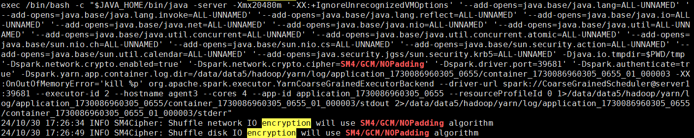

# 使用指南<a name="ZH-CN_TOPIC_0000002520471488"></a>

## 使用特性<a name="ZH-CN_TOPIC_0000002520471492"></a>

### DataFrame行式数据源加解密<a name="DataFrame"></a>

使用OmniShield机密大数据特性执行Spark引擎业务，需通过启动Spark提交任务执行。

1. 部署相应KMS服务，创建好所需的Primary Key。例如可以通过以下指令启动Hadoop KMS，并创建Primary Key。
     1. <a id="step_1"></a>编辑Hadoop配置文件。

        ```
        cd $HADOOP_HOME/etc/hadoop
        vi core-site.xml
        ```

    2. 按`i`进入编辑模式，在<configuration\>标签中添加以下内容。

        ```
        <property>
          <name>hadoop.security.key.provider.path</name>
          <value>kms://http@x.x.x.x:9600/kms</value>
        </property>
        ```

    3. 按`Esc`键，输入 **:wq!**，按`Enter`保存并退出编辑。
    4. 复制core-site.xml文件给Spark。

        ```
        cp $HADOOP_HOME/etc/hadoop/core-site.xml $SPARK_HOME/conf/
        ```

    5. 启动Hadoop KMS。

        ```
        cd $HADOOP_HOME/sbin
        sh kms.sh start
        ```

    6. 创建Key。

        ```
        hadoop key create key1
        ```

        > **说明：** 
        >-   在修改core-site.xml时将第二步中的x.x.x.x修改为实际的IP地址。
        >-   如果key1已经存在，在创建key1前执行**hadoop key delete key1**指令删除key1。

2. 在`/home`目录下生成待加密的CSV数据源文件。
    1. 编辑`simple.csv`文件。

        ```
        vi simple.csv
        ```

    2. 按`i`进入编辑模式，在文件中添加以下内容。

        ```
        name,age,job
        user1,12,Engineer
        user2,13,Engineer
        user3,14,Developer
        user4,15,Engineer
        user5,16,Engineer
        ```

    3. 按`Esc`键，输入 **:wq!**，按`Enter`保存并退出编辑。

3. 在`/opt/omnishield`目录下执行数据源加密的命令如下, 指令执行完成后将生成`/home/en`目录，并存放加密后的simple.csv数据。

    ```
    spark-submit --class com.huawei.analytics.shield.utils.Encrypt --master local --conf spark.hadoop.io.compression.codecs=com.huawei.analytics.shield.crypto.CryptoCodec  --conf spark.shield.primaryKey.name=key1 --conf spark.shield.primaryKey.key1.kms.type=test.example.HadoopKeyManagementService --jars omnishield-1.0-SNAPSHOT.jar,kms.jar omnishield-1.0-SNAPSHOT.jar  -i file:///home/simple.csv -o file:///home/en -a AES/GCM/NOPadding -t csv -e encrypt
    ```

4. 在`/opt/omnishield`目录下执行数据源解密的命令如下，指令执行完成后将生成`/home/de`目录，并存放解密后的数据。

    ```
    spark-submit --class com.huawei.analytics.shield.utils.Encrypt --master local --conf spark.hadoop.io.compression.codecs=com.huawei.analytics.shield.crypto.CryptoCodec  --conf spark.shield.primaryKey.name=key1 --conf spark.shield.primaryKey.key1.kms.type=test.example.HadoopKeyManagementService --jars omnishield-1.0-SNAPSHOT.jar,kms.jar omnishield-1.0-SNAPSHOT.jar  -i file:///home/en -o file:///home/de -a AES/GCM/NOPadding -t csv -e decrypt
    ```

    > **说明：** 
    >-   spark.shield.primaryKey是指定当前使用的Primary Key，该key需要提前在KMS中创建生成。
    >-   spark.shield.primaryKey.key1.kms.type是指定Primary Key的KMS类型，KMS需要使用者自行按照OmniShield提供的接口实现，该项的值需要指定KMS在kms.jar中的具体类路径。
    >-   -i、-o分别用于指定输入和输出的路径，支持HDFS或本地文件系统。
    >    -   在加密模式下，-i指定的是原始数据文件，-o指定的是加密后输出的文件夹位置。
    >    -   在解密模式下，-i指定的是已加密的文件夹位置，-o指定的是解密后输出的文件夹位置。
    >-   -a用于指定使用的加密算法，目前只支持AES/GCM/NOPadding。
    >-   -t用于指定数据源文件格式，目前支持CSV/JSON/TXT。
    >-   -e用于指定工作模式，encryp表示加密，decrypt表示解密。


### Spark-SQL行式数据源加解密<a name="ZH-CN_TOPIC_0000002520631472"></a>

使用OmniShield机密大数据特性执行Spark引擎业务，需通过启动Spark提交任务执行。

1. 部署相应KMS服务，创建好所需的Primary Key。例如可以通过以下指令在Hadoop KMS中创建Primary Key。

    ```
    hadoop key create key2
    ```

    > **说明：** 
    >Hadoop KMS 的启动步骤与[步骤1](#step_1)相同。如果Hadoop KMS已经启动，创建Key时无需重复启动KMS。

2. 在`/opt/omnishield`目录下执行如下命令启动Spark-SQL。

    ```
    spark-sql --master local --conf spark.sql.extensions=com.huawei.analytics.shield.sql.DataSourceEncryptPlugin --conf spark.hadoop.io.compression.codecs=com.huawei.analytics.shield.crypto.CryptoCodec --jars omnishield-1.0-SNAPSHOT.jar,kms.jar  --conf spark.executor.extraClassPath=omnishield-1.0-SNAPSHOT.jar:kms.jar --driver-class-path omnishield-1.0-SNAPSHOT.jar:kms.jar
    ```

3. <a name="zh-cn_topic_0000002021075065_li1973462017298"></a>在Spark-SQL命令行执行如下SQL创建加密数据表。

    ```
    drop table if exists test1;
    create table test1 (id int) using csv options (`encrypt` 'true',`keyname` 'key2',`kmstype` 'test.HadoopKeyManagementService',`cryptomode` 'aes/gcm/nopadding',`keylength` '128');
    ```

    > **说明：** 
    >-   encrypt是指定是否使用加密表，该项的值为true时表示使用加密表。
    >-   keyname是指定当前使用的Primary Key，该key需要提前在KMS中创建生成。
    >-   kmstype是指定Primary Key的KMS类型，KMS需要使用者自行按照OmniShield机密大数据提供的接口实现，该项的值需要指定KMS在kms.jar中的具体类路径。
    >-   cryptomode是指定加密数据时使用的加密算法，支持AES/GCM/NOPadding和SM4/GCM/NoPadding。
    >-   keylength是指定加密的密钥长度，当使用AES/GCM/NOPadding加密算法时该项的值可以是128或256，当使用SM4/GCM/NoPadding加密算法时该项的值是128。
    >-   可以通过指定数据源格式创建不同类型的数据表，如创建JSON格式数据表需将using csv替换using json。目前支CSV/JSON/TXT式。

4. 在Spark-SQL命令行执行如下SQL检测数据表是否为加密数据表。

    ```
    show create table test1;
    ```

    > **说明：** 
    >在SQL运行结果的OPTIONS中如果包含encryptdatakey项则为加密表。


### Spark-SQL ORC数据源国密加解密<a name="ZH-CN_TOPIC_0000002551631473"></a>

使用OmniShield机密大数据特性执行Spark引擎业务，需通过启动Spark提交任务执行。

1. 部署Hadoop KMS服务，创建好所需的Primary Key。

    ```
    hadoop key create key3 -cipher 'SM4/GCM/NoPadding'
    ```

    > **说明：** 
    >Hadoop KMS 的启动步骤与[步骤1](#step_1)相同。如果Hadoop KMS已经启动，创建Key时无需重复启动KMS。

2. 在`/opt/omnishield`目录下执行如下命令启动Spark-SQL。

    ```
    spark-sql --master local --conf spark.sql.extensions=com.huawei.analytics.shield.sql.DataSourceEncryptPlugin --conf spark.hadoop.io.compression.codecs=com.huawei.analytics.shield.crypto.CryptoCodec --conf spark.sql.orc.filterPushdown=false --jars omnishield-1.0-SNAPSHOT.jar,kms.jar  --conf spark.executor.extraClassPath=omnishield-1.0-SNAPSHOT.jar:kms.jar --driver-class-path omnishield-1.0-SNAPSHOT.jar:kms.jar
    ```

3. 在Spark-SQL命令行执行如下SQL创建加密数据表。

    ```
    drop table if exists otest1;
    create table otest1 (name string) options ( hadoop.security.key.provider.path "kms://http@IP:PORT/kms", orc.key.provider "hadoop", orc.encrypt "key3:name") stored as orc;
    ```

    > **说明：** 
    >-   hadoop.security.key.provider.path是指定Hadoop KMS的地址和端口号。
    >-   orc.encrypt是指定加密的列。

4. 在Spark-SQL命令行执行如下SQL检测数据表是否为加密数据表。

    ```
    describe extended otest1;
    ```

    > **说明：** 
    >在SQL运行结果的Storage Properties中如果包含orc.encrypt项则为加密表。


### 支持国密算法的Shuffle安全IO<a name="ZH-CN_TOPIC_0000002520631464"></a>

使用OmniShield机密大数据特性执行Spark引擎业务，需通过启动Spark提交任务执行。

1. 在`/opt/omnishield`目录下执行SQL并打开Shuffle IO加密，命令如下。

    ```
    spark-sql --driver-cores 5 --driver-memory 20g --num-executors 6 --executor-cores 4 --executor-memory 20g --conf spark.executor.memoryOverhead=20g --master yarn --conf spark.memory.offHeap.enabled=true --conf spark.memory.offHeap.size=18g --conf spark.task.cpus=1 --conf spark.driver.maxResultSize=40g  --conf spark.authenticate.secret=testSecret  --conf spark.authenticate=true --conf spark.io.encryption.enabled=true  --conf spark.io.encryption.commons.config.cipher.classes=com.huawei.boostkit.omnishield.cipher.SM4Cipher --conf spark.io.crypto.cipher.transformation=SM4/GCM/NOPadding  --conf spark.network.crypto.enabled=true  --conf spark.network.crypto.cipher=SM4/GCM/NOPadding  --conf spark.driver.extraClassPath=omnishield-1.0-SNAPSHOT.jar --conf spark.executor.extraClassPath=omnishield-1.0-SNAPSHOT.jar  --jars omnishield-1.0-SNAPSHOT.jar --database tpcds_bin_partitioned_varchar_orc_2 -f /automated/lib/bd/testcase/scripts/omniop/conf/Spark_OmniRuntime_ShuffleEnhance/Spark_OmniRuntime_ShuffleEnhance_002.sql
    ```

    > **说明：** 
    >-   Shuffle磁盘IO加密打开需修改以下命令参数：
    >    -   spark.io.encryption.enabled=true
    >    -   spark.io.encryption.commons.config.cipher.classes=_自定义实现Cipher类_
    >    -   spark.io.crypto.cipher.transformation=SM4/GCM/NOPadding
    >-   Shuffle网络IO加密打开需修改以下命令参数：
    >    -   spark.authenticate.secret=_自定义密钥_
    >    -   spark.authenticate=true
    >    -   spark.network.crypto.enabled=true
    >    -   spark.network.crypto.cipher=SM4/GCM/NOPadding。

2. 查看Shuffle IO支持国密是否生效。
    1. 获取Executor日志。

        ```
        yarn logs --applicationId application_xxx > xxx.log
        ```

    2. 查看是否有使用国密的相关日志，出现**Shuffle network IO encryption will use SM4/GCM/NOPadding algorithm**和**Shuffle disk IO encryption will use SM4/GCM/NOPadding algorithm**即生效。

        


### Spark on Yarn应用级远程证明<a name="ZH-CN_TOPIC_0000002520471486"></a>

1. <a id="attest"></a>在virtCCA机密虚拟机内添加用于做IMA度量的用户。

    ```
    useradd attest
    ```

2. 在virtCCA机密虚拟机内配置IMA度量策略。
    1. 打开`policy`文件。

        ```
        vi policy
        ```

    2. 按`i`进入编辑模式，在文件中添加以下内容。

        ```
        measure func=FILE_CHECK mask=MAY_READ fowner=1001
        ```

        > **说明：** 
        >-   **1001**是[步骤1](#attest)中attest用户的ID，policy中fowner指定的ID需根据实际情况修改，可通过**cat /etc/passwd | grep attest**查看用户ID。
        >-   func=FILE\_CHECK表示IMA度量的对象为文件。
        >-   mask=MAY\_READ表示IMA度量的触发动作为读取操作。
        >-   fowner=1001表示被度量的文件的属主ID为1001。
        >-   3条参数规则结合在一起时表示：当属主为1001的文件被读取时将触发IMA度量。

    3. 按`Esc`键，输入 **:wq!**，按`Enter`保存并退出编辑。

3. 在virtCCA机密虚拟机内生效IMA度量策略。

    ```
    cat policy > /sys/kernel/security/ima/policy
    ```

4. 在virtCCA机密虚拟机内配置IMA度量用户的环境变量。
    1. 打开`/etc/profile`文件。

        ```
        vi /etc/profile
        ```

    2. 按`i`进入编辑模式，在文件中添加以下内容。

        ```
        export IMA_USER=attest
        ```

        > **说明：** 
        >IMA\_USER用户名称是[步骤1](#attest)新建的用户。

    3. 按`Esc`键，输入 **:wq!**，按`Enter`保存并退出编辑。

5. 在Yarn的ResourceManager节点提交Spark作业并进行远程证明，如可以通过如下指令启动Spark example中计算Pi值的作业。

    ```
    spark-submit --master yarn  --class org.apache.spark.examples.SparkPi --num-executors 1  --executor-cores 1 --executor-memory 1G --conf spark.remote.attestation.enable=true  --conf spark.remote.attestation.agent.class=rats.RatsTLSRemoteAttestationAgent --conf spark.network.timeout=1200 --conf spark.yarn.max.executor.failures=1 --conf spark.yarn.maxAppAttempts=1  --conf spark.executor.extraClassPath=omnishield-1.0-SNAPSHOT.jar:rats-tls-demo-1.0.jar --driver-class-path omnishield-1.0-SNAPSHOT.jar:rats-tls-demo-1.0.jar  --jars "omnishield-1.0-SNAPSHOT.jar,rats-tls-demo-1.0.jar" /usr/local/spark/examples/jars/spark-examples_2.12-3.3.1.jar
    ```

    > **说明：** 
    >-   rats-tls-demo-1.0.jar是spark.remote.attestation.agent.class指定的类所在的JAR包，需使用者自行实现。本步骤中以Virtcca rats-tls为例完成演示，具体实现细节和部署步骤请参见[OmniShield对接Virtcca rats-tls](https://gitee.com/kunpengcompute/boostkit-bigdata/tree/main/omnishield/src/test/scala/com/huawei/analytics/shield/ra/example/README.md)。
    >-   spark.remote.attestation.enable是OmniShield机密大数据中新增的配置，用于配置启动Executor时是否需要进行远程证明。true表示配置启动Executor时需要远程证明，false表示配置启动Executor时不需要远程证明。
    >-   spark.remote.attestation.agent.class是OmniShield机密大数据中新增的配置，用于配置Executor在开启远程证明后进行远程证明的类的名称，使用者需要根据实际业务自行对接。
    >-   spark.yarn.max.executor.failures=1和spark.yarn.maxAppAttempts=1是Spark的配置，用于设置Spark on Yarn Executor启动失败后的重试次数。当远程证明不通过时Spark Executor会启动失败，通过以上2项配置可以控制Executor的重启次数。


## 维护特性<a name="ZH-CN_TOPIC_0000002551511475"></a>

升级或卸载OmniShield时请满足操作规范。

**升级OmniShield<a name="section018614194301"></a>**

> **须知：** 
>当前暂不支持通过工具进行升级，因此如需要升级，请下载安装包重新安装。

请通过[鲲鹏社区](https://www.hikunpeng.com/zh/developer/download?title=%E5%A4%A7%E6%95%B0%E6%8D%AE&subTitle=OmniRuntime)下载要升级的OmniShield机密大数据软件安装包。

**卸载OmniShield<a name="section1397016019314"></a>**

> **须知：** 
>-   当前步骤仅供需要卸载OmniShield时参考，不属于部署OmniShield的必要操作步骤。
>-   卸载OmniShield前需先停止所有运行业务，并在所有安装OmniShield的节点进行卸载操作。

进入`/opt/omnishield`目录，删除相关OmniShield的JAR包。

```
cd /opt/omnishield
rm -rf omnishield-1.0-SNAPSHOT.jar
```